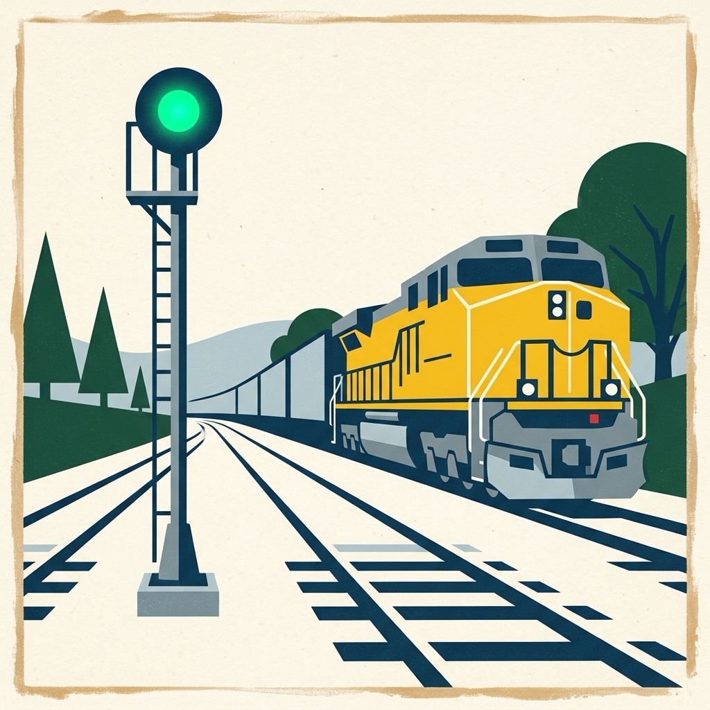

<table border="0">
  <tr>
    <td width="230" align="center" valign="middle">
      
    </td>
    <td valign="middle">
      <h1>⚡ bloc_signals_genui_jaspr</h1>
      <p><strong><em>"With the rigor of BLoC and the flex and speed of Signals"</em></strong></p>
      <p>
        Jaspr web component bindings, HTML DOM catalog adapters, and 0ms reactive two-way data bindings
        for <a href="https://pub.dev/packages/bloc_signals_genui">bloc_signals_genui</a> and Google's
        <strong>A2UI (Agent-to-User Interface)</strong> protocol.
      </p>
    </td>
  </tr>
</table>

<p align="center">
  <a href="https://pub.dev/packages/bloc_signals_genui_jaspr/score"></a>
  <a href="https://pub.dev/packages/bloc_signals_genui_jaspr"></a>
  <a href="https://github.com/RandalSchwartz/BlocSignal/blob/main/LICENSE"></a>
</p>

`bloc_signals_genui_jaspr` connects the pure-Dart `A2uiSurfaceBloc` state machine to Jaspr's web component hierarchy via `A2uiSurfaceView`, `A2uiJasprCatalog`, `A2uiComponentContext`, and standard DOM catalog components.

---

## 🌐 Ecosystem Packages

The `BlocSignal` monorepo consists of 14 modular packages:

| Package | Version | Description |
| :--- | :--- | :--- |
| **`bloc_signals`** | [](https://pub.dev/packages/bloc_signals) | Core pure Dart reactive state primitives bridging BLoC & Signals |
| **`bloc_signals_flutter`** | [](https://pub.dev/packages/bloc_signals_flutter) | Flutter UI bindings, providers, builders, listeners & selectors |
| **`bloc_signals_bloc`** | [](https://pub.dev/packages/bloc_signals_bloc) | Classic BLoC 8/9 interop adapters & bidirectional event bridges |
| **`bloc_signals_riverpod`** | [](https://pub.dev/packages/bloc_signals_riverpod) | Bidirectional Riverpod 2/3 interop adapters & provider extensions |
| **`bloc_signals_jaspr`** | [](https://pub.dev/packages/bloc_signals_jaspr) | Jaspr web component integration and state binding for BlocSignal |
| **`bloc_signals_hydrate`** | [](https://pub.dev/packages/bloc_signals_hydrate) | Automated synchronous local state persistence & hydration |
| **`bloc_signals_replay`** | [](https://pub.dev/packages/bloc_signals_replay) | Undo & redo state history tracking for CubitSignal and BlocSignal |
| **`bloc_signals_otel`** | [](https://pub.dev/packages/bloc_signals_otel) | OpenTelemetry tracing and span generation for state transitions |
| **`bloc_signals_devtools`** | [](https://pub.dev/packages/bloc_signals_devtools) | Universal DevTools telemetry observer using `dart:developer` |
| **`bloc_signals_test`** | [](https://pub.dev/packages/bloc_signals_test) | Declarative unit testing utilities (`blocSignalTest`) |
| **`bloc_signals_lint`** | [](https://pub.dev/packages/bloc_signals_lint) | Custom analyzer lint rules & automated IDE quick-fixes |
| **`bloc_signals_genui`** | [](https://pub.dev/packages/bloc_signals_genui) | Pure-Dart A2UI streaming state machine & Generative UI runtime adapter |
| **`bloc_signals_genui_flutter`** | [](https://pub.dev/packages/bloc_signals_genui_flutter) | Declarative Flutter surface containers & A2UI catalog widget adapters |
| **`bloc_signals_genui_jaspr`** | [](https://pub.dev/packages/bloc_signals_genui_jaspr) | Declarative Jaspr web components & DOM catalog adapters for A2UI |

---

## ⚡ Key Features

- 🎨 **`A2uiSurfaceView`**: Reactive Jaspr web component handling the complete `A2uiSurfaceState` lifecycle (`SurfaceInitial`, `SurfaceStreaming`, `SurfaceReady`, `SurfaceSubmitting`, and `SurfaceError`) with customizable builders, per-component error boundaries, and bounded per-render `maxDepth` (default `32`) / `nodeBudget` (default `1000`) guards against exponential DAG payloads.
- 🧱 **`A2uiJasprCatalog`**: Extensible component registry pre-populated with all 16 `BasicCatalog` DOM components (`Text`, `Row`, `Column`, `Card`, `Divider`, `Button`, `TextField`, `List`, `Tabs`, `Modal`, `Icon`, `Image`, `CheckBox`, `ChoicePicker`, `Slider`, and `DateTimeInput`) alongside immutable composition helpers (`copyWith`, `copyWithout`, `registerAll`).
- ♿ **A2UI 1.0 Conformance (`NodeAction`, `weight`, `accessibility`, `metadata`)**: Supports `NodeAction` `functionCall` execution via `A2uiComponentContext.triggerAction()`, positive finite child `weight` (`flex-grow`) via `buildWeightedChildren`, universal `accessibility` envelopes (`hidden`, `aria-label`, `aria-description`), and component `metadata` access.
- ✅ **Reactive `CheckRule` Validation UI**: Automatically surfaces `GenericBinder` validation state (`isValid`, `validationErrors`, `validationResults`) across form inputs and disables button submissions when validation rules fail.
- ⚡ **Granular Signal Bindings & Two-Way Sync**: Each rendered component subscribes to its own resolved properties and writes two-way input mutations via `A2uiComponentContext.updateBoundValue`, updating leaf DOM elements and `A2uiSurfaceBloc` form data in 0ms on data changes without tearing down parent containers.
- 🧭 **Multi-Surface & Split-Pane Support**: Pin `A2uiSurfaceView(bloc: bloc, surfaceId: '...')` to a specific surface or omit `surfaceId` to follow `bloc.activeSurfaceId` reactively across tabs and split views.
- 🛡️ **Defensive LLM Property Coercion**: Built-in `safe_prop_parser.dart` utilities (`unwrapBinding`, `asString`, `asInt`, `asDouble`, `asBool`, `extractChildId`, `extractChildIds`) protect the DOM tree from malformed or stringified LLM JSON properties.

---

## 📦 Installation

Add `bloc_signals_genui_jaspr` to your Jaspr project:

```bash
dart pub add bloc_signals_genui_jaspr
```

Or declare it in your `pubspec.yaml`:

```yaml
dependencies:
  jaspr: ^0.23.1
  bloc_signals: ^1.7.1
  bloc_signals_jaspr: ^1.3.0
  bloc_signals_genui: ^2.0.0
  bloc_signals_genui_jaspr: ^2.0.0
  a2ui_core: ^0.7.0
```

---

## 🚀 Quick Start

### Rendering an Interactive A2UI Surface

```dart
import 'package:bloc_signals_genui/bloc_signals_genui.dart';
import 'package:bloc_signals_genui_jaspr/bloc_signals_genui_jaspr.dart';
import 'package:bloc_signals_jaspr/bloc_signals_jaspr.dart';
import 'package:jaspr/dom.dart';
import 'package:jaspr/jaspr.dart';

// Dart 3.5+ (Standard)
class AgentSurfacePage extends StatelessComponent {
  const AgentSurfacePage({
    required this.surfaceBloc,
    super.key,
  });

  final A2uiSurfaceBloc surfaceBloc;

  @override
  Component build(BuildContext context) {
    return section(classes: 'agent-surface-page', [
      const h1([Component.text('Generative UI Surface')]),
      A2uiSurfaceView(
        bloc: surfaceBloc,
        catalog: A2uiJasprCatalog.standard(),
      ),
    ]);
  }
}

// Dart 3.13+ (Modern Primary Constructor)
class const ModernAgentSurfacePage({
  required this.surfaceBloc,
  super.key,
}) extends StatelessComponent {
  final A2uiSurfaceBloc surfaceBloc;

  @override
  Component build(BuildContext context) {
    return section(classes: 'agent-surface-page', [
      const h1([Component.text('Generative UI Surface')]),
      A2uiSurfaceView(
        bloc: surfaceBloc,
        catalog: A2uiJasprCatalog.standard(),
      ),
    ]);
  }
}
```

### Registering Custom Catalog Components

Extend `A2uiJasprCatalog.standard()` using `copyWith` (or `register`) to bind domain-specific A2UI components to custom Jaspr web components while reading and mutating form signals through `A2uiComponentContext`:

```dart
final customCatalog = A2uiJasprCatalog.standard().copyWith({
  'MetricBadge': (context, A2uiComponentContext componentContext) {
    final label = componentContext.props['label'] as String? ?? 'Metric';
    final value = componentContext.props['value']?.toString() ?? '0';

    return button(
      classes: 'metric-badge-btn',
      onClick: () => componentContext.dispatchAction('inspect_metric'),
      [Component.text('$label: $value')],
    );
  },
});
```

---

## 🛡️ License

MIT License. See [LICENSE](https://github.com/RandalSchwartz/BlocSignal/blob/main/LICENSE) for details.
