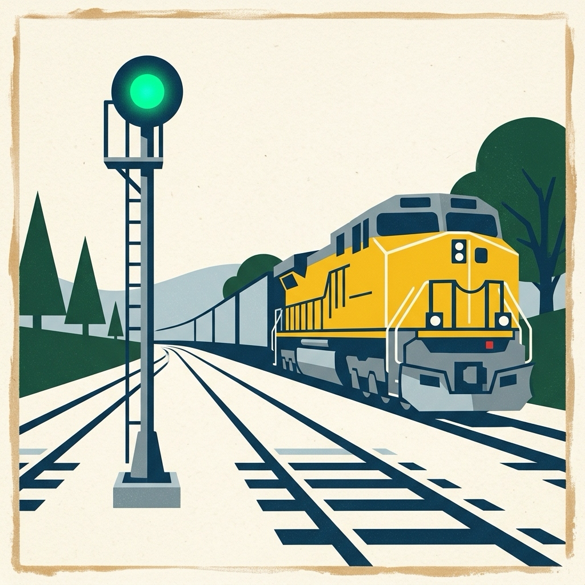

<table border="0">
  <tr>
    <td width="230" align="center" valign="middle">
      
    </td>
    <td valign="middle">
      <h1>⚡ bloc_signals_lint</h1>
      <p><strong><em>"With the rigor of BLoC and the flex and speed of Signals"</em></strong></p>
      <p>
        Custom static analysis lints, diagnostics, and automated IDE quick-fixes 
        for <a href="https://pub.dev/packages/bloc_signals">bloc_signals</a>.
      </p>
    </td>
  </tr>
</table>

Built on top of Dart's native [`analysis_server_plugin`](https://pub.dev/packages/analysis_server_plugin), `bloc_signals_lint` catches common framework misuse, preserves Zone-context transition tracing, and enforces `BlocSignal` architectural invariants directly inside your IDE and `dart analyze`.

---

## 🌐 Ecosystem Packages

The `BlocSignal` monorepo consists of 14 modular packages:

| Package | Version | Description |
| :--- | :--- | :--- |
| **`bloc_signals`** | [](https://pub.dev/packages/bloc_signals) | Core pure Dart reactive state primitives bridging BLoC & Signals |
| **`bloc_signals_flutter`** | [](https://pub.dev/packages/bloc_signals_flutter) | Flutter UI bindings, providers, builders, listeners & selectors |
| **`bloc_signals_bloc`** | [](https://pub.dev/packages/bloc_signals_bloc) | Classic BLoC 8/9 interop adapters & bidirectional event bridges |
| **`bloc_signals_riverpod`** | [](https://pub.dev/packages/bloc_signals_riverpod) | Bidirectional Riverpod 2/3 interop adapters & provider extensions |
| **`bloc_signals_jaspr`** | [](https://pub.dev/packages/bloc_signals_jaspr) | Jaspr web component integration and state binding for BlocSignal |
| **`bloc_signals_hydrate`** | [](https://pub.dev/packages/bloc_signals_hydrate) | Automated synchronous local state persistence & hydration |
| **`bloc_signals_replay`** | [](https://pub.dev/packages/bloc_signals_replay) | Undo & redo state history tracking for CubitSignal and BlocSignal |
| **`bloc_signals_otel`** | [](https://pub.dev/packages/bloc_signals_otel) | OpenTelemetry tracing and span generation for state transitions |
| **`bloc_signals_devtools`** | [](https://pub.dev/packages/bloc_signals_devtools) | Universal DevTools telemetry observer using `dart:developer` |
| **`bloc_signals_test`** | [](https://pub.dev/packages/bloc_signals_test) | Declarative unit testing utilities (`blocSignalTest`) |
| **`bloc_signals_lint`** | [](https://pub.dev/packages/bloc_signals_lint) | Custom analyzer lint rules & automated IDE quick-fixes |
| **`bloc_signals_genui`** | [](https://pub.dev/packages/bloc_signals_genui) | Pure-Dart A2UI streaming state machine & Generative UI runtime adapter |
| **`bloc_signals_genui_flutter`** | [](https://pub.dev/packages/bloc_signals_genui_flutter) | Declarative Flutter surface containers & A2UI catalog widget adapters |
| **`bloc_signals_genui_jaspr`** | [](https://pub.dev/packages/bloc_signals_genui_jaspr) | Declarative Jaspr web components & DOM catalog adapters for A2UI |

---

## ⚡ Rules & Quick-Fixes

### Core Framework Rules

| Rule | Default Severity | Description | Automated Fix |
| :--- | :--- | :--- | :--- |
| **`avoid_duplicate_event_handlers`** | Warning | Flags multiple `on<E>` registrations for the exact same event type `E` within a `BlocSignal` or `BlocSignalMixin` class or mixin declaration. | `Cmd+.` -> Remove duplicate event handler |
| **`require_super_on_event`** | Warning | Enforces calling `super.onEvent(event)` inside `onEvent` overrides to preserve Zone event context. | `Cmd+.` -> Add `super.onEvent(event);` |
| **`avoid_stream_transformers_on_bloc_signal`** | Warning | Flags stream transformer invocations (for example `.transform()`, `.debounce()`, `.switchMap()`) directly on synchronous `BlocSignalBase` instances. | `Cmd+.` -> Insert `.toStream()` |
| **`avoid_direct_signal_mutation_outside_bloc`** | Warning | Prevents external code outside the state container class from calling protected `emit()` or mutating internal signal state. | — |
| **`avoid_top_level_bloc_signal_instances`** | Warning | Flags top-level variables and static fields declared directly as `BlocSignal` / `CubitSignal` instances. | — |
| **`require_cubit_signal_mixin_init`** | Warning | Enforces calling `initCubitSignal(initialState: ...)` in constructors of classes mixing in `CubitSignalMixin` or `BlocSignalMixin`. | `Cmd+.` -> Add `initCubitSignal(initialState: ...);` |
| **`avoid_raw_signal_effects_in_bloc`** | Warning | Flags unmanaged top-level `effect()` calls inside `BlocSignalBase` containers, recommending `createEffect()`. | `Cmd+.` -> Replace `effect` with `createEffect` |
| **`prefer_named_replay_constructor`** | Warning | Flags `super.positional(...)` invocations in `ReplayCubit` and `ReplayBloc` subclasses, recommending `super(initialState: ...)`. | `Cmd+.` -> Replace `super.positional(...)` with `super(initialState: ...)` |
| **`require_emit_in_helper_name`** | Warning | Flags private helper methods calling `emit()` whose names do not reflect state emission. | `Cmd+.` -> Rename to `...AndEmit` |
| **`avoid_multiple_synchronous_emits`** | Warning | Flags multiple synchronous `emit()` calls along the same linear execution path without an intervening `await`. | — |
| **`avoid_primitive_event_types`** | Warning | Flags `BlocSignal<Event, State>` or `BlocSignalMixin` using primitive or untyped types (`int`, `String`, `bool`, `dynamic`, etc.) as event types. | — |
| **`avoid_pseudo_events_in_telemetry`** | Warning | Flags `emitTelemetry('...')` calls inside `CubitSignal` where the name matches UI event action patterns (`Pressed`, `Clicked`, `Submitted`, etc.). | — |
| **`avoid_emit_or_add_in_computed`** | Error | Flags `emit()` or `add()` calls on state containers inside `computed()` callbacks. | — |
| **`require_hydrated_storage_prefix`** | Warning | Requires concrete `HydratedCubitSignal`, `HydratedBlocSignal`, and `HydratedMixin` classes to override `storagePrefix`. | `Cmd+.` -> Add `@override String get storagePrefix` |
| **`require_hydrated_mixin_init`** | Warning | Requires classes mixing in `HydratedMixin` with `CubitSignalMixin` or `BlocSignalMixin` to call `hydrate()` in constructors. | `Cmd+.` -> Add `hydrate();` |
| **`avoid_unmanaged_signal_subscription`** | Warning | Flags discarded `ReadonlySignal.subscribe(...)` calls whose cleanup closure is not retained. | — |

### Flutter UI Rules


| Rule | Default Severity | Description | Automated Fix |
| :--- | :--- | :--- | :--- |
| **`avoid_emit_in_build`** | Warning | Flags calls to `emit()` or `add()` on state containers directly inside Flutter `Widget.build()` methods. | — |
| **`avoid_unmanaged_signal_effects`** | Warning | Flags unmanaged `effect()` calls inside Flutter `Widget`/`HookWidget`/`State` or Jaspr `Component`/`State` methods outside `build()`. | — |
| **`prefer_bloc_signal_provider_read_in_callbacks`** | Warning | Warns when `context.watch<T>()` is used inside event callback closures (for example `onPressed`), suggesting `context.read<T>()`. | `Cmd+.` -> Replace `watch` with `read` |
| **`avoid_providing_existing_instance_with_create`** | Warning | Flags passing existing variable references to `BlocSignalProvider(create: ...)` instead of `BlocSignalProvider.value(value: ...)`. | `Cmd+.` -> Replace `create:` with `value:` |
| **`avoid_manual_close_on_provided_bloc`** | Warning | Flags calling `.close()` manually on state containers retrieved via `context.read<T>()` or `BlocSignalProvider.of(context)`. | `Cmd+.` -> Remove manual `close()` call |
| **`avoid_invalid_context_select_generics`** | Warning | Flags `context.select<B, R>` where generic parameters are omitted or invalid. | `Cmd+.` -> Reduce type arguments to `<B, R>` |
| **`avoid_context_watch_for_bloc_state`** | Warning | Flags `context.watch<T>()` on state containers inside `build()` methods to prevent missing state emission rebuilds. | `Cmd+.` -> Replace `watch` with `read` / `value<B, S>()` |
| **`avoid_unused_select_result`** | Warning | Flags calling `context.select(...)` as an unused expression statement where the result is discarded. | `Cmd+.` -> Bind result to `final value` |
| **`avoid_bridging_in_build`** | Warning | Flags `.toBlocSignal()`, `.toAsyncBlocSignal()`, `.toValueListenable()`, and `ListenableBlocSignal` calls directly inside UI `build()` methods. | — |
| **`require_child_outside_multi_bloc_signal`** | Warning | Flags `BlocSignalProvider`, `BlocSignalProvider.value`, and `BlocSignalListener` omitting `child:` outside `MultiBlocSignalProvider` / `MultiBlocSignalListener`. | — |
| **`avoid_signal_creation_in_build`** | Warning | Flags direct `signal()`, `computed()`, and `effect()` allocations inside `build()` methods. | — |
| **`avoid_context_select_outside_build`** | Warning | Flags `context.select(...)` and `context.value(...)` calls outside `build()` (callbacks, closures, `computed`/`effect`, or non-`build` lifecycle methods). | `Cmd+.` -> Replace with `context.read<B>()` |

---

## 🚀 Quick Setup

Enable `bloc_signals_lint` solely under `plugins:` in your root `analysis_options.yaml` (no `dev_dependencies:` entry is needed, allowing `sdk: ^3.5.0` consumer packages to run the Dart 3.13+ analyzer plugin):

```yaml
plugins:
  bloc_signals_lint: ^2.0.0
```

For local unreleased workspaces, reference the package by `path:` instead:

```yaml
plugins:
  bloc_signals_lint:
    path: ../bloc_signals_lint
```

---

## ⚙️ Customization & Inline Ignores

Disable or customize diagnostics in `analysis_options.yaml`:

```yaml
plugins:
  bloc_signals_lint:
    version: ^2.0.0
    diagnostics:
      avoid_duplicate_event_handlers: false
```

Or ignore inline in code:

```dart
// ignore: bloc_signals_lint/avoid_duplicate_event_handlers
on<Increment>((event, emit) => emit(stateValue + 1));
```

---

## 🤖 AI Coding Assistant Skill

This package is supported by an official pre-packaged [AI Coding Skill](https://github.com/RandalSchwartz/BlocSignal/tree/main/plugins/bloc-signals/skills/bloc-signals) representing analyzer rules, IDE diagnostics, and automated quick-fix rules for `BlocSignal`.

If you develop with AI coding assistants (such as Claude Code, Antigravity, Gemini, Cursor, or Codex), you can load the [`bloc-signals`](https://github.com/RandalSchwartz/BlocSignal/tree/main/plugins/bloc-signals/skills/bloc-signals) skill bundle to guide your assistant's code generation and analysis.
