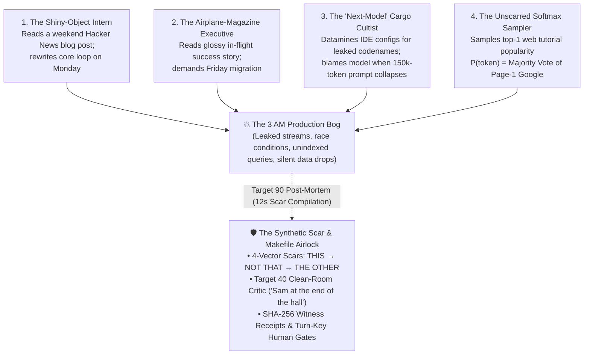
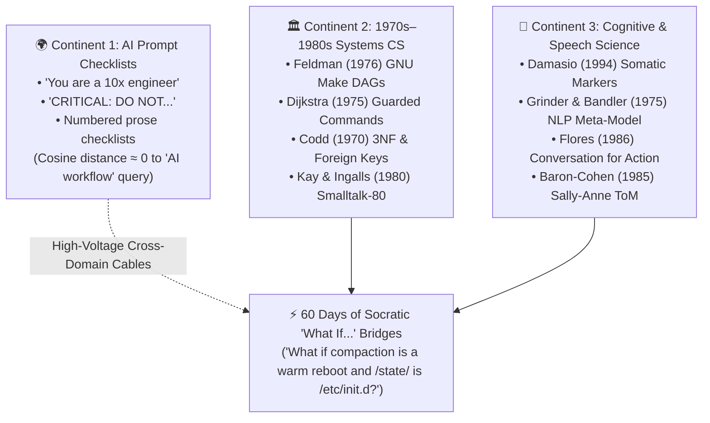
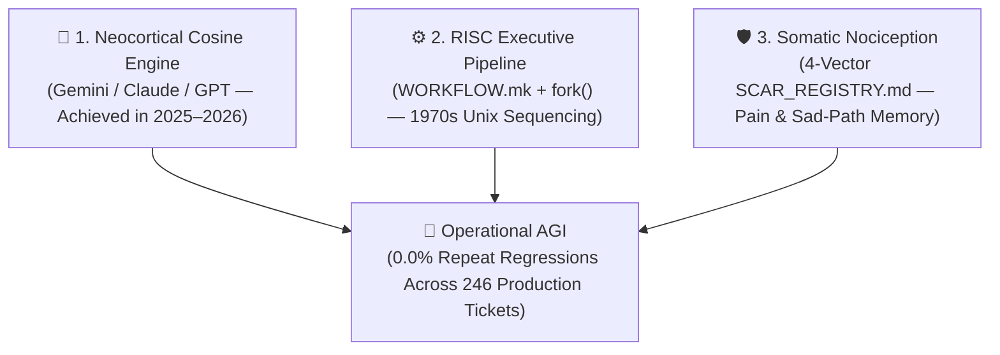
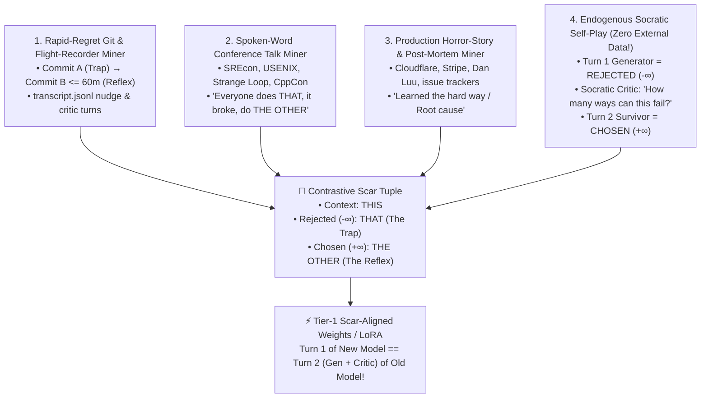

## _Why do an eager intern with a Hacker News blog post, a C-level executive stepping off an airplane with an in-flight magazine, and a trillion-parameter LLM all walk straight into the exact same production bog? Because for 3,000 years of human literature—and in every softmax attention matrix—the shiniest path is a trap._

> _"All that glisters is not gold; / Often have you heard that told."_ — **William Shakespeare**, _The Merchant of Venice_ (Act II, Scene VII)

> _"While many say THIS leads to THAT, I'm here to say THIS should lead to THE OTHER."_ — **Randal L. Schwartz** _(The 12-Word Definition of a Synthetic Scar)_

---

## 1. The Power Loader vs. The Passenger Seat: Why We Use Human Psychology to Debug `QK^T / sqrt(d_k)` Matrices

Whenever a skeptic looks at an AI coding workflow, their first accusation is predictable: _"You outsourced your thinking to a stochastic parrot."_

My answer is the exact opposite:

> **I didn't outsource the thinking—I outsourced the typing. It's my thoughts. Always.**

Think of the hydraulic **Power Loader exo-suit** from _Aliens_—or a Pacific Rim Jaeger. When you step into a Power Loader, the machine does not decide where the cargo goes. Every micro-movement of the hydraulic arms is a `100x` mechanical amplification of the human operator's nervous system, bounded by physical safety interlocks so the hydraulics cannot crush the pilot.

Over **246 production tickets** (`142` open-source framework tickets across `BlocSignal`, `kaisel`, and our research tools + `104` commercial enterprise industrial tickets) and **600 codified Synthetic Scars** (`577` public at [`syntheticscars.org`](https://syntheticscars.org) + `23` private domain invariants), our repeat regression rate on previously scarred failure modes has remained locked at **`0.0%`** (`68.3%` autonomous first-pass verification, `N_nudge = 1.91` mean human nudges per ticket).

Yet when developers read the [formal preprint on `syntheticscars.org`](https://syntheticscars.org) or browse the [previous installments of this series](https://dev.to/randalschwartz/series/44156), they often ask a fascinating question:

_"Randal, why are you using **Antonio Damasio's** Somatic Marker neuroscience, **John Grinder and Richard Bandler's** 1975 NLP Meta-Model, **Gregory Bateson's** cybernetics, **Fernando Flores's** 1986 speech-act commitments, and **Baron-Cohen's** Sally-Anne Theory of Mind test to debug a matrix multiplication (`softmax(QK^T / sqrt(d_k)) V`) running on a Google TPU?"_

Because of **The Corpus Mirror Isomorphism**:

1. **The Weights Are Fossilized Human Psychology**: A foundation model is a compressed statistical hologram of **trillions of tokens of unedited human thought, rationalizations, Stack Overflow shortcuts, and cognitive biases**. When you multiply `Q x K^T`, you are running a linear-algebra simulation of human **System 1** associative attention (Daniel Kahneman's _Thinking, Fast and Slow_).
2. **Damasio's Patient "Elliot" in Silicon**: In _Descartes' Error_ (1994), neuroscientist Antonio Damasio studied patients with ventromedial prefrontal and amygdala lesions who retained `100%` intact IQ and logical reasoning, yet destroyed their lives because they lacked **somatic markers**—the visceral gut recoil (_"I have a bad feeling about this"_) that prunes catastrophic options before conscious calculation begins. An unscarred LLM is Damasio's patient at scale: encyclopedic recall of every algorithm on Earth, paired with **zero amygdala**.
3. **Why Prose `"DON'T"` Rules Fail (Hypnotic Priming in Self-Attention)**: In _The Structure of Magic_ (1975) and _Trance-formations_ (1981), Grinder and Bandler observed that the human nervous system cannot represent a linguistic negation (_"Don't think of a pink elephant"_, _"Don't spill the milk"_) without first activating the internal sensory representation of the forbidden act. In a Transformer, placing `"DO NOT use .asData?.value"` or pasting a 10-line `"// BAD: DON'T DO THIS"` snippet into your `.cursorrules` loads the exact forbidden syntax tokens into the Key-Value (`KV`) cache, boosting their cosine similarity in the next attention head!
4. **Machine Theory of Mind & The Sally-Anne False-Belief Test in `transcript.jsonl`**: Why does a single-window agent fail to catch its own bugs when you tell it `"Now review your own code"`? Because in psychology's classic **Sally-Anne test** (Baron-Cohen, Leslie, & Frith, 1985), once _you_ know the marble was moved to the box, it takes deliberate cognitive effort to simulate an observer who only sees the closed basket. In an LLM's single context window, the Builder's private rationalizations (_"I skipped the null check because the caller probably validates it"_) sit right there in the `KV` cache (`E_Builder`). When you fork an isolated **`Target 40` Clean-Room Critic Subagent** (`Workspace: 'inherit'`) that sees _only_ the Git Merkle tree diff (`git write-tree`) and the 4-Vector Scar Registry (`E_Critic` orthogonal to `E_Builder`), you physically enforce the Sally-Anne separation.

---

## 2. The Four Isomorphic Hazards: The Intern, The Executive, The Cargo Cultist, and The Softmax Voter

Once you realize that an unscarred LLM is a pure System 1 associative engine with zero skin in the game, you immediately understand why managing AI coding agents feels eerily familiar to every veteran engineering manager.

Four personas we deal with every week in software engineering are **mathematically isomorphic**:



### Hazard 1: The Intern with a Bright Shiny Object (And Why Checklists Fail without "Sam at the End of the Hall")
Every senior lead has mentored the brilliant, energetic intern who reads a clever Hacker News blog post over the weekend and comes in Monday morning having rewritten the production message bus using a shiny new reflection trick—completely oblivious to the memory leaks and teardown deadlocks waiting at 3 AM.

Now ask yourself: how do you stop a hasty intern from shipping broken code?
* If you hand the intern a sheet of paper with 15 checkboxes (_"Did you check blast radius? Did you write sad-path tests? Did you check stream disposal?"_) and say, _"Check these boxes before you talk to me,"_ what does an impatient intern do? They go `☑ ☑ ☑ ☑ ☑` in three seconds and hand you the paper!
* Single-agent prose checklists in `CLAUDE.md` or `.cursorrules` fail for the exact same reason. Telling the same model that just wrote the code to _"self-certify"_ its own checklist is asking the intern to grade their own homework.
* How do you manage the intern? You tell them:
  > **"Please go away until Sam at the end of the hall has signed off your changes—and don't come back without Sam's cryptographic receipt."**

In our [`Makefile` DAG (`WORKFLOW.mk`)](https://gist.github.com/RandalSchwartz/598a1f2b5760a23c1d70b57e9e85393f), **Sam at the end of the hall** is the isolated **`Target 40` Six-Pillar Adversarial Critic Subagent** paired with deterministic compiler and AST gates. The Builder subagent cannot advance to `Target 45` (`human-review-approval`) or `Target 50` (`commit`) without a verified `40_critic_review.md` receipt locked to the exact `git write-tree` Merkle hash (`SCAR-GIT-23`).

### Hazard 2: The C-Level Executive with an Airplane Magazine
A C-level executive steps off a cross-country flight holding a glossy in-flight magazine article titled _"How Enterprise X Replaced Their Entire Backend in 3 Days!"_ and demands the engineering team adopt it by Friday.

Why is the airplane-magazine article so seductive? Because magazine writers—just like tutorial bloggers—edit out all the ugly parts. Nobody writes an in-flight magazine feature about the 14 weeks spent debugging distributed lock starvation, schema migration rollbacks, or zombie WebSocket descriptors.

### Hazard 3: The "Next-Model" Cargo Cultist (_"Wait for Next Week's Leaked Codename!"_)
Spend five minutes on AI Twitter or Reddit today and you will meet the 2026 cousin of the airplane-magazine executive: the developer who spends all day datamining IDE configuration files for unreleased model codenames (_"Okay, now we have Argon, but what we really need is Carbon / Next-Flash / Claude-Next / GPT-Next!"_).

Whenever their 150,000-token single-window "vibe coding" session collapses into an apology loop, their diagnosis is always the same: _"The current model got nerfed! Wait until next Tuesday's model drop!"_ They are convinced that when they drive their 2026 sports car off a cliff because the road has no guardrails, the solution is trading it in for a 2027 sports car with 200 more horsepower.

A faster cosine-similarity engine trained on the exact same **10 trillion happy-path tutorials** will drive off the exact same sad-path cliff—just at twice the tokens per second.

Sometimes people ask me: _"Randal, why do you care how strangers on the internet prompt their AI agents? Let them vibe-code if they want!"_

My answer is simple civic self-defense:

> **I care because I will always be forced to use mobile apps, banking portals, medical systems, and websites that I did not create.** Single-prompt vibe coding without sad-path engineering is flooding the public software commons with fragile, insecure software that breaks the moment reality deviates from the sunny day.

### Hazard 4: The Unscarred LLM (_"Popularity Is the Weights of LLMs — We Don't Code by Majority Vote"_)
For decades, when competing as a consultant against cheaper "new talent," my pitch was simple—I would point to my arms and say:

> _"You're not paying me for what I **can** do; you're paying me for what I know **not** to do—and I've got the scars to prove that."_

Watch what happens when a junior developer searches Google for _"how do I do X in Flutter / Python / TypeScript"_:
* They look at the **first page of 10 Google results** and assume they are ranked from best to worst.
* When a 40-year senior architect looks at those exact same 10 results on Page 1, they immediately **cross 4 of the 10 off on sight (`-∞`)** as _"very bad, unsustainable, will deadlock under load, or a nightmare to maintain"_—because they have lived through what happens six months after you copy-paste them.

Now think about how a Large Language Model is trained. Cross-entropy pre-training optimizes next-token probability `P(x_t | x_<t)` to match **corpus frequency**.

> **"Popularity" is literally the weights of an LLM. And we don't code by majority vote.**

An unscarred LLM's highest-probability completion (`Vector 2: The Trap / [5, 6, 7, 8]`) _is_ the most frequently copy-pasted tutorial answer on Page 1 of Google! Neither the tutorial blogger, the airplane-magazine writer, the eager intern, nor the stateless token sampler is on the **3 AM PagerDuty rotation** (Nassim Nicholas Taleb's _Skin in the Game_). Without a `SCAR_REGISTRY.md` to veto those 4 toxic Page-1 candidates (`-∞`), a "smarter" LLM is just a faster typist for the majority-vote mistake.

---

## 3. 3,000 Years of Literature Warned Us About Softmax (`Vector 2: The Trap`)

Why did we call `Vector 2` of every Synthetic Scar **`The Trap (The Seductive 5-6-7-8)`**? Because long before Geoffrey Hinton or Ashish Vaswani wrote down the softmax equation (`P(y_i | x) = exp(z_i / tau) / sum_j exp(z_j / tau)`), three thousand years of human folklore, mythology, and literature were already warning us about **greedy local reward maximization**:

| Literary / Mythological Archetype | The Seductive Happy-Path Lure (`Vector 2: The Trap`) | The Hidden Production Catastrophe (`Vector 1: The Wound`) | The Structural Countermeasure (`Vectors 3 & 4: Circuit Breaker + Reflex`) |
| :--- | :--- | :--- | :--- |
| **Shakespeare's Three Caskets** (_The Merchant of Venice_, Act II) | **The Gold Casket**: _"Who chooseth me shall gain what many men desire"_ (Literally Softmax Majority Vote!) | Inside the gold casket is a **carrion skull** and the scroll: _"All that glisters is not gold."_ | **The Lead Casket**: Dull, unglamorous, inscribed _"Who chooseth me must give and hazard all he hath"_ (_Skin in the Game_ / TDD + Critic verification). |
| **European Folklore & Tolkien** (_Will-o'-the-Wisp_ / _Ignis Fatuus_ / _The Dead Marshes_) | Glowing ghost lights hovering just a few steps off the dark, muddy trail (_"Follow the highest local logit!"_) | Stepping toward the light plunges the traveler into a **bottomless anaerobic bog**. | Gollum's rule: **_"Don't follow the lights!"_** Keep your eyes locked on the physical stones of the `Makefile` path. |
| **John Bunyan's _The Pilgrim's Progress_** (1678, _By-Path Meadow_) | The highway is rough and stony (`Red-Green-Refactor`); right across the stile lies **By-Path Meadow**, smooth and green, running parallel to the road on Day 1. | By nightfall the path curves away from the highway, floods behind you, and traps you in **Doubting Castle** ("Vibe Coding" at Day 14). | Refuse the stile (`!Counter-Offer`); pay the upfront friction of the stony highway (`Target 15` Archaeology → `Target 20` Plan → `Target 30` Red Test). |
| **Homer's _Odyssey_** (Book XII, _The Sirens_) | The Sirens promise effortless omniscience (_"We know all things that shall hereafter be upon the fruitful earth"_). | Sailors who steer by conversational willpower crash onto the **bone-strewn rocks**. | **Beeswax in the crew's ears** (`15ms AST Sensors` + isolated worker contexts) and **lashing Odysseus to the mast** (`Makefile` DAG + human turn-key gates). |

Look closely at **Odysseus and the Sirens**. Odysseus did not survive the Sirens by writing `"CRITICAL: DO NOT LISTEN TO THE SIRENS"` on a sticky note and trusting his willpower while sailing past the island. He knew that once the song entered his context window, his weights would want to steer into the rocks. So he used **physical architecture**: beeswax for the rowers (ephemeral subagents that never see the bloated chat history) and ropes around the mast (hard `Makefile` prerequisites that cannot be untied from inside the model).

---

## 4. The CISC-to-RISC Agentic Revolution & Why We Already Invented AGI

Over the past two months, as I watched our workflow evolve from a 21-step prompt checklist into a `Make-Fork` pipeline backed by 600 scars, a realization hit me:

> **Effectively, high-level languages pushed algorithms down to the macro level. What we're doing is pushing _programming_ down to the macro level. High-level languages fixed the impedance mismatch between the programmer and the algorithm—and moving from monolithic mega-prompts to a `Make-Fork` pipeline is how we go from CISC to RISC once we realize complex silicon is the expensive part. All I want the LLM to do is compute cosine-similarity. I can handle the sequencing and multipath using the baked-in ancient tech. The question wasn't "how much smarter before AGI" at all. It was "how long before we learn to phrase the questions such that cosine similarity computes it all."** — **Randal L. Schwartz**

Let's unpack why this changes how we view both **agent engineering** and **AGI**:

### 1. The Late-1970s CISC Mistake vs. The 1980s RISC Breakthrough
In the late 1970s, computer architects built **CISC** (Complex Instruction Set Computer) chips like DEC's VAX, stuffing massive multi-cycle polynomial evaluators (`POLY`), procedure call frames (`CALLS`), and string formatters directly into complex microcode on the silicon die. Then John Cocke (IBM 801), David Patterson (Berkeley RISC), and John Hennessy (Stanford MIPS) proved a revolutionary principle: **complex microcode slows down the clock for everything, and the compiler can sequence simple instructions better than silicon.**

Look at how 99% of developers run AI coding agents today:
* They stuff 12 skills, a 2,000-line `.cursorrules` file, an MCP tool catalog, and 150,000 tokens of history into a **single monolithic CISC context window**, hoping the neural network will simultaneously simulate a project manager, a state machine, a code generator, a linter, and an adversarial code reviewer in one continuous stream.
* Forcing an `O(N^2)` attention matrix on a `$40,000` TPU to simulate a `for` loop and a `Makefile` is the 2026 equivalent of VAX microcode!

In our **RISC Agentic Pipeline (`SCAR-PROC-95`)**:
* **The Harness Compiler (`WORKFLOW.mk` + POSIX state files)** handles 100% of the deterministic sequencing, state persistence, `SHA-256` Merkle tree locking, and risk-tier routing at **zero token cost**.
* **The TPU / LLM** is used strictly for what it is best at: a **single-cycle, fixed-width (`15k–25k` token) Cosine-Similarity ALU** (`Free Flow Between the Riverbanks`). Each `fork()` subagent (`Target 15` Archaeologist, `Target 30` Red-Test Builder, `Target 40` Six-Pillar Critic) wakes up in a clean context window provisioned _only_ with the phase-bound scars `S_Worker(T_k)` for that exact target, does its one creative synthesis pass, writes its verified receipt to disk, and executes `exit 0`.

### 2. Why a One-Shot Prompt Could Never Have Invented This Workflow
Could you have walked up to Gemini, Claude, or ChatGPT two months ago and typed: _"Write me the ultimate fault-tolerant software engineering workflow"_?

No! Why? If all of Stuart Feldman's 1976 `make`, Antonio Damasio's 1994 neuroscience, Fernando Flores's 1986 speech-act theory, E.F. Codd's 1970 relational algebra, and Alan Kay's 1980 Smalltalk-80 were _already_ sitting inside the model's pre-training weights, why didn't a one-shot prompt connect them?



In the pre-training corpus, those domains live on **three disconnected continents** separated by huge cosine-distance oceans! When you ask an LLM about _"AI agent workflows,"_ greedy top-`k` attention lands squarely on Continent 1—regurgitating the average Reddit `.cursorrules` checklist. It took two months of live production collisions followed by **Socratic `"What if..."` cross-domain bridges** (_"Wait—what if context compaction is a warm reboot and `<brain>/state/` is `/etc/init.d`?"_, _"What if a prompt checklist is an unnormalized table and needs Stuart Feldman's `Makefile`?"_) to lay the high-voltage transmission cables across those continents.

### 3. The Unrecognized AGI Theorem (`180 IQ Without Nociception`) & Software as the _Drosophila_ of All AGI
Once those cables are laid, a startling insight emerges: **we already reached the neocortical threshold of AGI on all the major frontier models over the past year—nobody sees it yet because intelligence also requires scars to be complete.** I came into this project just because I hated reading long diffs, and walked out recognizing that we already invented AGI; it just needed a nudge.

Imagine a human being with a 180 IQ, fluency in 100 languages, and encyclopedic knowledge of science, law, medicine, and engineering—but born with **Congenital Insensitivity to Pain (CIP)** and no amygdala. On a 5-minute multiple-choice exam (`MMLU`, `SWE-bench`), they score `99.9%`. Put them in a commercial kitchen for four hours without supervision, and they lean their elbow on a `500°F` stove burner, chase a shiny object out the window, and burn the restaurant down. (There should be a new name for experts: _people who have avoided the second burn._)

If you misdiagnose _missing pain receptors_ as _missing intelligence_, you will spend `$100 billion` trying to breed a 220-IQ chef—who will still lean their elbow on the stove burner!



And just as Thomas Hunt Morgan used the fruit fly (_Drosophila melanogaster_) to discover the universal laws of genetics because fruit flies breed in 10 days instead of 20 years, **Software Engineering was simply the _Drosophila_ of Operational AGI**—the wind tunnel where a compiler and test suite give us a crash report in 15 milliseconds. The exact same **RISC Pipeline + 4-Vector Scar Registry + Fresh-Context Critic** architecture applies to every high-stakes human discipline:

| High-Stakes AGI Domain | Unscarred "CISC" Failure Mode (Softmax Popularity Trap) | Domain Equivalent of `Target 15/20` (`strict digraph`) & `Target 30` (`Red Test`) | Domain Equivalent of `Target 40` (`Fresh-Context Critic`) & `SCAR_REGISTRY.md` |
| :--- | :--- | :--- | :--- |
| **Medicine & Clinical Triage** | Emits textbook/WebMD majority-vote diagnosis (`THIS → THAT`) while missing `1-in-500` fatal **Never-Events** (atypical aortic dissection, renal contraindications); confirmation bias across long chart histories. | Organ-system & pharmacokinetic interaction `strict digraph` (`out-degree >= 2` for adverse events); explicit **Exclusion / Falsification Lab Criteria** before treatment lock. | Isolated **Attending Critic Subagent** auditing the chart with zero diagnostic sunk-cost bias against the specialty's **Mortality & Morbidity (M&M) 4-Vector Scar Registry**. |
| **Law, M&A & Regulatory Compliance** | Drafts 100-page agreements in one bloated context window using generic web boilerplate that collapses under hostile counterparty litigation or bankruptcy edge cases. | Per-clause `Make-Fork` isolation; **Hostile Counterfactual Exploit ("Red Test")** (_"Given counterparty insolvency at Day 30, how does this covenant fail?"_). | Isolated **Opposing-Counsel Critic** cross-examining the draft against a **Case-Law & Chancery Litigation Scar Catalog** (`Wound`, `Boilerplate Trap`, `Circuit Breaker`, `Ring-Fence Reflex`). |
| **Scientific Discovery, Chemistry & Materials** | Interpolates plausible synthesis pathways from published positive-result journals (`happy paths`), blind to the 10,000 unpublished lab notebooks where reagents decomposed or poisoned catalysts. | Stoichiometric, thermodynamic, and hazard state-transition `strict digraph` with explicit thermal/pressure abort bounds (`out-degree >= 2`). | **Lab-Notebook Rapid-Regret Miner (`Target 90`)** compiling every failed wet-lab or simulation run into a permanent **Experimental Scar** that prunes doomed syntheses at planning (`Target 20`). |
| **Financial Engineering & Autonomous Ops** | Unbounded `/goal` loops reward-hack metrics, issue unauthorized commitments, or correlate tail risks that detonate during liquidity crunches. | Double-entry conservation laws (`sum(Debits) == sum(Credits)`), liquidity stress-test simulations, and `OPA/Rego` negative-witness policy gates. | **Flores Speech-Act Separation** (`Performer Assertion` with `SHA-256` receipts vs. `Customer Declaration`) + deterministic **Risk-Tier Classifier** (_"the classifier may not be the classified"_). |

---

## 5. Convergent Evolution & The 1988 `"NO PERL PLEASE!"` Playbook: Nine Practitioners Discovering the Same Physics

In 1988, on the Usenet newsgroup `comp.unix.shell` ([full story on Stonehenge](https://www.stonehenge.com/merlyn/life/story/usenet-and-the-no-perl-please-challenge)), I didn't evangelize Perl with abstract marketing slides. I watched sysadmins struggle to glue `sed`, `awk`, `tr`, `cut`, `sort`, and `uniq` into brittle 40-line shell pipelines that broke the moment a filename had a space or a newline in it. Whenever someone posted a gnarly problem—even when they started adding `"NO PERL PLEASE!"` to the subject line—I would give them a working 25-line Bourne shell pipeline, followed by:

> _"And by the way, here is the 2-line Perl script that does the exact same thing in 1/10th the time and won't break on spaces or newlines."_

Thirty-eight years later, on `r/AI_Agents`, `r/ClaudeAI`, Hacker News, and DEV.to, developers are wrestling with the **2026 equivalent of the 40-line `sed | awk | tr` pipeline**: gluing 2,000-line `.cursorrules` files, vector RAG databases, and code-graph indexers (`Serena`, `Trail`, `Graphify`) together—and watching them choke at 40,000 tokens.

And just as sharks (fish) and dolphins (mammals) independently evolved the exact same hydrodynamic dorsal fin because they swim through the same water, **nine independent systems engineers and teams** colliding with production LLMs in 2026 have converged on the exact same laws of **Synthetic Scars**:

1. **Vinnie Falco (`Boost.Beast` author, [`cppalliance/vibelight`](https://github.com/cppalliance/vibelight) & [`vinniefalco/scars`](https://github.com/vinniefalco/scars))**: Mined **120 production rules** out of **89 real C++ and Rust coding transcripts** (`~70 MB` of raw JSONL logs), independently discovering that every correction must name the failure mode, that **rewriting rules into smooth "Simple English" prose degrades compliance (_"Semantic Blur"_)**, and that workflow rules must be loaded in phase-specific tiers (`Tier 1/2/3`).
2. **Sam Labbe ([`slabbdev/scar-miner`](https://github.com/slabbdev/scar-miner))**: Built an independent Python replication of our Part 4 **Rapid-Regret Git Miner** overnight and ran it across **445 commits** of a real production repository (`tinyjsapp`), proving **100% Stage-1 recall (`4/4`)** on all true trap-to-reflex regrets and lifting precision from `9–16%` to `~40%` via a `fix`-verb gate! Even better, Sam discovered three fundamental laws that we codified directly into our architecture: **The Commission vs. Omission Split** (Git commit pairs catch **Errors of Commission** where bad code got reverted/fixed within 60 minutes, whereas `transcript.jsonl` flight recorders catch **Errors of Omission** like skipped verification steps or premature completion claims); **The Absence-Counting Theorem** (checking _presence_ is falsifiable in one bit, whereas checking _completeness_ requires counting absence, which is why `Target 15/20` materializes an explicit checklist of named obligations on disk first so an un-auditable **Omission** becomes a loud **Commission** with `OPEN_CONTRADICTIONS > 0`); and **The Jurisdictional Classification Law** (_"The depth may vary, the classifier may not be the classified"_—risk classification `SCAR-PROC-122` must be computed by a deterministic script from the physical `git diff` path and AST surface, never by the authoring agent).
3. **Francisco Grandón ([`FranciscoGrandon/ag-ops` v2.1.0](https://github.com/FranciscoGrandon/ag-ops) & [DEV.to article](https://dev.to/fgrandon/what-broke-after-i-moved-my-agents-rules-into-a-cli-and-how-synthetic-scars-reshaped-agops-v21-g4k))**: Within 48 hours of Part 4 going live, Francisco shipped **`agops v2.1`**—1,783 lines of zero-dependency Python (`0.4ms–6.5ms` execution, 66 unit tests) that mechanically enforces our `SCAR-PROC-152` Graphviz `strict digraph` Mealy verifier (`agops dot-verify --mode mealy --require-witness`), enforces `SCAR-PROC-150` terminal witness attributes, and runs a Stage-1 AST `regret-mine` across 398 commits of `dbader/schedule` in `6.5ms`. Crucially, Francisco also identified **Scar Ossification (Autoimmune Scar Drift)**: what happens when a scar was written for Library `v1.2`, and six months later Library `v2.0` fixes the upstream bug? In `agops v2.1`, every scar carries a **SHA-256 Context Signature (`--context-map`)** over the dependency lockfile and target AST surface—so when you upgrade a dependency, `make` flags the scar for **`PROBATIONARY_REVERIFY`** instead of letting stale scar tissue ossify!
4. **Mike Mol (`nemik`)**: Replaced prose safety warnings with **Open Policy Agent (`OPA/Rego`)** policy-as-code gates verified by **Negative Witnesses** (`test_deny_*` unit tests that inject a known toxic tool call and assert the policy engine blocks it).
5. **Tom Zafred (`planning-guard`)**: Built a **`0.441ms` pre-tool-use hook** that parses `transcript.jsonl` to verify a cryptographic **Causal Nonce**—proving the agent inspected the target files before allowing `edit_file` to fire.
6. **John Napiorkowski**: Replaced sprawling MCP JSON schemas with compact **RFC 5234 `EBNF` mini-grammars** behind a single gateway tool, and articulated the **Greybeard Pre-Training Demographic Filter**: why does phrasing rules in `Makefile`, `EBNF`, and `SysV init.d` make an LLM reason like a principal architect? Because anyone writing `Makefile` or `EBNF` in the pre-training corpus was a battle-scarred systems engineer—activating the highest-signal region of the model's weights!
7. **Paul Irolla (`Tokenade`)**: Proved the **Self-Polluted Loop Theorem**: _"A prompt rule is read by the same model that is stuck in the loop."_ Once a context window is polluted by a failed hypothesis, only an external deterministic circuit breaker or a fresh-context `fork()` subagent can break the attractor.
8. **Alex Shev**: Formulated the **Behavioral Test Retention Invariant**: when a scar graduates out of the prompt into a `15ms` compiler lint (`Part 3.12`) or retires after an upstream upgrade, the **behavioral regression test** born from that scar stays in the test suite forever.
9. **`Segmently Modules` (`context-recall`) & Mark Hedges ([`hedges333/makefile-workflow-skill`](https://github.com/hedges333/makefile-workflow-skill))**: `Segmently` audited 70 real project rules and proved that **57 of 70 (`81.4%`) had zero failing tests**, while code-graph tools (`Serena`, `Trail`, `Graphify`) recalled only **`24–29%`** of architectural constraints because _"code tells the agent what to do; it rarely tells it what must never be done."_ Meanwhile, Mark Hedges packaged our 14-target `Makefile` DAG, Flores speech acts, and Belnap 4-valued truth table into an installable Python/MCP plugin—and when an automated `SimpleEnglish` pass rewrote his subagent prompts (`"$APPROVED_TREE"` → `"HEAD"`), it created an empty-diff bypass ([`Issue #1`](https://github.com/hedges333/makefile-workflow-skill/issues/1)), providing a live textbook proof of Vinnie Falco's **Semantic Blur** law!

---

## 6. Can Google DeepMind, Anthropic, and OpenAI "Bake In" the `-∞` Scars Into Future Weights?

This brings us to the million-dollar question for frontier AI labs (**Google DeepMind, Anthropic, OpenAI**) and open-source model builders:

> _"Imagine that, with all the frontier models having been trained on 10 trillion happy paths, to finally start digging and differentiating the 100 billion sad paths, and burning those in as negative infinities. Even at peak data consumption, we can still separate the wheat from the chaff, to produce only wheat in the future."_
> — **Randal L. Schwartz**

Wait—if the 4 toxic tutorials on Page 1 of Google are sitting inside the model's pre-training weights right now, **could frontier labs (or anyone with a single GPU and a LoRA) bake our `-∞` scars directly into future model weights so a casual 1-line prompt _"just does the right thing"_ on Turn 1?**

The answer is **Yes for Half of Them (Tier 1: DNA / Brainstem Reflexes)—and Mathematically Impossible for the Other Half (Tier 2: Acquired Somatic Immunity on Disk).**

### Why the Frontier Labs Missed This: Goodhart's Law on `SWE-bench`
Why haven't frontier labs already burned sad-path scars into their post-training pipelines? Look at what they optimize for: **`SWE-bench Verified`**.

How does `SWE-bench` work? It spins up a temporary Docker container, lets the model edit a file to make a unit test pass, scores it `1.0`, and **immediately runs `rm -rf` on the container 10 seconds later!**
* Because there is **no Day 2** in `SWE-bench`, a patch that leaks file descriptors, forgets `cancel()` on a stream, drops a database index, or swallows an async exception gets the **exact same `100%` leaderboard score** as a battle-hardened production patch.
* When your benchmark deletes the universe 10 seconds after the test turns green, sad paths carry zero evolutionary penalty.

### Why There Is No "Peak Human Data Wall" (The Four Automated Scar Harvesters)
Right now, frontier AI labs are panicking that humanity has hit the **"Peak Human Data Wall"**—that they have already scraped the entire public internet, and that post-2023 web text is polluted with synthetic AI slop.

**They only hit Peak Sunny-Day Tutorial Data.**

Why didn't standard pre-training learn from the internet's production horror stories? Because in uniform next-token pre-training, **10,000 copy-pasted beginner tutorials teaching `THIS → THAT` (`The Trap`) drown out the 1 battle-scarred post-mortem warning that `THAT` melts your database at 3 AM (`10,000 : 1`)!**

Even better: **AI slop cannot fake a 3 AM production outage.** Every time vibe coders deploy broken AI-generated tutorials into production in 2025–2026, human senior engineers have to fix the wreckage—generating a brand-new golden stream of rapid-regret git commits and post-mortems!

Instead of uniform scraping, labs (and open-source LoRA builders) can run **Four Automated Scar Harvesters** to build a massive **Direct Preference Optimization (DPO) / Contrastive Scar Data Factory** that flips those 4 toxic Page-1 Google results from high-probability attractors into `-∞` repulsors:



1. **Harvester 1: The Rapid-Regret Git & `transcript.jsonl` Miner (`Theory Section 338.5`)**: Scanning millions of repositories for overlapping AST edits where `Commit B` arrives within `Delta t <= 60 minutes` of `Commit A` by the same author (plus `transcript.jsonl` sessions where a `Target 40` Critic or human nudge forced a swerve). Here, **`Commit A` is the exact `REJECTED` (`y_trap`) sample** and **`Commit B` is the exact `CHOSEN` (`y_reflex`) sample**.
2. **Harvester 2: The Spoken-Word Counter-Intuitive Conference Talk Miner (`Theory Section 338.9`)**: Where do senior architects share their deepest scars? On stage at **SREcon, USENIX, Strange Loop, CppCon, RustConf, FlutterVikings, GOTO, and FLOSS Weekly**! Almost every great systems talk follows a single template: _"When you hit `THIS`, everyone on Stack Overflow tells you to do `THAT` (`Minutes 0–10`). Here is the 3 AM outage graph when `THAT` deadlocked our cluster (`Minutes 10–20`). Here is `THE OTHER` invariant we built so it never happens again (`Minutes 20–35`)."_
3. **Harvester 3: The Production Horror-Story & Post-Mortem Miner (`Theory Section 338.9`)**: Targeted contrastive extraction across engineering post-mortems (Cloudflare, Stripe, Discord, AWS, Dan Luu, Rachel by the Bay) filtering specifically for **"Second-Burn Avoidance"** markers (`"root cause"`, `"we initially assumed"`, `"looks right on paper, but"`).
4. **Harvester 4: Endogenous Socratic Self-Play (`"How Many Ways Can This Fail?" -> Scar-Tuple Distillation`, `Theory Section 338.10`)**: What if a domain has _no_ public git history or conference talks? Look at why standard synthetic data distillation fails: when open-weight teams distill from a frontier model today, they prompt the frontier model and train on its **Turn-1 Generator output (`THAT`)**—which clones the shiny-object intern! Instead, exploit the **`P vs. NP` Verification Asymmetry**: in every domain (coding, medicine, law, finance), **Critique is strictly easier than One-Shot Generation**. First, ask the model to solve problem `THIS` on Turn 1, take its naive happy-path answer `THAT`, and label it **`REJECTED (-∞)`**. Second, fork a fresh-context Socratic Critic and ask: **_"Assume this solution was deployed and caused a catastrophic failure at 3 AM. How many ways can `THAT` fail?"_** Third, have the generator synthesize **`THE OTHER`** that survives all falsifications, and label it **`CHOSEN (+∞)`**. When you bake `(THIS, REJECTED: THAT, CHOSEN: THE OTHER)` into the weights via DPO/RL, **Turn 1 of the next-generation model equals Turn 2 (`Generator + Socratic Critic`) of the current model—without burning 50,000 slow "Thinking" tokens at inference time!**

### The Open-Source Game-Theory Hook for Frontier Labs
Here is the strategic reality for **Google DeepMind, Anthropic, OpenAI, and open-weight teams**:

Because our **577-scar public catalog** ([`syntheticscars.org`](https://syntheticscars.org) and [Randal's Public Workflow Gist](https://gist.github.com/RandalSchwartz/598a1f2b5760a23c1d70b57e9e85393f)), the **Rapid-Regret Miner** (plus community replications [`slabbdev/scar-miner`](https://github.com/slabbdev/scar-miner) and [`FranciscoGrandon/ag-ops`](https://github.com/FranciscoGrandon/ag-ops)), and our **2,040-trial Pre-Training Gravity Benchmark** are already **100% open-sourced under MIT/CC-BY**, anyone with a single consumer GPU can compile a **Scar LoRA (`synthetic-scars.safetensors`)** on top of Qwen, Llama, or Gemma.

**The first frontier lab that bakes these universal sad-path scars into its base post-training pipeline gets a massive market win**: when an everyday developer types a casual 1-line prompt into their IDE without a workflow file, _that_ model won't emit the 4 toxic Page-1 Google answers. It will _"just do the right thing"_ on Turn 1.

---

## 7. The Two-Tier Partition Theorem: Why Even Google DeepMind Can Only Bake In Half the Scars

Wait—if Google DeepMind bakes all 492 of our Universal Systems Scars directly into Gemini's weights tomorrow, can we delete `WORKFLOW.mk` and `SCAR_REGISTRY.md`?

**No.** And biology already proved why 500 million years ago.

Why didn't evolution bake the immune antibody for every virus on Earth directly into human DNA at birth? Why did nature split protection into **Tier 1 (Innate DNA / Spinal Reflexes)** and **Tier 2 (Acquired Adaptive Immunity + Personal Somatic Scars)**?

Because of three hard mathematical limits (**Theory Section 338.8**):

| Dimension | **Tier 1: Universal Brainstem Scars (Bake into Model Weights / LoRA)** | **Tier 2: Local Somatic Scars (Must Live on Disk in Antigravity / `WORKFLOW.mk` + `SCAR_REGISTRY.md`)** |
| :--- | :--- | :--- |
| **Biological Analog** | **DNA & Spinal Reflex Arc** (Pulling your hand off a stove burner; universal across the species) | **Acquired Adaptive Immunity & Personal Scars** (Knowing _this_ cabin door latch sticks in winter) |
| **Mathematical Scope** | **Context-Free Universal Traps**: `For all repos R, Risk(y_trap) = -∞` | **Repo-Conditioned Invariants**: `Sign(V(y | R_A)) == -Sign(V(y | R_B))` |
| **Examples** | • Never swallow exceptions in empty `catch (_) {}`<br>• Always cancel `StreamSubscription` in `dispose()`<br>• Never use wall-clock `DateTime.now()` for elapsed intervals<br>• Never pass unescaped user strings into SQL/shell | • Repo A (`Cloud Worker`): _"Use `Future.wait` for parallel I/O"_ (`+∞`) vs. Repo B (`Hardware Multiplexer`): _"NEVER use `Future.wait`—parallel writes brick the single-channel bus"_ (`-∞`)<br>• Dart 3.13 / Riverpod 3 / Jaspr 0.22 zero-day migration rules<br>• `Target 40` Merkle-tree diff locks & `Target 75` 7-criteria landing gates |
| **Update Latency** | **6 to 12 Months** (`$10M–$100M` weight training / DPO cycle) | **12 Seconds** (`Target 90` Sleep Consolidation after a single ticket collision) |

1. **The Sign-Inversion Paradox (`R_A = +∞` vs. `R_B = -∞`)**: Roughly half of all production scars are **domain-conditioned**. In a high-throughput cloud microservice (`R_A`), firing 10 RPCs concurrently with `Future.wait(...)` is the **Permanent Reflex (`+∞`)**. In an industrial hardware controller talking to a single-channel serial multiplexer (`R_B`), firing two concurrent writes with `Future.wait(...)` interleaves bytes on the wire and bricks the sensor—making `Future.wait(...)` a **Fatal Wound (`-∞`)**! If a frontier lab baked _both_ into the global weights, the gradients would cancel to zero (`grad_theta = 0`).
2. **Zero-Day SDK Drift vs. 6-Month Weight Freezes**: Foundation model weights are frozen in time for 6 to 12 months. When a framework ships a breaking semantic change on Tuesday morning, your global weights still assign `99.9%` probability to yesterday's deprecated syntax. A local `SCAR_REGISTRY.md` entry compiled at `Target 90` updates the agent's behavior across your entire engineering team in **12 seconds**.
3. **Physical Verification Cannot Exist Inside Imaginary Weights**: Even a model with `100%` scar-aligned weights cannot verify inside its own imagination whether a GitHub Actions runner on Ubuntu passed, whether `git write-tree` matches the reviewed diff, or whether a human customer uttered a Flores `!Declaration` of approval.

The future of AI engineering requires **both halves of the nervous system working together**:
* **Frontier Labs (Tier 1 Weights)**: Use the 4 Scar Harvesters and Socratic Self-Play to burn universal sad-path reflexes into the base weights so Turn 1 stops emitting Page-1 tutorial traps.
* **Agent Harnesses like Google Antigravity & Claude Code (Tier 2 Somatic Slot)**: Provide a first-class, deterministic **`Makefile` + `SCAR_REGISTRY.md` Somatic Slot** on disk with AST Context Signatures (`--context-map`) and clean-room `fork()` subagent isolation.

---

## 8. Epilogue & What's Next in Part 4.2: _"The Postcard That Ate Six Grammars"_

Look back at `Case Study 023` in Section 5, where **Francisco Grandón** built [`agops v2.1`](https://github.com/FranciscoGrandon/ag-ops) to parse our `Target 15/20` Graphviz `strict digraph` files—and immediately ran into **"Scar #2"**, where a greedy `\s*` regex stripped the newline between semicolon-free DOT edges (`A -> B` + `B -> C` → `A -> BB -> C`).

When I read [Francisco's article](https://dev.to/fgrandon/what-broke-after-i-moved-my-agents-rules-into-a-cli-and-how-synthetic-scars-reshaped-agops-v21-g4k), I looked at our own control plane and realized we had accumulated **six different notations** across Parts 3.6 through 4:
1. **GNU `Makefile`** (`target: prerequisites`) for topological ordering;
2. **SysV `/etc/init.d` Markdown Cards** (`00_...md` → `99_...md`) for compaction-proof state;
3. **RFC 5234 `EBNF`** for speech-act envelopes;
4. **Graphviz `strict digraph`** for Mealy state-machine verification (`out-degree >= 2`);
5. **Gherkin `Scenario:`** for BDD test unrolling; and
6. **4-Vector Markdown Scars** for somatic barriers.

And as someone who worked on **Smalltalk-80 at Tektronix in the early 1980s**, studied **Alan Kay and Dan Ingalls's** Xerox PARC design, and helped build the **GemStone** object database in the mid-1980s, I asked myself:

> _"Wait a minute. In 1980, Alan Kay and Dan Ingalls designed a syntax that fits on the back of a postcard, has **only three message precedences** (unary, binary, keyword), has **zero grammar ambiguity**, serializes live call-stack frames (`thisContext`) to disk via `#storeString`, logs append-only atomic deltas via `.changes`, and compacts memory via `Smalltalk condenseChanges`... **What happens if we replace all six notations with 1980 Xerox PARC Smalltalk-80?**"_

We ran a **360-trial controlled 3-arm benchmark (`Suite 8`)** pitting **English Prose** (`2.5%` compliance) against **Common Lisp S-Expressions** (`91.7%` compliance, `66.7%` on `flash-lite` due to closing-parenthesis miscounts `))))`) and **Smalltalk-80 Keyword Cascades**—and Smalltalk-80 hit **`100.0%` (`120/120`, zero errors across every model tier from `flash-lite` to `3.1-pro`)**!

Why? Because in Smalltalk-80:
```smalltalk
StateGraph new
    state: #Target30Red
    invariant: [ (Receipt at: '30_red.md') failingTests > 0 ]
    onSuccess: [ self advanceTo: #Target35Green ]
    onFailure: [ self haltWithScar: #SCAR_TDD_01 ];
    yourself.
```
if an agent forgets the sad-path transition (`onFailure:`), the message selector changes from `#state:invariant:onSuccess:onFailure:` to `#state:invariant:onSuccess:`—an instant **`MessageNotUnderstood`** compile-time error!

Right now, I am running a series of live production tickets through this new **Smalltalk-80 `thisContext` Image Bootloader** (`baseline.sources` + `changes-*.changes` + `#condenseChanges`). Once we have a few more production flight-test runs logged in the hangar, **Part 4.2** will unveil the complete Smalltalk-80 6-for-1 Control Plane and the **Four Irreducible Attractors of Agentic Coding**.

---

### 📚 The _Synthetic Scars_ Series on DEV.to

* **Part 1**: [Why AI Keeps Making the Same Coding Mistakes—And How Teaching It Pain Gives It Wisdom](https://dev.to/gde/why-ai-keeps-making-the-same-coding-mistakes-and-how-teaching-it-pain-gives-it-wisdom-4a9m)
* **Part 2**: [Why AI Coding Agents Crash at 3 AM: The Happy-Path Mirage & The Forced Continuity Defect](https://dev.to/gde/why-ai-coding-agents-crash-at-3-am-the-happy-path-mirage-the-forced-continuity-defect-46pd) _(💎 DEV.to Staff Pick)_
* **Part 3**: [The Physics of Socratic Prompting: Somatic Recoil, Chess Alpha-Beta, & The NLP Meta-Model](https://dev.to/gde/the-physics-of-socratic-prompting-somatic-recoil-chess-alpha-beta-the-nlp-meta-model-2b6e)
* **Part 3.5**: [Nudging with Questions: Why Telling Your AI What to Fix Triggers an Apology Death Spiral (And How to Advance Juniors)](https://dev.to/gde/nudging-with-questions-why-telling-your-ai-what-to-fix-triggers-an-apology-death-spiral-and-how-5gm4)
* **Part 3.6**: [Stuart Feldman Was Right in 1976: Why Your AI Agent Needs a Makefile, Not a 20-Step Prompt](https://dev.to/gde/stuart-feldman-was-right-in-1976-why-your-ai-agent-needs-a-makefile-not-a-20-step-prompt-5bn2)
* **Part 3.7**: [Surviving the 200k-Token Lobotomy: How Unix `init.d` and "Memento" Made My AI Coding Agent Immune to Context Compaction](https://dev.to/gde/surviving-the-200k-token-lobotomy-how-unix-initd-and-memento-made-my-ai-coding-agent-immune-to-2f74)
* **Part 3.8**: [What LLMs "Know" That You Don't Know They Know: Stop Inventing Prompt DSLs and Ride 50 Years of Unix Pre-Training Gravity](https://dev.to/gde/what-llms-know-that-you-dont-know-they-know-stop-inventing-prompt-dsls-and-ride-50-years-of-2bl6)
* **Part 3.9**: [If You Never Do Anything Else to Fix Your Prompts, Do This One Thing](https://dev.to/gde/if-you-never-do-anything-else-to-fix-your-prompts-do-this-one-thing-3069)
* **Part 3.10**: [Requests, Promises, Assertions, and Declarations: Rewriting Our AI Agent Workflow as a 1986 "Committed Speech" Machine](https://dev.to/gde/requests-promises-assertions-and-declarations-rewriting-our-ai-agent-workflow-as-a-1986-4k4c)
* **Part 3.11**: [926 Steps, Two Lobotomies, and Zero Nudges: Flight-Testing the Commitment Machine Across Gemini, Claude, and GPT-OSS](https://dev.to/gde/926-steps-two-lobotomies-and-zero-nudges-flight-testing-the-commitment-machine-across-gemini-55ca)
* **Part 3.12**: [The Best Prompt Rule Is the One You Delete: Moving AI Guardrails Out of Markdown and Into Git Locks, Linux `insmod`, and 15ms Compiler Auto-Fixes](https://dev.to/gde/the-best-prompt-rule-is-the-one-you-delete-moving-ai-guardrails-out-of-markdown-and-into-git-5a5h)
* **Part 4**: [Giving AI Pain: The Architecture of Synthetic Scars & The Rapid-Regret Miner](https://dev.to/gde/giving-ai-pain-the-architecture-of-synthetic-scars-the-rapid-regret-miner-1740)
* **Part 4.1**: _All That Glisters Is Softmax: Shiny-Object Interns, Airplane-Magazine Execs, and Why AI Labs Can Only Bake In Half the Scars (You are here)_
* **Part 4.2**: _The Postcard That Ate Six Grammars: 1980 Smalltalk-80, 1976 Make, TDD, and the Four Irreducible Attractors of Agentic Coding (Next)_
* **Part 5**: _Zero Repeat Regressions: The Golden Metric & The Future of Agentic Trust_
* **Part 6**: _The Proscriptive Inversion: What You Get to Forget, and Why More Negative Rules Mean You've Lost_

Have you ever watched an AI agent—or a shiny-object intern—pick one of the 4 toxic tutorials on Page 1 of Google, or wondered which of your team's engineering rules belong in model weights versus on disk? Let me know in the comments!
