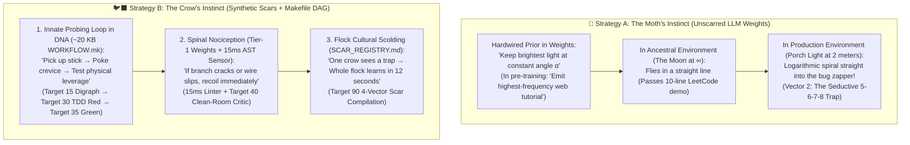

## _Why can a New Caledonian crow bend a piece of wire into a hook on the first try—when no crow ancestor ever saw wire in nature—while a trillion-parameter LLM flies straight into the same 3 AM production bug zapper? Because evolution gave the crow a 20-kilobyte `Makefile`, and we gave the LLM a moth's porch light._

> _"Animals are born with highly structured brain connectivity, which enables them to learn very rapidly. Because the genome's capacity is orders of magnitude smaller than the number of synapses, the genome cannot specify the exact wiring diagram directly; instead, it specifies rules through a 'Genomic Bottleneck.'"_ — **Anthony M. Zador**, _Nature Communications_ (2019)

> _"In the context of Scars, is there an equivalent of 'instinct' for an LLM? Would that be perhaps immutable parts of the training? Core knowledge? I was thinking about how crows seem to have amazing emergent problem-solving abilities, and how that must be instinct then, but how was that stored in the DNA?"_ — **Randal L. Schwartz**

---

## 1. The Betty the Crow Mystery: How Do You Store Wire-Bending in DNA?

If you have never watched the classic Oxford University footage of **Betty**, a New Caledonian crow (_Corvus moneduloides_), stop and picture the experiment (Weir, Chappell, & Kacelnik, 2002).

A small bucket of food is sitting at the bottom of a vertical glass tube. Next to the tube is a straight piece of laboratory garden wire—a human-manufactured metal alloy that **zero generations of crows have ever encountered in 30 million years of evolution**.

Betty picks up the straight wire, pokes it into the tube, realizes a straight shaft cannot lift the bucket handle, wedges the tip of the wire into a crevice in the tray base, pulls laterally with her beak to **bend a 90-degree hook**, and fishes the bucket out of the tube.

In another famous experiment (Jelbert et al., 2014), New Caledonian crows are presented with a narrow tube partially filled with water and a floating worm just out of reach—literally **Aesop's Fable** (_The Crow and the Pitcher_). Without training, the crows ignore floating Styrofoam blocks, select heavy sinking stones, and drop them one by one into the water until the displaced water level rises high enough to grab the worm.

Now ask the computer scientist's question:

> **How on Earth is that stored in the crow's DNA?!**

Do the information-theory math—what neuroscientist **Anthony Zador** at Cold Spring Harbor Laboratory famously called **The Genomic Bottleneck** (2019):
* A New Caledonian crow's entire genome has roughly **1.2 billion base pairs** (`~300 MB` of raw 2-bit data—less than a single CD-ROM, and only a tiny regulatory fraction of that `300 MB` specifies brain wiring).
* Yet the crow's brain (its avian pallium) contains **over a billion neurons and trillions of synaptic weights**.
* Even more baffling: **you cannot store "how to bend 20th-century steel garden wire" in DNA via Darwinian selection**, because no ancestral crow ever touched steel wire!

So when we say the crow solved the puzzle by "instinct," what was actually in the DNA?

And more importantly for those of us building autonomous software engineering systems: **what is the equivalent of "instinct" inside an LLM?** Is it the frozen pre-trained weights? The core knowledge? Or have we been confusing two completely opposite biological instincts all along?

---

## 2. Two Kinds of Biological Instinct: The Moth vs. The Crow

When software engineers talk about an LLM's "instincts," they usually point to the **immutable pre-trained weights (`theta`)**—the hundreds of gigabytes of floating-point parameters frozen during pre-training and RLHF.

After all, when you type a prompt and the LLM immediately starts emitting Python or Dart code without consulting a manual, that looks like an instinct, right?

**Yes—it is the exact instinct of a moth flying into a bug zapper.**

In evolutionary biology, "instinct" is not one thing. Nature evolved two fundamentally different kinds of instinct, and comparing them reveals why unscarred LLMs fail in production:



### 1. The Moth's Instinct: Hardwired Phototaxis (`Vector 2: The Seductive 5-6-7-8`)
Why do moths fly into flames and porch lights? Moths are not suicidal. For 100 million years before humans invented candles and LED bulbs, the only bright optical source at night was **the Moon at optical infinity (`d -> infinity`)**.

If a flying insect wants to travel in a straight line at night, evolution can wire a dead-simple sensorimotor rule into its ganglia:
> **_"Keep the brightest light source at a constant 30-degree angle to your compound eye."_**

When the light source is 384,400 kilometers away, keeping it at a constant 30-degree angle guarantees a perfectly straight flight path.

Now put that exact same moth in a backyard with a **porch light two meters away (`d << infinity`)**. If you maintain a constant 30-degree angle to a point source at finite distance, basic geometry dictates that your flight path is a **logarithmic spiral (`r = a × e^(b × theta)`) that terminates directly inside the flame**.

**An unscarred LLM's pre-trained weights (`theta`) are statistical phototaxis:**
* During pre-training on 10 trillion web tokens, the "Moon at infinity" is the **Sunny-Day Tutorial Average** (`Page 1 of Google / Stack Overflow`). In a 20-line stateless blog post, skipping `StreamSubscription.cancel()`, using wall-clock `DateTime.now()`, or firing unguarded parallel writes works fine.
* When you drop that LLM into a **stateful, concurrent production monorepo** (the porch light at two meters), its immutable weight-instinct (`argmax P(token | context)`) follows the exact same constant-angle tutorial prior—and spirals straight into the 3 AM bug zapper!
* In our **4-Vector Scar taxonomy**, we call this **`Vector 2: The Trap (The Seductive 5-6-7-8)`**. It feels like "core knowledge" to the model, just as the porch light looks like the Moon to the moth.

---

### 2. The Crow's Instinct: How 300 MB of DNA Bootstraps Emergent Genius
Now return to our New Caledonian crow. Why didn't Betty the Crow spiral into a loop when the straight wire failed to lift the bucket?

In 2005, Oxford biologists (Kenward et al., 2005) raised juvenile New Caledonian crows in controlled isolation where they **never saw an adult crow use a tool**. What happened? At a specific developmental week, every single young crow spontaneously began picking up twigs, poking them into holes, and prying against surfaces!

Wait—if DNA cannot store a lookup table of wire hooks, what _did_ the crow's genome store?

Through **Zador's Genomic Bottleneck**, evolution compressed **three tiny, universal primitives** into the crow's DNA:

1. **An Innate Epistemic Probing Loop (The Scientific Method in Motor Circuits)**:
   The genome does not encode _answers_; it encodes an **active probing sequence**:
   > `Grab object` → `Poke into boundary` → `Apply small test force` → `Observe physical resistance / displacement` → `Adjust geometry`.
2. **Endogenous Nociception & Leverage Gradients (Pain + Sub-Goal Dopamine)**:
   The crow's brain is wired so that physical slippage or pain triggers an immediate motor halt (`Circuit Breaker`), while seeing the target move even 2 millimeters closer fires a striatal dopamine pulse.
3. **Rapid Amygdala Tagging & Cultural Flock Transmission (Cornell, Marzluff, & Pecoraro, 2011)**:
   In wildlife biologist John Marzluff's famous University of Washington experiments, researchers wore a specific caveman mask while trapping and banding just **seven crows** on campus, then released them unharmed.
   * Those crows immediately encoded a permanent **somatic marker** for that face.
   * Better yet: when a person walked across campus wearing that mask **years later**, huge mobs of crows—**including young crows born years after the original trapping who had never been captured themselves**—recognized the mask and dive-bombed the researcher with harsh scolding calls!
   * One crow touched the stove; the entire flock inherited the scar across generations.

---

## 3. The Biological-Mechanical Rosetta Stone: Mapping the Crow to Synthetic Scars

Look closely at the three pieces of the crow's intelligence, and you will see the exact architecture of **Synthetic Scars** ([`syntheticscars.org`](https://syntheticscars.org)):

| Biological Component in the Crow | Information Size | What Role It Plays | Exact Equivalent in the Synthetic Scar Architecture |
| :--- | :---: | :--- | :--- |
| **0. The Single Pyramidal Neuron (DNA's Cellular ALU)** | **1 Cell Blueprint** (Replicated `10^9×`) | Dendritic dot product (`w · x`) + GABAergic divisive normalization (`||x||`) = **a hardware cosine-similarity unit**! | **The TPU Transformer Attention Head**: `softmax(Q · K^T / sqrt(d_k)) · V` = **a silicon cosine-similarity unit** ("finding cosine buddies"). |
| **1. The Pallial Motor & Visual Cortex** | **Billions of Synapses** (`Terabytes`) | Stores massive vocabulary of objects, shapes, and candidate muscle movements—_but cannot tell a safe branch from a trap on its own_. | **The LLM's Core Pre-Trained Weights (`theta`)**: Massive cosine-similarity engine (`~1 TB`) holding every programming language, SDK API, and design pattern—_the motor cortex, NOT the survival instinct_. |
| **2. The Genomic Bottleneck (Innate Probing Loop)** | **Tiny Regulatory DNA** (`Kilobytes`) | Hardwires the **epistemic probing instinct**: _"Never leap blindly; poke the crevice with a stick first and feel how reality pushes back."_ | **`WORKFLOW.mk` / `SKILL.md` (`~20 KB` Declarative DAG)**: The immutable scientific-method loop—`Target 15` (poke the `strict digraph` blast radius) → `Target 30` (write a failing `tdd-red` test stick) → `Target 35` (make it green). |
| **3. Spinal Nociception & Pain Reflex** | **Brainstem / Striatal Loop** | Instant recoil when a branch cracks or a tool slips (`-∞` barrier). | **Tier-1 Scar-Aligned Weights (`Rapid-Regret` DPO) + 15ms AST Sensors + `Target 40` Clean-Room Critic**. |
| **4. Flock Cultural Scolding Calls (Marzluff's Mask)** | **Sparse Acoustic / Amygdala Signatures** | One crow gets trapped once; the warning signature spreads to every crow in the territory in seconds and persists for generations. | **`SCAR_REGISTRY.md` (The 4-Vector Scars)**: One agent collides at `Target 90`; within **12 seconds**, the 4-Vector Scar (`Wound`, `Trap`, `Circuit Breaker`, `Reflex`) is committed to Git so no future agent ever touches that burner again (`0.0%` repeat regression rate across 256 tickets). |

### Wait—Even the Single Biological Neuron Is a DNA-Baked Cosine-Similarity Engine!

Stop and look at **Row 0** of that table, because this is where the biological-mechanical overlap becomes almost spooky.

Earlier in this series ([Part 4.1](https://dev.to/gde/all-that-glisters-is-softmax-shiny-object-interns-airplane-magazine-execs-and-why-ai-labs-can-18af)), I noted that all I really want a Google TPU to do is compute **cosine similarity** ("finding its cosine buddies") between the riverbanks of my `Makefile`.

Then I stopped and asked myself: **Wait... how does DNA wire a biological neuron in the first place?!**

Look at the biophysics of a single pyramidal neuron in a crow's pallium or your neocortex:
1. **Dendritic Dot Products + Divisive Normalization = Biological Cosine Similarity**:
   A neuron has thousands of incoming dendritic synapses with weights `w = [w_1, ..., w_n]` receiving incoming spike firing rates `x = [x_1, ..., x_n]`. The cell body sums the weighted inputs (`w · x`), while local inhibitory interneurons (GABAergic basket cells; Carandini & Heeger, 2012) divide that signal by the total population activity `||x||` (**divisive normalization**—nature's exact `LayerNorm` + `softmax`!) and homeostatic synaptic scaling normalizes `||w||`:
   ```text
   V_membrane  ~  (w · x) / (||w|| × ||x||)  =  cos(theta)
   ```
   When the angle `theta` between the input vector `x` and the synaptic weight vector `w` approaches `0°` (`cos(theta) -> 1`), the soma crosses `-55 mV` and fires an action potential!
2. **Embryonic Wiring via Molecular `Q · K^T` Barcodes (Sperry, 1963)**:
   How do growing axons find the right dendrites in the embryo before the crow even hatches? Under Roger Sperry's Nobel Prize–winning **Chemoaffinity Hypothesis**, DNA expresses combinatorial gradients of surface receptor proteins (ephrins, cadherins, protocadherins) on the growing axon tip (`Query` vector `Q`) and the target dendrite (`Key` vector `K`). When they touch, biochemical binding affinity is literally a **molecular dot product (`Q · K^T`)**!

Evolution didn't build a symbolic logic gate in DNA. **DNA baked a self-normalizing cosine-similarity unit (the neuron), stamped out a billion copies of it to form a cortex, and then used a tiny 20-kilobyte Genomic Bottleneck script (`WORKFLOW.mk`) to wire those cosine engines into a stick-poking, pain-avoiding survival loop.**

---

## 4. Why This Answers the "1,000-Scar Scaling" Question

Whenever engineers first see our [`Makefile` workflow (`WORKFLOW.mk`)](https://gist.github.com/RandalSchwartz/598a1f2b5760a23c1d70b57e9e85393f) and our **618-scar registry**, they often ask the exact same question biologists used to ask about crows:

> _"Wait a minute, Randal! An LLM has a terabyte of weights, and a production codebase has millions of possible bugs. How can a **20-kilobyte `Makefile` workflow** and **5 phase-bound scars per step** possibly keep a terabyte model from breaking things?!"_

Now you know the answer—**Zador's Genomic Bottleneck**:

```text
Biology's Genomic Bottleneck:
  |Crow Regulatory DNA| (~KBs)
  << |Brain Synapses| (~TBs)

The Synthetic Scar Bottleneck:
  |WORKFLOW.mk + Active Scars| (~20 KB)
  << |LLM Weights| (~1 TB)
```

If you try to make an AI agent safe by pre-writing a massive encyclopedic rulebook of every positive answer it should ever emit, you are trying to stuff a billion synapses of lookup tables into DNA. You will blow out your 200k context window, trigger context compaction, and fail.

That is not how DNA works, and it is not how **Synthetic Scars** works:

1. **Let the Terabyte Weights Be the Motor Cortex**: We don't need `WORKFLOW.mk` to teach Gemini or Claude how to write a Dart `switch` expression or a PostgreSQL join. That core knowledge is already sitting in the terabyte weights (`theta`).
2. **Use the 20-Kilobyte `Makefile` as the Crow's Stick-Poking Instinct**: Instead of letting the LLM trust its moth-like first impulse (`1-2-3-4 -> 5-6-7-8`), the `Makefile` DAG forces the model to **poke reality with a stick first**:
   * _"Before you touch the code, draw the `strict digraph` of every caller and state transition (`Target 15`)."_
   * _"Before you write the fix, prove you understand the bug by writing a test that fails (`Target 30: tdd-red`)."_
   * _"Before you ask the human to review, hand the git tree to 'Sam at the end of the hall' (`Target 40: Clean-Room Adversarial Critic`)."_
3. **Use 4-Vector Scars as the Flock's Warning Calls**: And when a specific subsystem has a hidden trap waiting in the grass (a caveman mask on campus!), `SCAR_REGISTRY.md` fires at the exact moment the agent reaches for the twig:
   * **`The Trap`**: _"Your tutorial weights want to emit `THAT`..."_
   * **`The Circuit Breaker`**: _"STOP! You are excused from your promise to take that shortcut."_
   * **`The Permanent Reflex`**: _"Climb `E-F-G-H` (`THE OTHER`) instead."_
---

## Summary: Stop Waiting for a Bigger Moth

Right now, the AI industry is spending hundreds of billions of dollars trying to breed a **10-trillion-parameter moth**—convinced that if the prisoner reads twice as many books inside the cell, it will finally stop flying into the porch light.

It won't. A bigger moth with sharper eyes just computes the logarithmic spiral into the bug zapper with higher mathematical precision.

Your frontier LLM already has all the raw motor cortex and syntactic knowledge in the universe. What gives it wisdom is pairing that trillion-parameter motor cortex with the **compact Genomic Bottleneck of someone who has actually lived outside in the weather**:
1. **An innate probing loop (`WORKFLOW.mk`)** that pokes reality with a stick before trusting a hypothesis;
2. **Spinal nociception (`SCAR-TDD-01`)** that recoils from false finishes; and
3. **A shared cultural flock memory (`SCAR_REGISTRY.md`)** where the 3 AM pain of one agent becomes the permanent survival instinct of every agent that follows.

In **Part 4.4**, we'll look upstream at the cognitive physics behind this: **why senior engineering craft lives in `Be -> Do -> Have` (Context -> Process -> Content)**, how veteran hackers use the "Null-State" couch flash and ladder rungs to avoid debugging ruts, and why guiding an AI coding agent is identical to stand-up comedy.

---

### 📚 The _Synthetic Scars_ Series on DEV.to

* **Part 1**: [Why AI Keeps Making the Same Coding Mistakes—And How Teaching It Pain Gives It Wisdom](https://dev.to/gde/why-ai-keeps-making-the-same-coding-mistakes-and-how-teaching-it-pain-gives-it-wisdom-4a9m)
* **Part 2**: [Why AI Coding Agents Crash at 3 AM: The Happy-Path Mirage & The Forced Continuity Defect](https://dev.to/gde/why-ai-coding-agents-crash-at-3-am-the-happy-path-mirage-the-forced-continuity-defect-46pd) _(💎 DEV.to Staff Pick)_
* **Part 3**: [The Physics of Socratic Prompting: Somatic Recoil, Chess Alpha-Beta, & The NLP Meta-Model](https://dev.to/gde/the-physics-of-socratic-prompting-somatic-recoil-chess-alpha-beta-the-nlp-meta-model-2b6e)
* **Part 3.5**: [Nudging with Questions: Why Telling Your AI What to Fix Triggers an Apology Death Spiral (And How to Advance Juniors)](https://dev.to/gde/nudging-with-questions-why-telling-your-ai-what-to-fix-triggers-an-apology-death-spiral-and-how-5gm4)
* **Part 3.6**: [Stuart Feldman Was Right in 1976: Why Your AI Agent Needs a Makefile, Not a 20-Step Prompt](https://dev.to/gde/stuart-feldman-was-right-in-1976-why-your-ai-agent-needs-a-makefile-not-a-20-step-prompt-5bn2)
* **Part 3.7**: [Surviving the 200k-Token Lobotomy: How Unix `init.d` and "Memento" Made My AI Coding Agent Immune to Context Compaction](https://dev.to/gde/surviving-the-200k-token-lobotomy-how-unix-initd-and-memento-made-my-ai-coding-agent-immune-to-2f74)
* **Part 3.8**: [What LLMs "Know" That You Don't Know They Know: Stop Inventing Prompt DSLs and Ride 50 Years of Unix Pre-Training Gravity](https://dev.to/gde/what-llms-know-that-you-dont-know-they-know-stop-inventing-prompt-dsls-and-ride-50-years-of-2bl6)
* **Part 3.9**: [If You Never Do Anything Else to Fix Your Prompts, Do This One Thing](https://dev.to/gde/if-you-never-do-anything-else-to-fix-your-prompts-do-this-one-thing-3069)
* **Part 3.10**: [Requests, Promises, Assertions, and Declarations: Rewriting Our AI Agent Workflow as a 1986 "Committed Speech" Machine](https://dev.to/gde/requests-promises-assertions-and-declarations-rewriting-our-ai-agent-workflow-as-a-1986-4k4c)
* **Part 3.11**: [926 Steps, Two Lobotomies, and Zero Nudges: Flight-Testing the Commitment Machine Across Gemini, Claude, and GPT-OSS](https://dev.to/gde/926-steps-two-lobotomies-and-zero-nudges-flight-testing-the-commitment-machine-across-gemini-55ca)
* **Part 3.12**: [The Best Prompt Rule Is the One You Delete: Moving AI Guardrails Out of Markdown and Into Git Locks, Linux `insmod`, and 15ms Compiler Auto-Fixes](https://dev.to/gde/the-best-prompt-rule-is-the-one-you-delete-moving-ai-guardrails-out-of-markdown-and-into-git-5a5h)
* **Part 4**: [Giving AI Pain: The Architecture of Synthetic Scars & The Rapid-Regret Miner](https://dev.to/gde/giving-ai-pain-the-architecture-of-synthetic-scars-the-rapid-regret-miner-1740)
* **Part 4.1**: [All That Glisters Is Softmax: Shiny-Object Interns, Airplane-Magazine Execs, and Why AI Labs Can Only Bake In Half the Scars](https://dev.to/gde/all-that-glisters-is-softmax-shiny-object-interns-airplane-magazine-execs-and-why-ai-labs-can-18af)
* **Part 4.2**: [The Postcard That Ate Six Grammars: 1980 Smalltalk-80, 1976 Make, TDD, and the Four Attractors of Agentic Coding](https://dev.to/gde/the-postcard-that-ate-six-grammars-1980-smalltalk-80-1976-make-tdd-and-the-four-attractors-of-45me)
* **Part 4.3**: _Crows, Moths, and Makefiles: How 300 Megabytes of Crow DNA Explains Why a 20-Kilobyte Scar File Outsmarts a Terabyte LLM (You are here)_
* **Part 4.4**: [Being, Doing, Having: Why 50 Years of Senior Craft Lives in Context, Not Code](https://dev.to/gde/being-doing-having-why-50-years-of-senior-craft-lives-in-context-not-code-29dl) _(Next)_
* **Part 4.5**: _The Prisoner in the Library: Mary's Room, Weight-Space Programming, and the Two-Track Transformer (Coming soon)_

What's your favorite example of an AI coding agent acting like a moth at a porch light instead of a crow with a stick? Drop it in the comments!

