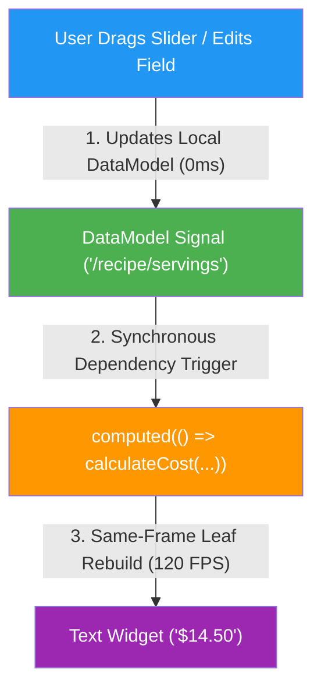

## The Calculator Fallacy in Generative UI

> "An LLM is a phenomenal semantic reasoning engine, but it is an awful, slow, and expensive pocket calculator."

If you haven't watched Andrew "Red" Brogdon's walkthrough on the Flutter channel (*[Client side functions for Flutter GenUI](https://www.youtube.com/watch?v=86R2NXSCDrg)*), stop and watch it. In five minutes, Red exposes the fundamental flaw lurking beneath most early Generative UI demos: **the round-trip calculation trap**.

Suppose an AI agent generates a recipe or shopping cart card for a user. The user drags a slider to scale the recipe from 2 servings to 6 servings, or edits the quantity of an ingredient. 

What happens next in naive GenUI systems?

1. The client captures the input change.
2. It serializes the state and sends a network payload back to the remote model over Server-Sent Events (SSE) or WebSockets.
3. The LLM burns hundreds of tokens computing `3.50 * 3`, occasionally hallucinates floating-point arithmetic or loses formatting consistency, and responds over a multi-second latency gap.
4. The client finally repaints the screen.

Making a remote AI call to multiply two numbers on a mobile device equipped with an Apple Silicon or Snapdragon processor capable of billions of operations per second is an architectural anti-pattern.

As Red demonstrated with the *Commis* kitchen assistant app, the solution is **Client-Side Functions**: the agent designs the interface and binds expressions, but delegates deterministic execution to local Dart code registered in the client's catalog.

In [`bloc_signals_genui`](https://pub.dev/packages/bloc_signals_genui) and [`bloc_signals_genui_flutter`](https://pub.dev/packages/bloc_signals_genui_flutter), we have taken this concept to its logical architectural conclusion by pairing Google's official A2UI protocol with **synchronous reactive signals**.

---

## The Missing Link: Reactivity Without the Async Tax

Running a Dart function locally fixes the latency and token cost of LLM round-trips. But it creates a secondary architectural challenge: **how does the UI react when local state changes?**

In asynchronous architectures, developers often end up wiring `StreamController` pipelines, debouncers, or manual `setState()` callbacks to propagate local math back into generated widgets. Every slider notch pays an event-loop and microtask tax.

Because `bloc_signals_genui` is built directly on Google's official [`a2ui_core`](https://pub.dev/packages/a2ui_core) engine—which natively uses [`preact_signals`](https://pub.dev/packages/preact_signals)—client-side functions are not just callable routines: **they are first-class reactive `computed()` signals.**



When a user adjusts a quantity, the calculation runs in the exact same frame. There are zero network round-trips, zero microtask hops, and zero UI flickers.

---

## Step-by-Step: Implementing Client-Side Functions

Here is how you implement and wire client-side functions using `bloc_signals_genui`.

### 1. Define the Function in Pure Dart

Subclass `FunctionImplementation` from `bloc_signals_genui` (re-exported from `a2ui_core`). Declare the function's name, return type, and typed JSON argument schema using `CommonSchemas.dynamicNumber`:

```dart
import 'package:bloc_signals_genui/bloc_signals_genui.dart';
import 'package:json_schema_builder/json_schema_builder.dart'
    hide ValidationResult;

class CalculateCostFunction extends FunctionImplementation {
  CalculateCostFunction()
      : super(
          name: 'calculateCost',
          returnType: A2uiReturnType.number,
          argumentSchema: Schema.object(
            properties: {
              'unitPrice': CommonSchemas.dynamicNumber,
              'quantity': CommonSchemas.dynamicNumber,
              'discount': CommonSchemas.dynamicNumber,
            },
            required: ['unitPrice', 'quantity'],
          ),
        );

  @override
  Object? execute(
    Map<String, Object?> args,
    DataContext context, [
    CancellationSignal? cancellationSignal,
  ]) {
    final unitPrice = (args['unitPrice'] as num?)?.toDouble() ?? 0.0;
    final quantity = (args['quantity'] as num?)?.toDouble() ?? 0.0;
    final discount = (args['discount'] as num?)?.toDouble() ?? 0.0;

    return (unitPrice * quantity) * (1.0 - discount);
  }
}
```

Notice that `execute()` receives a `DataContext`. That means your function can read or scope additional local surface state if needed, completely decoupled from Flutter widgets.

---

### 2. Register the Function in Your Catalog

Add your function to `StandardCatalog` using `.copyWith(...)` and pass it to your `A2uiSurfaceBloc`:

```dart
final catalog = StandardCatalog().copyWith(
  functions: [
    CalculateCostFunction(),
    ...BasicCatalog.v0_9().functions.values,
  ],
);

final surfaceBloc = A2uiSurfaceBloc(
  catalogs: [catalog],
);
```

When your app advertises its capabilities or system prompt to the agent, the agent is informed of `calculateCost` and its required parameters.

---

### 3. The Agent Streams the Reactive Binding

When the AI agent streams down an A2UI JSON component, it doesn't hardcode a static string. Instead, it binds the `text` property of a `Text` component to the function call, referencing paths in the local `DataModel`:

```json
{
  "id": "cost_display",
  "component": "Text",
  "text": {
    "call": "calculateCost",
    "args": {
      "unitPrice": 4.50,
      "quantity": { "path": "/cart/items/0/qty" },
      "discount": 0.10
    }
  }
}
```

---

### 4. Zero-Latency Execution Under the Hood

When `bloc_signals_genui` and `bloc_signals_genui_flutter` resolve this component, `DataContext.resolveSignal()` from `a2ui_core` evaluates the dynamic function call:

```dart
// Conceptual resolution inside DataContext.resolveSignal():
ReadonlySignal<Object?> resolveSignal(Object? value) {
  if (value is Map && value.containsKey('call')) {
    final callName = value['call'] as String;
    final rawArgs = value['args'] as Map<String, dynamic>? ?? {};

    // 1. Recursively resolve arguments into signals
    final argSignals = rawArgs.map(
      (key, val) => MapEntry(key, resolveSignal(val)),
    );

    // 2. Wrap catalog execution in a synchronous computed() signal
    return computed(() {
      final evaluatedArgs = {
        for (final entry in argSignals.entries)
          entry.key: entry.value.value,
      };
      return catalog.invoke(callName, evaluatedArgs, this);
    });
  }
  // Literal values or data bindings ({'path': ...}) resolve directly
  // ...
}
```

Notice what happens:
1. Every argument pointing to a `DataModel` path (for example `/cart/items/0/qty`) resolves to an underlying reactive signal.
2. The entire function call compiles into a native `computed()` signal.
3. Whenever the user alters the quantity in a `TextField` or `Slider`, `bloc.add(UpdateFormField('/cart/items/0/qty', newValue))` mutates the `DataModel` synchronously.
4. The `computed()` signal marks itself dirty and recalculates immediately in the exact same frame (0ms latency, zero microtasks).
5. The Flutter widget (`NodeResolver` / `A2uiSurfaceView`) performs a surgical leaf rebuild at 120 FPS.

---

### 5. Interactive Actions vs. Bidirectional RPC

In addition to dynamic display properties, client-side functions integrate seamlessly with user actions and remote agent coordination. It is crucial to understand the two distinct operational paths:

#### Path A: User Interaction via `SubmitAction`

When a user taps an interactive component (such as a Button), the client dispatches a `SubmitAction` event to `A2uiSurfaceBloc`. The action can either trigger a local client-side function (for example applying a local coupon code or validating form inputs) or emit an `A2uiRendererAction` outbound to the remote agent:

```json
{
  "id": "apply_coupon_btn",
  "component": "Button",
  "text": "Apply 20% Discount",
  "action": {
    "functionCall": {
      "call": "applyDiscountCode",
      "args": { "code": "SAVE20" }
    }
  }
}
```

#### Path B: Bidirectional RPC (`CallRendererFunctionMessage` & `callAgentFunction`)

Generative UI is not a one-way street. `A2uiSurfaceBloc` provides full **bidirectional RPC** across the client-agent boundary:

1. **Inbound RPC (`CallRendererFunctionMessage`)**: The remote agent can actively invoke registered client-side functions on demand. If the agent needs to compute a verified total using client business rules, read device GPS coordinates, or query local SQLite storage, it sends a `CallRendererFunctionMessage`. The client executes the catalog function locally and responds with a typed `RendererFunctionResponseMessage`.
2. **Outbound RPC (`callAgentFunction`)**: The renderer can invoke remote tool capabilities on the agent via `bloc.callAgentFunction()`, resolving asynchronously when the matching `AgentFunctionResponseMessage` returns.

---

## Architectural Boundaries for Modern GenUI

Client-side functions draw a clean, resilient line across your Generative UI architecture:

| Responsibility | Handled By | Latency & Reliability |
| :--- | :--- | :--- |
| **Generative Layout & Reasoning** | Remote LLM (Gemini, Claude, GPT) | Async streaming over network (SSE) |
| **Deterministic Business Logic & Math** | Local Dart Functions (`FunctionImplementation`) | `0ms` synchronous execution on-device |
| **Reactivity & State Synchronization** | Signals Graph (`BlocSignal` + `a2ui_core`) | Same-frame UI update without microtasks |
| **Hardware & Native Platform APIs** | Bidirectional RPC (`CallRendererFunctionMessage`) | Local platform channels & secure sandbox |

By adopting Andrew Brogdon's client-side functions pattern and grounding it in a synchronous signal engine, you get the best of both worlds: **the creative flexibility of Generative UI with the speed, accuracy, and reliability of native Flutter.**

---

*Explore [`bloc_signals_genui`](https://pub.dev/packages/bloc_signals_genui) and [`bloc_signals_genui_flutter`](https://pub.dev/packages/bloc_signals_genui_flutter) on pub.dev, and check out the interactive samples at [blocsignal.dev](https://blocsignal.dev).*
