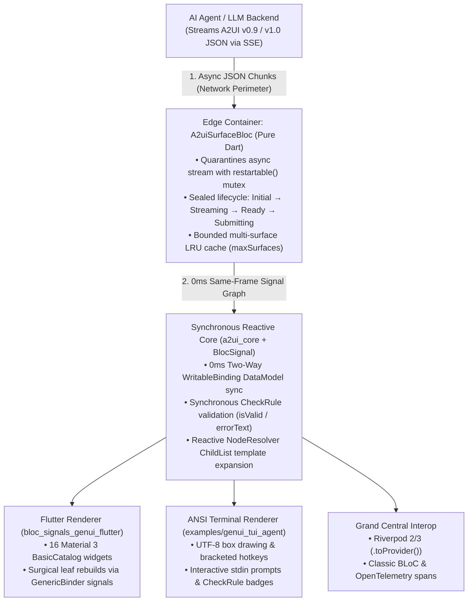

## Wait—Another Generative UI Package?

> "An asynchronous network stream belongs at the perimeter of your architecture; once an AI agent's UI lands on the client, every keystroke, validation rule, and leaf rebuild should execute in 0ms on a synchronous signal graph."
> — Randal L. Schwartz

When you see a new Generative UI announcement for Dart and Flutter, your first reaction is probably healthy skepticism: *Do we really need another GenUI wrapper?*

Most Generative UI prototypes stop at the initial parlor trick: an LLM streams a JSON payload over Server-Sent Events (SSE), a widget tree appears on screen, and everyone claps. The architectural cracks appear five seconds later when a user tries to interact with that generated interface:

* **The Everything-Is-Async Tax**: Because the LLM response arrives over an asynchronous network stream, most GenUI libraries wire the entire client lifecycle through `StreamBuilder`, `async*` generators, or asynchronous controller notifications. Every keystroke in a generated text field, every cross-field validation check, and every widget test pays a microtask and frame-delay tax.
* **Framework Lock-In**: Most GenUI state engines are coupled directly to `package:flutter/widgets.dart` (`BuildContext`, `Widget`, `ChangeNotifier`), making it impossible to run or test the agent state machine in pure Dart, CLI tools, or terminal interfaces—and forcing you to adopt a bespoke state management paradigm that clashes with your existing Riverpod or `flutter_bloc` app.

Today, we are publishing **v1.0.0** of [`bloc_signals_genui`](https://pub.dev/packages/bloc_signals_genui) and [`bloc_signals_genui_flutter`](https://pub.dev/packages/bloc_signals_genui_flutter) on pub.dev. Here is what sets them apart:

* **100% Compliant with Google's Emerging A2UI Protocol**: Built directly on Google's official [`package:a2ui_core`](https://pub.dev/packages/a2ui_core) (`^0.3.0`) library from the [`a2ui-project/a2ui`](https://github.com/a2ui-project/a2ui) specification (`v0.9.1` and `v1.0`).
* **0ms Synchronous Core & Live Two-Way Form Bindings**: The async SSE stream is quarantined at the edge. Once on the client, two-way `WritableBinding` form inputs, synchronous `CheckRule` validation, and `NodeResolver` list templates execute in `0ms` in the exact same frame.
* **True Pure-Dart Decoupling (From Flutter to Terminal TUIs)**: `bloc_signals_genui` has zero Flutter dependencies. The exact same `A2uiSurfaceBloc` state machine drives both a 120 FPS Material 3 Flutter app and an interactive ANSI Terminal User Interface (TUI).
* **Universal Interop (Keep Your Riverpod or Classic BLoC Core)**: Through [`bloc_signals_riverpod`](https://pub.dev/packages/bloc_signals_riverpod) and [`bloc_signals_bloc`](https://pub.dev/packages/bloc_signals_bloc), you can drop A2UI surfaces straight into an existing Riverpod or classic BLoC codebase without rewriting your architecture.

---

## Foundation: Official A2UI Compliance and Shared Reactive DNA

We avoided inventing a custom JSON schema or maintaining a divergent protocol parser. Both packages build directly on Google's official [`package:a2ui_core`](https://pub.dev/packages/a2ui_core) Dart SDK for the **A2UI (Agent-to-User Interface)** protocol. (We even contributed upstream in [`a2ui-project/a2ui#2819`](https://github.com/a2ui-project/a2ui/pull/2819) to lower `a2ui_core`'s minimum SDK constraint to Dart `^3.5.0`, opening the official A2UI engine to the entire Flutter `3.24+` ecosystem.)

When inspecting `a2ui_core` under the hood, one architectural detail stands out immediately: **Google's `a2ui_core` already standardizes on [`preact_signals`](https://pub.dev/packages/preact_signals) for its internal `DataModel`, `GenericBinder`, and reactive path bindings.**

Wrapping a signal-powered protocol engine inside asynchronous `StreamController` pipes adds unnecessary translation layers. Because [`BlocSignal`](https://pub.dev/packages/bloc_signals) is built on the exact same reactive signal primitives, `bloc_signals_genui` connects to `a2ui_core` with zero impedance mismatch:



---

## Pillar 1: A Synchronous Core with Live Two-Way Form Bindings

In a real application, an AI-generated surface functions as a live interactive form, not a static poster. When a flight-booking agent streams a checkout card, the user still needs to type passenger names, toggle baggage checkboxes, pick seat classes, and see instant validation feedback before submitting their selection back to the agent.

`bloc_signals_genui` and `bloc_signals_genui_flutter` support the full 16-component A2UI `BasicCatalog` (`Text`, `Row`, `Column`, `List`, `Tabs`, `Modal`, `Card`, `Divider`, `Icon`, `Image`, `Button`, `TextField`, `CheckBox`, `ChoicePicker`, `Slider`, and `DateTimeInput`) with four synchronous capabilities:

### 1. Two-Way `WritableBinding` Synchronization in `0ms`
When an A2UI component binds a property to a JSON Pointer path in the surface's `DataModel` (for example, `{"path": "/user/name"}` in `v0.9` or `{"@path": "/user/name"}` in `v1.0`), `A2uiComponentContext` exposes `resolveBoundPath` and `updateBoundValue`. Typing into an `A2uiTextField`, sliding an `A2uiSlider`, or picking a chip in `A2uiChoicePicker` mutates the underlying `DataModel` signal synchronously in `0ms`. Only the leaf widget observing that path rebuilds—leaving the parent surface scaffold untouched.

### 2. Same-Frame `CheckRule` Validation UI
A2UI allows components to declare client-side `checks` rules right in the wire JSON. As the user edits a bound field, `GenericBinder` evaluates those `CheckRule` conditions synchronously on every keystroke. `A2uiComponentContext` exposes `isValid` and `validationErrors`, displaying inline `errorText` on invalid inputs and automatically disabling `A2uiButton` submissions (`onPressed: null`) in the exact same frame when required checks fail—with zero LLM round-trips.

### 3. Data-Driven `NodeResolver` List Templates
Instead of burning LLM output tokens streaming 20 repetitive component subtrees for a list of flights, the agent streams a single template component (`flight_card`) and a `ChildList` binding (`{"componentId": "flight_card", "path": "/flights"}`). `A2uiSurfaceView` mounts `a2ui_core`'s `NodeResolver` to dynamically expand and scope each item's data context (`/flights/0`, `/flights/1`, ...) reactively as array elements stream in.

### 4. Bidirectional RPC (`RpcHandler`)
Beyond standard action submissions (`SubmitAction`), `A2uiSurfaceBloc` wires `MessageProcessor.rpc` so the agent can invoke client-side renderer functions (`CallRendererFunctionMessage`) and your Dart code can invoke agent-side functions via `bloc.callAgentFunction(...)` with built-in timeout and lifecycle cancellation safety.

```dart
import 'package:bloc_signals_genui/bloc_signals_genui.dart';

// 1. Create the pure-Dart A2UI state machine
final surfaceBloc = A2uiSurfaceBloc(
  maxSurfaces: 10,
  maxResponseHistory: 100,
);

// 2. Ingest an incoming A2UI v0.9 stream (quarantined by restartable())
surfaceBloc.add(IngestStream(llmChunkStream));

// 3. Mutate bound form fields synchronously in 0ms
surfaceBloc.add(
  const UpdateFormField(
    path: '/user/name',
    value: 'Randal L. Schwartz',
  ),
);
```

And because state transitions and form bindings are synchronous, your Flutter widget tests verify updates in a single `tester.pump()` without waiting on `pumpAndSettle()` microtask queues.

---

## Pillar 2: Streamless Concurrency and Production Scars Built In

Streaming UI from an LLM introduces failure modes that traditional CRUD screens never encounter:

1. **Impatient Users & Mid-Stream Interruptions (`restartable()`)**: What happens when an agent is halfway through streaming a complex itinerary surface and the user changes their mind and sends a new prompt? In naive stream setups, both streams interleave and corrupt the component tree. `A2uiSurfaceBloc` guards `IngestStream` with BlocSignal's streamless `restartable()` mutex transformer—subscribing to the replacement stream, preempting the stale stream immediately, and cleaning up resources without race conditions.
2. **Zero-Chunk Stream Failures & Turn-Alternation Protection**: Conversational APIs (such as Google Gemini and Firebase Genkit) enforce strict `user` → `model` turn alternation. If your app optimistically appends a user prompt to chat history and the network drops *before the first SSE chunk arrives* (`chunkCount == 0`), leaving that unfulfilled user turn in history causes the user's next retry to crash with `INVALID_ARGUMENT: Consecutive user turns are not allowed`. Our architecture and reference apps bake in transactional zero-chunk turn pruning out of the box.
3. **Multi-Surface Navigation & Bounded LRU Eviction**: Agents frequently spawn multiple surfaces across a conversation (main workspace, comparison cards, detail modals). `A2uiSurfaceBloc` separates navigation coordinates (`activeSurfaceId`, a `0ms` `ReadonlySignal<String?>`) from per-surface content revisions (`_surfaceVersions`), so switching tabs via `SelectSurface` never triggers redundant binder rebuilds in split-pane views—while `maxSurfaces` automatically evicts the least-recently-used non-active surfaces so long sessions never leak memory.

---

## Pillar 3: Pure-Dart Decoupling—Running the Exact Same Agent in a Terminal TUI

Because `bloc_signals_genui` has **zero dependency on Flutter**, your entire Generative UI state machine can run in CLI tools, backend Dart servers, automated test harnesses, or terminal applications.

To prove this architecture in the monorepo, we built two complete reference applications powered by the exact same `A2uiSurfaceBloc` and `BasicCatalog` payloads:

1. **[`examples/genui_flight_booking`](https://github.com/RandalSchwartz/BlocSignal/tree/main/examples/genui_flight_booking)**: A Material 3 Flutter application rendering `ChoicePicker` seat chips, `CheckBox` preferences, `DateTimeInput` pickers, `NodeResolver` flight card templates (`/flights`), `CheckRule` passenger validation, and `assignPreferredSeat` RPC calls.
2. **[`examples/genui_tui_agent`](https://github.com/RandalSchwartz/BlocSignal/tree/main/examples/genui_tui_agent)**: An interactive ANSI Terminal User Interface (TUI) inspired by `agy-cli` that renders those exact same 16 `BasicCatalog` components, template paths, and `CheckRule` validation badges using UTF-8 box-drawing characters (`┌─┐`, `│`, `└─┘`), interactive `stdin` prompts, and bracketed action hotkeys (`[1] Search Flights`).

```bash
# Run the interactive ANSI Terminal TUI agent in pure Dart:
dart run examples/genui_tui_agent/bin/main.dart --mock
```

Decoupling the A2UI state machine from the renderer means you can verify and fuzz-test complex multi-turn agent flows in pure `dart test` in milliseconds, without spinning up a simulator or headless browser.

---

## Pillar 4: "Grand Central Station" Interop—Keep Your Riverpod or Classic BLoC Core

Adopting a Generative UI library should not require rewriting your application's existing state management architecture.

Because `A2uiSurfaceBloc` extends `BlocSignal`, it plugs directly into the rest of the 13-package BlocSignal ecosystem:

* **Using Riverpod? Keep Your Riverpod Core**: Add [`bloc_signals_riverpod`](https://pub.dev/packages/bloc_signals_riverpod) and call `.toProvider(autoClose: true)` on `A2uiSurfaceBloc`. Your Riverpod `ConsumerWidget`s and providers can watch the A2UI surface state or dispatch events through `ref` while `A2uiSurfaceView` handles the granular signal rendering:

```dart
import 'package:bloc_signals_genui/bloc_signals_genui.dart';
import 'package:bloc_signals_riverpod/bloc_signals_riverpod.dart';
import 'package:riverpod/riverpod.dart';

// Expose A2uiSurfaceBloc as a native Riverpod NotifierProvider
final surfaceBloc = A2uiSurfaceBloc(maxSurfaces: 5);
final a2uiSurfaceProvider = surfaceBloc.toProvider(autoClose: true);

// Inside any Riverpod consumer:
// final surfaceState = ref.watch(a2uiSurfaceProvider);
// ref.read(a2uiSurfaceProvider.notifier).bloc.add(IngestStream(stream));
```

* **Using Classic `flutter_bloc`? Bridge It cleanly**: Use [`bloc_signals_bloc`](https://pub.dev/packages/bloc_signals_bloc) to bridge events and states bidirectionally with classic `Bloc` and `Cubit` instances.
* **Want Production Telemetry? Attach OpenTelemetry & DevTools**: Drop in [`bloc_signals_otel`](https://pub.dev/packages/bloc_signals_otel) and [`bloc_signals_devtools`](https://pub.dev/packages/bloc_signals_devtools) to trace every A2UI stream ingestion, chunk transition, and `restartable()` preemption span in OpenTelemetry and the Flutter DevTools extension with zero changes to your UI code.

---

## Get Started Today

Both `bloc_signals_genui` (`1.0.0`) and `bloc_signals_genui_flutter` (`1.0.0`) are live on pub.dev with 100% test coverage and full support for Dart `3.5+` through Dart `3.13+`:

```bash
# For pure-Dart, CLI, or TUI applications:
dart pub add bloc_signals_genui bloc_signals

# For Flutter applications:
flutter pub add bloc_signals_genui_flutter bloc_signals_genui bloc_signals_flutter
```

In follow-up articles in this series, we will dive deeper into each of these four pillars—including a hands-on walkthrough of building two-way validated A2UI forms with `WritableBinding` and `CheckRule`, wiring `NodeResolver` templates, and building headless/TUI agent runners in pure Dart.

### Links & Resources
* **pub.dev**: [`bloc_signals_genui`](https://pub.dev/packages/bloc_signals_genui) | [`bloc_signals_genui_flutter`](https://pub.dev/packages/bloc_signals_genui_flutter) | [`a2ui_core`](https://pub.dev/packages/a2ui_core)
* **Documentation Hub**: [`blocsignal.dev/docs/pkg-genui`](https://blocsignal.dev/docs/pkg-genui) & [`blocsignal.dev/docs/pkg-genui-flutter`](https://blocsignal.dev/docs/pkg-genui-flutter)
* **GitHub Monorepo & Examples**: [`RandalSchwartz/BlocSignal`](https://github.com/RandalSchwartz/BlocSignal) ([`genui_flight_booking`](https://github.com/RandalSchwartz/BlocSignal/tree/main/examples/genui_flight_booking) & [`genui_tui_agent`](https://github.com/RandalSchwartz/BlocSignal/tree/main/examples/genui_tui_agent))
