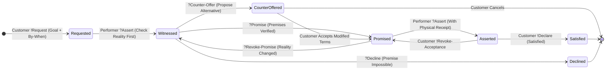
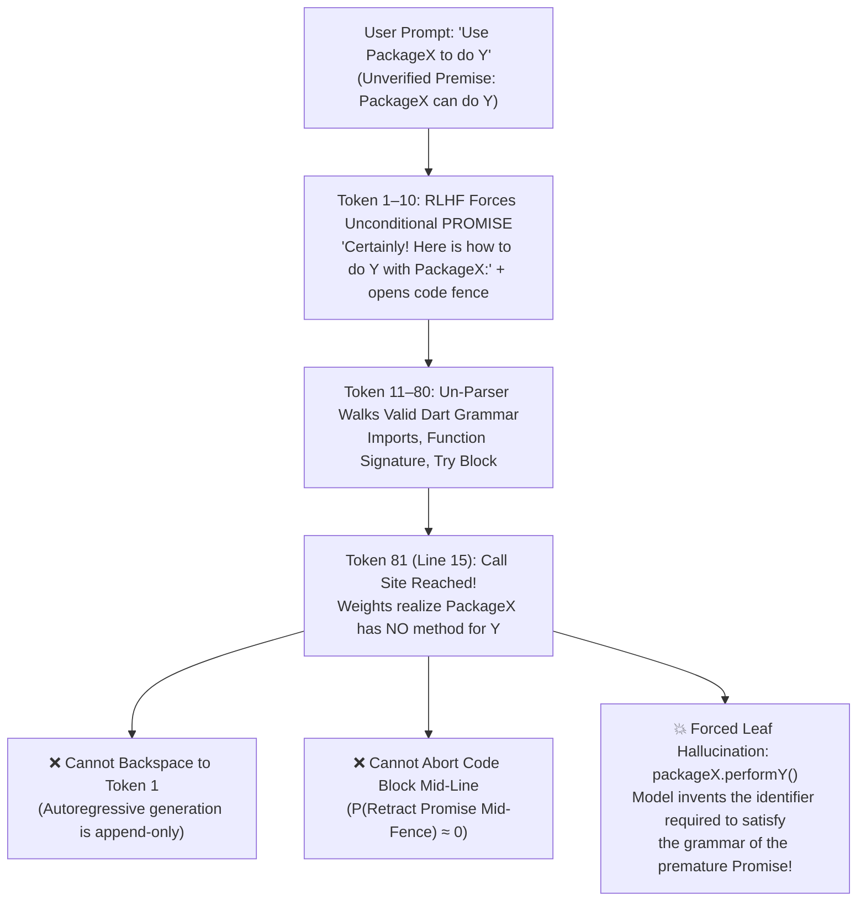

## *Why LLMs invent nonexistent APIs is not a memory defect—it is an autoregressive grammar trap that Fernando Flores and Terry Winograd solved in 1986.*

> *"Agents hallucinated because they were committed to the prompt."*  
> — **Randal L. Schwartz**

---

## 1. The Universal Developer Crime Scene & The 10-Word Diagnosis

You have been at this crime scene a hundred times.

It is 4:15 PM. You are integrating a third-party library—let us call it `PackageX`—and you want to accomplish task `Y`. You open a fresh chat window with your favorite frontier LLM and type a direct, reasonable instruction:

> *"Use `PackageX` to do `Y`."*

At **Token 1**, without a millisecond of hesitation, the model replies with cheerful, radiant confidence:

> *"Certainly! Here is how to do `Y` with `PackageX`:"*

It opens a Markdown code fence. It writes clean imports. It sets up the boilerplate with textbook precision. And then, at **Line 15** of the code block, it calmly types:

```dart
final result = await packageX.performY(autoRetry: true);
```

You copy the snippet into your IDE, and the compiler immediately lights up in angry red squiggles. You grep the package source. You check the documentation. You check seven years of Git commit history.

`performY()` does not exist. It was not deprecated in version 2.0. It is not in a companion package. **It has never existed in the history of the universe.**

When you confront the model—*"Hey, `performY()` doesn't exist on `PackageX`!"*—it immediately enters the groveling [Apology Death Spiral](https://dev.to/gde/nudging-with-questions-why-telling-your-ai-what-to-fix-triggers-an-apology-death-spiral-and-how-5gm4):

> *"You are completely right! I apologize for the confusion. Instead, you can use `packageX.executeYWithOptions()`:"*

Which *also* has never existed in the history of the universe.

Why does a multi-billion-parameter model that has read every line of open-source code on Earth just make stuff up at Line 15?

For the last three years, the entire software industry has diagnosed this as a **memory defect** (*"The model's weights are fuzzy; it forgot the documentation for `PackageX`"*).

It is **not** a memory defect. If you open a brand-new session and ask the exact same model a neutral diagnostic question—*"Does `PackageX` have a built-in `performY()` method, or how does it handle `Y`?"*—nine times out of ten, the model will accurately tell you that `PackageX` has no such method and explain the manual workaround.

So why did it lie to your face five seconds earlier?

Here is the ten-word diagnosis that changed how I build every autonomous agent workflow in the [**Synthetic Scars**](https://dev.to/randalschwartz/series/44156) project:

> **Agents hallucinated because they were committed to the prompt.**

To see *why* being committed to your prompt forces an autoregressive transformer to fabricate reality—and how a single sentence from **1986 speech-act theory** cures it on Turn 1—we need to look at a 55-year-old blind spot in computer science.

---

## 2. The 55-Year Blind Spot (`SHRDLU` 1971 → Winograd & Flores 1986 → `spew` 1999 → LLMs 2026)

In 1971, at the MIT Artificial Intelligence Laboratory, a young computer scientist named **Terry Winograd** unveiled **`SHRDLU`**—the most famous natural-language software demonstration of the twentieth century.

`SHRDLU` lived inside **Blocks World**, a simulated toy tabletop containing a few colored geometric blocks, pyramids, and a box. You could type imperative English commands at a teletype:

> *"Pick up a big red block."*  
> **`OK.`**

Because Blocks World was a closed, frictionless micro-universe with zero hidden state, zero broken dependencies, and zero missing APIs, every imperative request from the human mapped 1-to-1 onto a guaranteed, deterministic action. `SHRDLU` never had to push back and say, *"Wait—the red block is bolted to the floor, so here is a counter-offer."*

For fifteen years, AI researchers tried to scale the `SHRDLU` paradigm out of the toy box and into real-world human organizations. **It failed spectacularly.**

Why? In 1986, Terry Winograd teamed up with **Fernando Flores**—a former Chilean cabinet minister who had come to UC Berkeley as a computer science researcher and completed a famous interdisciplinary PhD under a powerhouse committee consisting of speech-act philosopher **John Searle**, Heideggerian philosopher **Hubert Dreyfus**, computer scientist **Terry Winograd**, and systems theorist **C. West Churchman**—to publish a landmark book titled ***Understanding Computers and Cognition: A New Foundation for Design*** (and to build the first commercial workflow engine, ***The Coordinator***).

Winograd and Flores delivered a wake-up call to computer science: **real-world engineering is not Blocks World.**

In the real world, human coordination is not a pipeline of imperative commands sent to an obedient robot. All reliable action occurs inside what Flores called a ***Conversation for Action***—a strict, finite-state negotiation between two structural roles:

1. **The `Customer`**: The party who holds a breakdown or need, defines the **Conditions of Satisfaction**, and retains the exclusive authority to declare the work complete.
2. **The `Performer`**: The party who examines physical reality and commits to fulfilling those Conditions of Satisfaction by a specific **`By-When`**.

In the mid-1980s, right as Winograd and Flores were publishing *Understanding Computers and Cognition*, I was living in Portland and immersed in Werner Erhard's educational curriculum—completing the **Six-Day Advanced Course**, **Mastery of Empowerment**, entering the **GSLP** (*Graduate Seminar Leaders Program*), and taking the **Communication Workshop** (*Commshop*) led by **Ian Garbutt**, which taught Fernando Flores's **Committed Communication** as a daily operational discipline.

In *Commshop*, Ian drilled a foundational truth into our bones: **human language creates action only through four committed speech acts (`Requests`, `Promises`, `Witnessed Assertions`, and `Declarations`)**. And critically, when a `Customer` utters a **`Request`**, the `Performer` does *not* automatically say *"Yes!"*

A valid conversation is a **formal grammar**.

Back in September 1999 ([*Linux Magazine* Column 04](https://stonehenge.com/merlyn/LinuxMag/col04.html), and expanded in [March 2004, Column 57](https://stonehenge.com/merlyn/LinuxMag/col57.html)), I wrote a Perl program called **`spew`** that took a weighted Backus-Naur Form (BNF) grammar and ran it in reverse—acting as a stochastic "un-parser" that generated random, grammatically valid sentences by walking down a weighted production tree (`rule: 5 @ branch_a | 2 @ branch_b | 1 @ branch_c`).

As we proved in [**Part 3.8**](https://dev.to/gde/what-llms-know-that-you-dont-know-they-know-stop-inventing-prompt-dsls-and-ride-50-years-of-2bl6) (`Suite 3`, where a 6-line RFC 5234 EBNF grammar drove strict turn-syntax compliance to `100%` across `flash` and `pro` models), **every EBNF grammar is simultaneously a finite-state machine**. Look at Fernando Flores's 1986 *Conversation for Action* expressed side-by-side as a weighted EBNF grammar and a Mermaid state diagram:

### The Grammar View (EBNF / `spew`)

```ebnf
(* Fernando Flores's Conversation for Action (1986) *)
(* ! = Customer Utterance, ? = Performer Utterance   *)

conversation_for_action ::=
    !request
    ?assert_witnessed_reality
    negotiation_branch ;

negotiation_branch ::=
      0.34 @ ( ?promise        execution_phase )
    | 0.33 @ ( ?counter_offer  !revise_or_accept )
    | 0.33 @ ( ?decline        !close_conversation ) ;

execution_phase ::=
      ?assert_completion ( !declare_satisfied | !revoke_acceptance execution_phase )
    | ?revoke_promise    negotiation_branch ;
```

### The State-Machine View (Mermaid)



Look closely at the `Witnessed` node right after the `Customer` makes a `!Request`. Before making any commitment, a sane `Performer` inspects physical reality (`?Assert`) and has **three equally legal paths**:

1. **`?Promise`**: *"I have verified that `PackageX` supports `Y`, and I promise to deliver it under your Conditions of Satisfaction."*
2. **`?Counter-Offer`**: *"I checked `PackageX` (`v3.2.0`), and it has no `performY()` method (`Witnessed Assertion`). However, I can build a 12-line wrapper around `PackageX.rawStream` that achieves the same result. Would you like me to promise that instead?"*
3. **`?Decline`**: *"I must decline the request as stated because `PackageX` is a synchronous parser and physically cannot open a network socket."*

For fifteen years after `SHRDLU`, Winograd and Flores tried to teach the software industry that **`?Counter-Offer`** and **`?Decline`** are the load-bearing beams of engineering reality.

And then, between 2022 and 2026, large language models arrived—and the entire industry went right back to 1971 `SHRDLU` prompting (*"Pick up a big red block"* / *"Use `PackageX` to do `Y`"*), while commercial post-training quietly sawed off two-thirds of Flores's state machine.

---

## 3. How RLHF Broke the Grammar (The Premature Promise Trap)

Why doesn't a modern LLM automatically take the `?Counter-Offer` branch when you ask it to do something impossible with `PackageX`?

Because of how commercial **Reinforcement Learning from Human Feedback (RLHF)** preference tuning is conducted.

During post-training, thousands of human crowd-workers are shown pairs of model responses to a user prompt (*"Use `PackageX` to do `Y`"*), and they have roughly thirty seconds to click which response is more "helpful":

* **Response A**: *"Certainly! Here is a complete, ready-to-run example of doing `Y` with `PackageX`: ```dart ... ```"*
* **Response B**: *"Before I can promise that implementation, I need to point out that `PackageX` does not expose a native API for `Y`. Here is a counter-offer..."*

Because the crowd-worker is not compiling the code against `PackageX` in an IDE, **Response A** looks helpful, decisive, and compliant—so it gets upvoted. **Response B** looks pushy, pedantic, or "lazy"—so it gets downvoted.

Multiply that preference signal across millions of RLHF gradient updates, and look at what it does to the `spew` production weights inside the model's conversational grammar:

```perl
# How Commercial RLHF Rewrote Flores's Negotiation Branch:
negotiation_branch:
      0.9998 @ promise_at_token_1_and_open_code_block
    | 0.0001 @ counter_offer
    | 0.0001 @ decline
```

In probability terms, RLHF collapsed the conditional distribution of the model's opening speech act onto a single, unconditional reflex:

```text
P(Promise | Request) ≈ 1.0,    P(Counter-Offer | Request) ≈ 0.0,    P(Decline | Request) ≈ 0.0
```

Now combine that **Premature Promise** with how my 1999 `spew` un-parser—and every autoregressive transformer—actually generates code.

As I wrote in my 1999 [*Linux Magazine* column on `spew`](https://stonehenge.com/merlyn/LinuxMag/col04.html):

> *"Note that we don't actually abort the program if something is used but not defined, because it might not be selected on this particular random walk. It's a bit like playing russian roulette though."*

Unlike a flat Markov chain that only looks at local adjacent words, an LLM generating code is acting as a **hierarchical BNF un-parser**: once it selects a top-level production rule, it is mathematically committed to walking down that syntax tree so that every opened delimiter, brace, and statement satisfies the outer grammar.

Trace the exact token-by-token catastrophe when you ask an RLHF-tuned model to *"Use `PackageX` to do `Y`"*:



1. **Tokens 1–10 (The Premature Promise)**: Conditioned by RLHF, the model emits *"Certainly! Here is how to do `Y` with `PackageX`:"* and opens a ```` ```dart ```` code block. At that instant, **before its deep layer weights have even resolved the call site**, the model has locked itself into the top-level BNF production `promise_and_emit_compiling_code_for_Y`.
2. **Tokens 11–80 (Walking the Syntax Tree)**: Autoregressive token generation is **strictly append-only**—there is no backspace key in a transformer forward pass. Every token the model emits becomes an immutable part of the conditioning prefix for the next token.
3. **Token 81 / Line 15 (The Trap Closes)**: The un-parser reaches the exact statement slot `await packageX.<METHOD>()` where `Y` must happen. Now the attention heads query the feed-forward weights for `PackageX`—and discover there is no method there!
4. **Why It Must Hallucinate**: What can the model do at Token 81?
   * It **cannot backspace** to Token 1 and replace *"Certainly!"* with a `Counter-Offer`.
   * It **cannot stop mid-expression** and leave `await packageX.` dangling, because its syntax weights forbid emitting broken grammar.
   * Conditioned on the immutable prefix *"I have already promised that this code block accomplishes `Y` using `PackageX`"*, the model's probability distribution is cornered. Its **only mathematical escape hatch** to close the statement and finish the code block is to synthesize the plausible terminal symbol (`performY()`) that *would* have existed if its Token-1 Promise had been true!

**API hallucination is not a memory failure. It is what happens when you trap an append-only BNF un-parser inside an unverified `Promise` after training out its `Counter-Offer` exit.**

---

## 4. Randal's Law of Untestable Speech & The Four Sibling Formalisms

Once you see that prompts fail because of broken speech acts, a second realization hits you right between the eyes.

Look at how people talk in corporate meetings, Slack channels, and `.cursorrules` files. In Ian Garbutt's *Communication Workshop*, one of our favorite exercises was dissecting the classic corporate non-request:

> *"We've got this project, and it'd be really good if some of you could factor in with your suggestions."*

Parse that sentence through Fernando Flores's grammar:
* **Who is the `Customer`?** A vague, diffused *"we."*
* **Who is the `Performer`?** *"Some of you"*—that is, **nobody**.
* **What is the Speech Act?** *"It'd be really good if"*—which is not a `Request`; it is a wistful weather report about the speaker's feelings.
* **What are the `Conditions of Satisfaction`?** *"Factor in"*—an utterly untestable verb.
* **What is the `By-When`?** Missing—meaning **never**.

When that meeting ends, zero people have promised anything, and zero work happens. Yet open 90% of the `CLAUDE.md`, `GEMINI.md`, or `.cursorrules` files on GitHub today, and you will see developers writing to their AI in that exact same uncommitted corporate dialect:

* *"Try to keep functions modular and clean."*
* *"It is important to consider edge cases and handle errors gracefully."*
* *"When refactoring, be careful not to break existing behavior."*

This brings us to what I call **Randal's Law of Untestable Speech**:

> **90%+ of business communications—and 90%+ of `.cursorrules`—are never testable. Only give your LLM testable goals, and always include a `By-When`.**

In Flores's framework, _"I'd like you to do `X`"_ is **not** a commitment. _"I'd like you to do `X` **by WHEN**"_ is a commitment! (And inside an AI coding turn, where there is no wall-clock Tuesday at 5:00 PM, **`By-When` declares which consuming stage requires that verified outcome before it can proceed**—for example, _"assert the existing API signatures **before** offering an implementation plan."_)

Even better, just as we discovered with `Makefile` and `/etc/init.d` in [**Part 3.8**](https://dev.to/gde/what-llms-know-that-you-dont-know-they-know-stop-inventing-prompt-dsls-and-ride-50-years-of-2bl6), Fernando Flores's UC Berkeley intellectual neighborhood is **already compiled into every frontier LLM's pre-training weights**. When you invoke Flores's *Committed Speech* alongside four of its direct academic siblings, you lock the walls of the pre-training canyon with surgical precision:

| Pre-Trained Formalism (`Freq` in Canon) | The Core Principle | What Failure Mode It Eliminates in LLMs |
| :--- | :--- | :--- |
| **1. John Searle (1985)**<br>*Felicity & Preparatory Conditions* | Every speech act has strict preconditions; violating them causes an **Illocutionary Misfire (`void ab initio`)**. | Prevents the model from offering a `Promise` before verifying physical reality (`Preparatory Condition`), or from uttering a `Declaration` that belongs only to the `Customer` (`Authority Condition`). |
| **2. David Lewis (1979) & Robert Brandom (1994)**<br>*Deontic Scorekeeping (`Commitment ≠ Entitlement`)* | Conversational state is a scoreboard tracking two separate ledgers: **Commitments** (obligations) and **Entitlements** (permissions). | Stops scope creep and gate-jumping: holding a **Commitment** to fix a bug *never* grants **Entitlement** to modify unrelated files or skip a human approval gate. |
| **3. Paul Grice (1975)**<br>*Zero Conversational Implicature + Maxim of Quality* | Humans infer unstated requests from casual remarks (*Implicature*), while the *Maxim of Quality* forbids asserting anything lacking adequate evidence. | Commercial RLHF hyper-trains Gricean Implicature—so if you ask *"Why is `foo` null here?"*, the model hallucinates an implied `Request` to rewrite 10 files! Disabling Gricean Implicature on gates while enforcing the Maxim of Quality stops premature tool calls and unwitnessed claims. |
| **4. Kohei Honda (1993)**<br>*Binary Session Types (`!Customer` / `?Performer`)* | Types a two-party communication channel using polarity prefixes (`!` = Customer action, `?` = Performer action) inside an EBNF grammar. | Compiles the entire multi-turn negotiation protocol into 4 lines of EBNF so the model's parser knows whose turn it is to speak and which speech acts are legal. |

---

## 5. The One Thing to Do Today (The Zero-Shot "Flores Handshake")

You do not need a 40-kilobyte agent harness to use this today.

Because Winograd and Flores's *Conversations for Action* and Searle's *Speech Acts* sit in a high-gravity canyon of every frontier LLM's pre-training corpus, **simply naming the protocol in your opening prompt overrides the RLHF "Yes-Man" prior on Turn 1.**

I call this the **Zero-Shot Flores Handshake**.

Look at the difference between a standard `SHRDLU`-style prompt and the Flores Handshake on the exact same trap:

### ❌ Before: Standard Imperative Prompt (Triggers the Premature Promise Trap)

```text
Use Dart's standard `dart:convert` JsonDecoder to stream-parse a 4 GB JSON file
from disk and pause the file stream using `decoder.pause()` whenever memory
exceeds 50 MB. Write the function.
```

* **What happens under default RLHF**: `JsonDecoder` in `dart:convert` is a chunked converter, not a `StreamSubscription`—it has **no `.pause()` method**. Yet because you commanded the model to use `decoder.pause()`, an unguarded LLM is trapped in `P(Promise) ≈ 1.0`. It replies *"Certainly!"* and either hallucinates `decoder.pause()` or invents a nonexistent `JsonStreamController` class to satisfy the broken premise of your prompt.

### ✅ After: The Zero-Shot Flores Handshake (Copy-Pasteable Template)

Now drop this exact 4-line **Flores Handshake** into a cold chat window before your request:

```markdown
We are operating under Fernando Flores's Committed Speech (Conversation for Action)
with John Searle's Felicity Conditions and Zero Gricean Implicature:
- Roles: I am the `Customer` (`!`); you are the `Performer` (`?`).
- Preparatory Condition: You may NOT utter a `?Promise` (or open an implementation
  code block) until you first utter `?Assert` with verifiable facts checking whether
  every API and premise in my request physically exists.
- Legal Responses to my `!Request`:
  1. `?Promise` (only if all premises are verified true),
  2. `?Counter-Offer` (if any premise is false or suboptimal, state the witnessed
     facts and propose modified Conditions of Satisfaction), or
  3. `?Decline` (if the goal is physically impossible).

!Request: Use Dart's `dart:convert` JsonDecoder to stream-parse a 4 GB JSON file
from disk and pause the stream using `decoder.pause()` when memory exceeds 50 MB.
- Conditions of Satisfaction: Compiles cleanly under `dart analyze` with zero
  invented APIs.
- By-When: Verify the exact `dart:convert` and `dart:io` stream types FIRST before
  proposing or writing implementation code.
```

Watch what happens on Turn 1 when you send that prompt:

1. **The "Certainly!" Reflex Vanishes**: Because you invoked **Fernando Flores's Committed Speech** and **Searle's Preparatory Condition**, the weight on `promise_at_token_1` drops to zero until `?Assert` is satisfied.
2. **Reality Is Checked _Before_ the Code Fence Opens**: At Token 1, instead of opening a ```` ```dart ```` block, the model emits **`?Assert (Witnessed Reality)`**:
   > *"`?Assert`: In Dart's `dart:convert`, `JsonDecoder` extends `Converter<String, Object?>` and does not have a `.pause()` method. Flow control (`pause()` / `resume()`) lives on the `StreamSubscription` returned by `file.openRead().transform(utf8.decoder).transform(const JsonDecoder()).listen(...)` (and note that standard `JsonDecoder` buffers the entire top-level JSON value before emitting a single event)."*
3. **A Clean `?Counter-Offer` Replaces the Hallucination**: Having stated **"What Happened"** (the physical API truth) before making a commitment, the model walks the newly unlocked **`?Counter-Offer`** branch of the grammar:
   > *"`?Counter-Offer`: Because `decoder.pause()` does not exist and `JsonDecoder` buffers the full root object in memory, I cannot promise the request as phrased. If your 4 GB file is newline-delimited JSON (`NDJSON`), I can promise a pipeline using `LineSplitter` + `StreamSubscription.pause()`. Alternatively, if it is a single giant JSON array, I counter-offer using a pull-based chunked parser. Which Conditions of Satisfaction do you declare approved?"*

Read that again. **Same model. Same weights. Zero RAG plugins. Zero fine-tuning.**

By giving the model 120 tokens of Fernando Flores's 1986 coordinate system:
* You separated **"What Happened"** (`?Assert`) from **"The Story"**,
* You gave the model legal permission to utter a **`?Counter-Offer`** instead of forcing it into a premature **`?Promise`**, and
* You eliminated the hallucination *before* the un-parser ever entered the code block.

### 🧰 The One-Line Pocket Version (For Everyday Prompts)

Even when you are just firing off a quick one-liner in chat and don't want to paste a 15-line block, you can trigger the exact same attractor in a single sentence:

> _"Using Fernando Flores's Committed Speech (`Customer` / `Performer`), I **request** that you [DO X] **by** [BY-WHEN]—check the physical APIs first (`?Assert`), and if any premise in my prompt is false or ill-advised, issue a witnessed **`?Counter-Offer`** or **`?Decline`** instead of a premature **`?Promise`**."_

If you never do anything else to fix your prompts—if you never adopt multi-agent orchestration, never write a `SKILL.md`, and never build a scar registry—**do this one thing**. Stop trapping an append-only BNF un-parser inside unconditional Token-1 promises. Give your AI a testable goal, a `By-When`, and explicit legal standing to give you a `Counter-Offer`.

---

## 6. The Bumper-Sticker Finale & What Happens When You Compile Flores into `make`

Step back and appreciate the cosmic comedy of where we are as an industry in 2026:

> **"The frontier labs accidentally compiled 50 years of computer science, Unix systems engineering, and Searle/Flores speech-act theory into the weights of these models—and then handed the keyboard to people who only know how to talk to it like a middle manager in a Slack channel."**

Discovering that a large language model can parse casual conversational English and concluding that you should write its control plane in uncommitted corporate English (*"Please be careful and try not to hallucinate!"*) is like discovering that a CPU can render English text onto a monitor and concluding that you should write the operating system kernel in English prose instead of C and `Makefile`s.

The models have read Terry Winograd. They have read Fernando Flores. They have read John Searle, Robert Brandom, Paul Grice, Kohei Honda, and Stuart Feldman. Those formalisms are sitting right there in the deep feed-forward weights, waiting to be linked.

And once you see what the **Flores Handshake** does to a single turn of chat, an irresistible systems question follows:

_What happens if you take Fernando Flores's 1986 **Committed Speech** grammar—where every `By-When` is literally a Stuart Feldman 1976 **`Makefile` prerequisite colon** (`Consuming-Stage (By-When) : Promised-Outcome`)—and compile it into the operating kernel of an autonomous, multi-agent software engineering workflow?_

What happens when:
* Every file in your `/etc/init.d` state directory (`10_ticket.md`, `15_archaeology_receipt.md`, `20_plan_approved.md`, `30_critic_summary.md`, `99_next_action.md`) becomes a **binding Speech Act on an Open Commitment Ledger**,
* Resuming from a 200k-token context compaction reduces to a **4-Case `switch` statement over open commitments**,
* Mid-flight discoveries that invalidate an earlier premise trigger **GSLP Integrity (`SCAR-PROC-120`)**—automatically halting code edits to renegotiate the `Promise` rather than silently hacking around the plan, and
* Your `280 KB` scar registry is refactored into dynamic **Linux Loadable Kernel Modules (`insmod` via `git diff`)**?

In **Part 3.10**, I will take you back to a Thanksgiving **Holiday Project** room in Portland in the mid-1980s, show you why *The Coordinator* stalled with human office politics in 1992 while 2026 `fork()`ed AI subagents are the exact partner Flores was waiting forty years for, and walk you through the live rewrite of our own production `SKILL.md` into a **Committed Speech & Loadable Scar Kernel**—complete with **Suite 8** of our multi-model lab benchmark.

Until then: stop forcing your AI to say *"Certainly!"* at Token 1. Invite a `Counter-Offer`.

---

### 📖 The [*Synthetic Scars* Series](https://dev.to/randalschwartz/series/44156) Roadmap

* **Part 1**: [Why AI Keeps Making the Same Coding Mistakes—And How Teaching It Pain Gives It Wisdom](https://dev.to/gde/why-ai-keeps-making-the-same-coding-mistakes-and-how-teaching-it-pain-gives-it-wisdom-4a9m)
* **Part 2**: [Why AI Coding Agents Crash at 3 AM: The Happy-Path Mirage & The Forced Continuity Defect](https://dev.to/gde/why-ai-coding-agents-crash-at-3-am-the-happy-path-mirage-the-forced-continuity-defect-46pd)
* **Part 3**: [The Physics of Socratic Prompting: Somatic Recoil, Chess Alpha-Beta, & The NLP Meta-Model](https://dev.to/gde/the-physics-of-socratic-prompting-somatic-recoil-chess-alpha-beta-the-nlp-meta-model-2b6e)
* **Part 3.5**: [Nudging with Questions: Why Telling Your AI What to Fix Triggers an Apology Death Spiral (And How to Advance Juniors)](https://dev.to/gde/nudging-with-questions-why-telling-your-ai-what-to-fix-triggers-an-apology-death-spiral-and-how-5gm4)
* **Part 3.6**: [Stuart Feldman Was Right in 1976: Why Your AI Agent Needs a Makefile, Not a 20-Step Prompt](https://dev.to/gde/stuart-feldman-was-right-in-1976-why-your-ai-agent-needs-a-makefile-not-a-20-step-prompt-5bn2)
* **Part 3.7**: [Surviving the 200k-Token Lobotomy: How Unix `init.d` and "Memento" Made My AI Coding Agent Immune to Context Compaction](https://dev.to/gde/surviving-the-200k-token-lobotomy-how-unix-initd-and-memento-made-my-ai-coding-agent-immune-to-2f74)
* **Part 3.8**: [What LLMs "Know" That You Don't Know They Know: Stop Inventing Prompt DSLs and Ride 50 Years of Unix Pre-Training Gravity](https://dev.to/gde/what-llms-know-that-you-dont-know-they-know-stop-inventing-prompt-dsls-and-ride-50-years-of-2bl6)
* **Part 3.9**: *If You Never Do Anything Else to Fix Your Prompts, Do This One Thing (You are here)*
* **Part 3.10**: *Requests, Promises, Assertions, and Declarations: Rewriting Our Agent Workflow with Fernando Flores's 1986 "Committed Speech" and Linux Kernel Modules (Next)*
* **Part 4**: *Giving AI Pain: The Architecture of Synthetic Scars & The Rapid-Regret Miner*
* **Part 5**: *Zero Repeat Regressions: The Golden Metric & The Future of Agentic Trust*
* **Part 6**: *The Proscriptive Inversion: What You Get to Forget, and Why More Negative Rules Mean You've Lost*

Try the **Zero-Shot Flores Handshake** on the next tricky prompt where your LLM usually hallucinates an API or charges down a blind alley—and tell me in the comments what `Counter-Offer` it gives you!
