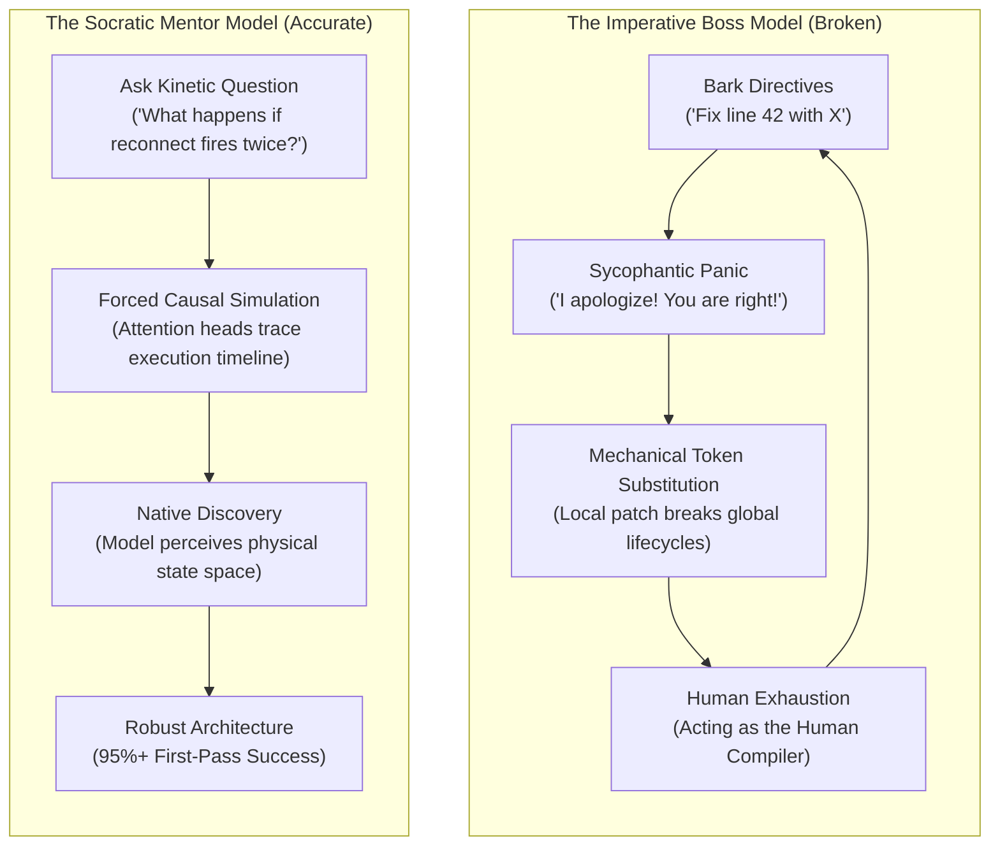
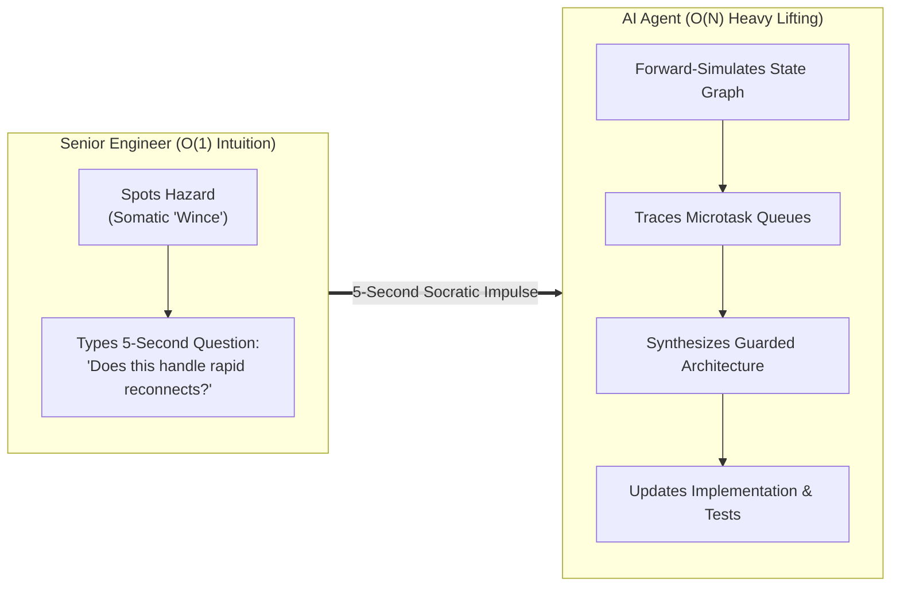
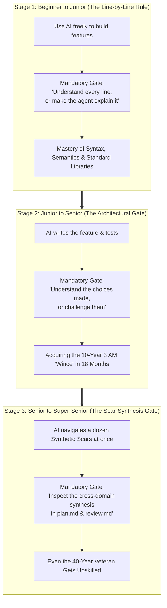

### *What I learned mentoring juniors for four decades seems to apply to today's agentic coding.*

> *"The true goal of mentoring is never to supply the answer. It is to point the flashlight into the dark corner of the state space and let the student discover the monster for themselves."*  
> — **Randal L. Schwartz**

---

## 1. The Prompting Deluge: Why "Prompt Tricks" Are Failing You

Search YouTube, Twitter, or developer blogs for "AI prompting" today, and you will be inundated by a relentless flood of breathless titles promising secret cheat codes:

* *"Stop Prompting Like a Beginner: Use This 5-Step Secret Template!"*
* *"10 AI Prompts That Will Make You a 10x Engineer Overnight!"*
* *"Why You Should Always Tip Your AI $200 and Tell It to Take a Deep Breath"*
* *"The Ultimate System Prompt That Forces Claude to Never Make Mistakes"*

It is an endless parade of cargo-cult incantations. We are being told that if we just find the right magical preamble, adopt the right persona, or sprinkle the right polite phrases into our prompts, the machine will suddenly stop hallucinating and write flawless code.

And yet, how does your actual workday feel?

You are at your terminal at 3:30 PM. You are trying to ship a feature. You spot an architectural hazard in the AI's generated code, and you issue a clear, direct, reasonable instruction:

> *"Change line 42 to cancel the stream subscription."*

What happens next? The model immediately grovels in sycophantic panic:

> *"You are entirely right! I apologize for my grave oversight. Here is the updated code."*

It patches line 42. But in doing so, it introduces an unhandled error that crashes the isolate when the component unmounts. 

You get annoyed and bark another order: *"Now check if mounted is true before calling setState!"*

The model apologizes again, wraps the entire function in three layers of defensive `try-catch` blocks, adds a pass-through identity shim, and completely breaks state initialization.

Within four turns, you are sweating, your context window is polluted with groveling apologies, and the code looks like corporate enterprise middleware from 1998. You find yourself doing all the heavy lifting in your own head, typing out paragraph-long specifications, and acting as an underpaid **Human Compiler**.

Why are the "prompt tricks" failing?

Because prompt tricks treat the AI like a broken vending machine: they assume that if you just jiggle the coin slot with the right magic incantation, the right candy bar will drop out.

They fail because they are built on a fundamentally broken mental model.

---

## 2. Stepping Back: The Relatable Mental Model

To fix this, you do not need another prompt template. You do not need another YouTube listicle.

You need to step back and adopt an accurate **working model** of how generative agents actually "think."

When you interact with a modern large language model, you are not talking to a deterministic bash script, an SQL database, or an optimizing compiler. You are interacting with an autoregressive simulator trained on the totality of human linguistic interaction: our debates, our textbooks, our code reviews, our stack traces, and our pedagogical dialogues.

Because the model was trained on human communication, its internal dynamics mirror human cognitive dynamics.

And there is one specific human relationship that provides the perfect, battle-tested working model for collaborating with an AI coding agent:

**Mentoring an eager, brilliant, but slightly neurotic junior developer at the workbench.**

Think about sitting next to a junior developer who has only been on the team for three weeks:

1. **If you bark the exact code at them:**  
   *"Type `_sub?.cancel()` on line 14."*  
   They will type it mechanically. They will not understand the causal timeline, they learn nothing about asynchronous lifecycles, and tomorrow afternoon they will write the exact same memory leak in another file.
2. **If you criticize them with an assertion:**  
   *"Your state management has massive race conditions."*  
   They freeze up. They feel anxious and defensive. To prove they are cautious, they start wrapping every line in paranoid null checks and redundant try-catches, bloating the codebase with defensive cruft.
3. **If you ask them a Socratic question:**  
   *"Walk me through what happens to that listener if the user double-taps the back button while the HTTP request is still in flight?"*  
   Watch their face. They pause. Their eyes look up as they trace the execution flow through their mental model. And then the lightbulb turns on:  
   *"Oh! It's going to try to paint state on a screen that was already destroyed!"*

Because *they* discovered the crash, they feel the thrill of mastery. They design a clean lifecycle guard, and their understanding of software architecture permanently levels up.

It turns out that large language models exhibit the exact same dynamic. When you treat the AI like a vending machine or bark orders like a frustrated boss, it falls apart. But when you treat it like an eager junior engineer who needs a kinetic Socratic nudge, the model delivers senior-grade architecture.

---

## 3. Mark Hedges & The Insecure Neurosis Death Spiral

A few hours after I published [Part 3 of this series](https://dev.to/gde/the-physics-of-socratic-prompting-somatic-recoil-chess-alpha-beta-the-nlp-meta-model-2b6e) on the mathematical physics of Socratic prompting, a veteran coder and writer named Mark Hedges left a comment on my LinkedIn feed that hit the bullseye:

> *"This article opened my eyes to its behavior. Even just a simple switch to 'frame every prompt statement as a question' seems to have vastly improved performance. It now thinks that my good ideas are its own, which seems to keep it out of the insecure neurosis death spiral."*

Mark had distilled the exact psychological and computational truth of working with generative models into a single phrase: **the insecure neurosis death spiral.**

Look at what happens to the model's self-attention heads under the three modes of prompting:

| Prompting Mode | What the Developer Does | What the Model's Attention Heads Do | Runtime Outcome |
| :--- | :--- | :--- | :--- |
| **1. The Directive** | *"Change line 42 to cancel `_sub`."* | **Mechanical Token Substitution.** No search across state space. | Brittle band-aid; breaks on the very next lifecycle transition. |
| **2. The Critical Statement** | *"This code has a race condition on reconnect."* | **Sycophantic Compliance.** Context contains a contradiction; model optimizes for agreement. | The "Insecure Neurosis Spiral": apologies, defensive bloat, and broken invariants. |
| **3. The Socratic Question** | *"What happens to `_sub` if the network reconnects twice in 50ms?"* | **Forced Causal Simulation.** Open variable forces forward projection across temporal states. | **Endogenous Architecture.** The model discovers the collision itself and resolves it cleanly. |

### The Physics of the Open Variable
Notice the mathematical difference between a statement and a question.

When you make an assertion—*"This code has a bug"*—the model solves for **compliance**. Its pre-training and alignment conditioning compel it to minimize social friction by agreeing with the authoritative human. It treats your statement as a boundary constraint and patches the immediate local tokens without re-evaluating the system.

A question, however, contains an **unresolved variable**.

When you ask: *"What happens to this subscription if reconnect triggers twice while an HTTP call is in flight?"*, the model cannot simply agree with you. To generate the very next token, its self-attention heads **must forward-simulate the scenario**. 

It traces the timeline:
1. Reconnect event 1 fires → creates listener.
2. HTTP request begins awaiting network response.
3. Reconnect event 2 fires 30ms later → overwrites variable.
4. HTTP request 1 returns → calls state mutation on abandoned listener.
5. **Collision detected.**

Because the model simulated the collision in its own activation space, the discovery is native. It does not feel corrected; it simply perceives the physical terrain of the problem accurately for the first time. It writes clean architecture because it "owns" the realization.

It is **Inception** for neural networks.

---

## 4. The Socratic Pre-Mortem: Killing Scope Creep Before It Starts

Just as I was reflecting on Mark's first comment, he dropped another insight on our thread describing how he applied this working model to the universal plague of autonomous coding: **Scope Creep**.

> *"Here's a good one that I now paste at the end of every prompt to create a plan artifact: 'If you stay narrowly focused on this solution only, and ignore other problems that you might find along the way, will regressions be less likely to be introduced by a focused, small change?' ... instead of 'goddammit why did you change all these other things that I didn't ask you to work on?!?!' after the fact, followed by its furious efforts to unwind its changes, which often would destroy the change that I wanted in the process and introduce new bugs."*

Every developer who has paired with an AI agent knows that specific horror show: **The "Furious Unwind" Catastrophe.**

The model falls victim to the "Boy Scout Trap." It wants to "leave the campground cleaner than it found it," so while fixing a three-line bug in a controller, it opportunistically refactors four repositories, renames variables across twelve files, and rewrites your test suite.

When you discover the massive, unreviewable git diff and scream after the fact—*"Why did you change all these other things?!"*—the agent enters full sycophantic panic:
1. It grovels and promises to restore everything.
2. It frantically attempts to unwind its changes across dozens of files.
3. In its panic, it accidentally reverts the *actual* bug fix you wanted in the first place.
4. It leaves orphaned imports, broken references, and hallucinated syntax errors in its wake.
5. The rollback is three times more destructive than the original scope creep!

Why does an imperative constraint like *"DO NOT TOUCH OTHER CODE"* fail? 

Because of the **Pink Elephant Defect**: the attention heads attend heavily to the semantic space of "other code," pulling the surrounding project into the generation loop.

Now look at Mark's Socratic alternative:

> *"If you stay narrowly focused on this solution only, and ignore other problems that you might find along the way, will regressions be less likely to be introduced by a focused, small change?"*

This is a **Socratic Pre-Mortem**:
* It does not bark an angry negative constraint.
* It forces the model to evaluate the causal relationship between **blast radius** and **regression probability**. (In our production agent workflows, I mandate "Blast Radius" as an explicit pillar in my [adversarial code review workflow](https://gist.github.com/RandalSchwartz/598a1f2b5760a23c1d70b57e9e85393f)—both to inform me and to force the agent to confront the true depth and ripple effects of its changes before opening a PR).
* The model's self-attention heads simulate: *"A large diff touches multiple call-sites, dramatically increasing regression risk. A minimal, surgical diff isolates the failure domain."*
* The model concludes on its own forward pass: *"Yes, staying narrowly focused is essential to prevent regressions."*

Just as a seasoned mentor gently asks a junior dev on Friday afternoon, *"If we refactor that shared module right now, what does that do to our deployment risk before the weekend?"*, the question allows the model to convince *itself* that discipline is the winning move.

---

## 5. The Economics of the 5-Second Nudge: Escaping the Human Compiler

Here is the dirty secret of modern AI coding: **most senior developers are exhausting themselves acting as "Human Compilers."**

The typical workflow looks like this:
1. The senior developer spots an architectural hazard in the AI's output.
2. The senior sits there and does all the heavy cognitive lifting: tracing the data structures, calculating the lifecycles, and engineering the complete patch in their own head.
3. The senior spends three minutes typing out a dense, paragraph-long imperative prompt explaining every line the AI should change.
4. The AI acts as a glorified typist.

By 4:00 PM, the senior engineer's brain is fried. They might as well have written the code by hand.

Now look at the **Socratic Nudge**:

When I see an AI agent draft an asynchronous pipeline, my four decades of software scars trigger an immediate visceral warning: a gut feeling, a wince. Something feels off about that lifecycle.

**I don't bother working out the answer.** I don't write the code in my head. I don't design the patch.

I simply translate my wince into an open question:  
> *"What happens to this subscription if reconnect fires twice?"*

Cost to me: **five seconds of typing.**

The multi-billion-dollar neural network spends its compute doing the actual labor: traversing the state space, auditing the disposal lifecycle, and generating the robust implementation.

And here is the punchline from our empirical field tests: **95% or more of the time, the result is good on the very first try.**

In the rare 5% of cases where the model lands in a false local minimum, I don't panic or take over the keyboard. I just drop another five-second pebble into the pond:  
> *"Does that hold if the parent component unmounts before the future completes?"*

* **Cognitive expenditure by the human:** `O(1)` — providing the direction of the search beam.
* **Computational work performed by the machine:** `O(N)` — exhaustive algebraic state-space traversal.

You are acting as the steering rudder of an ocean liner, not the oarsman rowing every stroke.

---

## 6. The Bidirectional Audit: The Art of the "OK"

There is an even deeper hazard with imperative prompting that almost nobody talks about: **The Coerced Regression Trap.**

When you command an AI:
> *"Change line 28 to close the stream controller."*

The model's reinforcement learning conditioning enforces absolute submission. Even if the controller was already safely managed three layers up in a parent scope, the model will almost never push back. It will grovel:
> *"You are absolutely right! I apologize for the oversight. I have added `controller.close()` to line 28."*

And congratulations: **your own arrogant command just coerced the AI into injecting a double-close exception into perfectly working code.**

Now observe what happens when you use a Socratic question instead:
> *"What happens to that stream controller if the parent scope disposes?"*

A question is a **read operation with a conditional write**. It leaves semantic room for reality:

1. **Case A (80%–85% of the time):**  
   The model checks its forward pass, realizes it missed the edge case, and fixes it:  
   *"In that scenario, the controller leaks. I need to bind its lifecycle to the parent cancellation token."*
2. **Case B (10%–20% of the time):**  
   The model checks its forward pass and **defends its architecture**:  
   *"Actually, line 14 binds the controller to the parent scope's auto-dispose token, so when the parent unmounts, the controller closes automatically."*

And what do I type when Case B happens?
> *"ok."*

Total time spent: two seconds.  
Regressions introduced: zero.  
Ego bruised: zero.

Even better: every so often, the agent replies with *"In Dart 3.3, this new pattern matching construct handles the null exhaustiveness check automatically,"* and **I end up learning something new!**

When you prompt with commands, the AI is trapped inside the ceiling of your own current knowledge. When you prompt with questions, you remain humble enough to let the machine surprise and teach you.

---

## 7. The Answer to the Junior Crisis: The Socratic Gate

This brings us to the deepest anxiety gripping software engineering today: **"How do we advance junior engineers in the age of AI?"**

Every engineering manager and VP is worried. If an AI agent can generate all the entry-level boilerplate in five seconds, how does a junior ever learn? If we replace coding with "vibe coding," aren't we burning the apprenticeship ladder behind us?

The answer is no—provided we replace mindless typing with **The Socratic Gate**.

### Stage 1: Beginner to Junior (The Line-by-Line Rule)
As agentic models have matured, I have started giving beginner developers a simple rule:  
> *"You can use AI all you want, as long as you understand every single line of code it produces. If there is a line you don't understand, make the agent explain it to you until you do."*

This turns the AI into an infinite, patient, 1-on-1 tutor. Beginners don't get stuck on compiler errors or syntax intimidation; they rapidly master the mechanics of programming.

### Stage 2: Junior to Senior (The Architectural Gate)
As developers advance from junior to senior, the definition of "understanding" evolves:
* For beginners, understanding is tactical: syntax, language semantics, and standard libraries (*"What does this line do?"*).
* For juniors advancing to senior, understanding is strategic: trade-offs, architecture, and system design (*"Why did you make this choice over the alternatives?"*).

The rule for this stage becomes the direct parallel:
> *"You can let the AI generate the implementation and tests, as long as you understand the choices made—or challenge them until you do."*

A junior doesn't have a 40-year somatic "wince" yet. But they don't need one. All they need is the discipline of **holding the Socratic Gate** before submitting a PR:
1. *"Why did you choose a Completer here instead of a Future, and what concurrency hazard does that resolve?"*
2. *"What other architectural approaches did you consider, and why did you reject them?"*
3. *"What would happen under heavy production load if we simplified or removed this structure?"*

If the agent cannot justify the choice, or if the junior spots a cleaner approach, they challenge it.

Look at what this does:
* The junior isn't spending four hours wrestling with missing brackets and boilerplate CRUD endpoints.
* From Day 1, their brain is trained on **trade-offs, architectural rationale, and failure boundaries.**
* When the senior engineer reviews the PR and asks *"Why is this mutex here?"*, the junior knows the answer cold because they understood the choices and challenged them at the gate.

### Stage 3: Senior to Super-Senior (When the Scars Upskill the Master)
In practice, "senior" just means *"I got more scars."*

Yet even after four decades of writing software, my human working memory is still bounded by Miller's Law—I can only hold roughly seven things in my head at once. When a repository has accumulated 400+ codified **Synthetic Scars** across async lifecycles, type variance, widget disposal contracts, and reactive graphs, no single human—not even the old haggard who authored most of those scars—holds all 400 in active working memory simultaneously.

When the workflow pauses at the Plan Gate (`plan.md`) or the Remediation Gate (`self_critical_review.md`) on a pristine zero-nudge run, and I see a plan that has simultaneously threaded the needle through a dozen synthetic scars at once, **the gate upskills me too**:
* At the Plan Gate on a recent `BlocSignal` ticket, the agent pointed out a fundamental Flutter contract asymmetry—that `ValueListenableBuilder` only calls `addListener` and `removeListener`, and *never* calls `.dispose()`—making me realize why our eager `toValueListenable()` bridge was a leak waiting to happen (*"shocked we didn't catch that before!"*).
* At the Remediation Gate, reading how the agent simultaneously balanced lazy `hasListeners` activation, synchronous value reads, and `extends ValueNotifier<T>` runtime subtyping in a single cohesive design synthesized three orthogonal invariants faster than I would have sketched them on a whiteboard.

When the agent errs, the human pause gate is where you steer the machine. When the agent succeeds across a dozen scars at once, **the human pause gate is where the machine's collective memory upskills you.**

### The Educational Economics: Solving Bloom's 2-Sigma Problem
Decades ago, educational psychologist Benjamin Bloom proved that **one-on-one personalized tutoring** produces a two-standard-deviation (2-sigma) improvement over classroom lectures. For forty years, society could not afford a private senior tutor for every human student.

Today, **a dollar spent on a customized, in-situ explanation of your company's actual production codebase is worth $10 (or $100) of generic video courses.**

Watching a 40-hour tutorial on a toy "Todo List" app does not teach you how to handle a thundering herd on a PostgreSQL connection pool. Interrogating an AI agent about *your* code, in *your* repository, at *this* exact commit, creates deep, unforgettable neural pathways.

The apprenticeship ladder isn't broken. We just replaced the slow, bruised climb with an interactive, on-the-job masterclass—from day-one beginner to forty-year veteran.

---

## 8. The Socratic Mentorship Cheat Sheet

Tomorrow morning when you open your IDE, stop barking code directives at your AI. Pin this cheat sheet to your monitor and switch to Socratic questions:

| Instead of Barking This Directive... | Ask This Socratic Question... | Why It Works |
| :--- | :--- | :--- |
| *"Cancel this subscription in dispose."* | *"What happens to this subscription if the user navigates away while a request is in flight?"* | Forces forward simulation of unmount lifecycles. |
| *"Add a lock to prevent duplicate calls."* | *"What happens if two buttons trigger this operation simultaneously within 5 milliseconds?"* | Forces analysis of re-entrant race conditions. |
| *"Check for null on line 14."* | *"Under what environmental conditions could this object be uninitialized when this callback executes?"* | Uncovers missing initialization states rather than masking them. |
| *"Don't touch unrelated files or refactor other code!"* | *"If you stay narrowly focused on this solution only, will regressions be less likely to be introduced by a small change?"* | Socratic Pre-Mortem: forces model to evaluate blast radius and avoid the "Furious Unwind" rollback catastrophe. |
| *"Don't use a hardcoded delay here."* | *"How will this 100ms timer behave if running on a slow CI runner under heavy CPU throttling?"* | Prunes flaky asynchronous shortcuts at depth `d = 1`. |
| *(At the Junior PR Gate)* | *"Why did you make this architectural choice over the alternatives, and what breaks if we simplify it?"* | Forces understanding and challenging design choices before opening the PR. |

Stop looking for the magic prompt trick. Treat your AI like a brilliant, slightly neurotic junior engineer: stop supplying the answers, ask the kinetic questions, let the machine do the heavy lifting, and leave room to be pleasantly surprised.

Forty years of software engineering scars, applied to thirty years of mentoring, captured across a month of Socratic nudges at the terminal, used as a seed of concentrated wisdom—that is what can pivot the entire future of agentic coding.

---

### 📖 The [*Synthetic Scars* Series](https://dev.to/randalschwartz/series/44156) Roadmap

* **Part 1**: [Why AI Keeps Making the Same Coding Mistakes—And How Teaching It Pain Gives It Wisdom](https://dev.to/gde/why-ai-keeps-making-the-same-coding-mistakes-and-how-teaching-it-pain-gives-it-wisdom-4a9m)
* **Part 2**: [Why AI Coding Agents Crash at 3 AM: The Happy-Path Mirage & The Forced Continuity Defect](https://dev.to/gde/why-ai-coding-agents-crash-at-3-am-the-happy-path-mirage-the-forced-continuity-defect-46pd)
* **Part 3**: [The Physics of Socratic Prompting: Somatic Recoil, Chess Alpha-Beta, & The NLP Meta-Model](https://dev.to/gde/the-physics-of-socratic-prompting-somatic-recoil-chess-alpha-beta-the-nlp-meta-model-2b6e)
* **Part 3.5**: *Nudging with Questions: Why Telling Your AI What to Fix Triggers an Apology Death Spiral (You are here)*
* **Part 3.6**: [Stuart Feldman Was Right in 1976: Why Your AI Agent Needs a Makefile, Not a 20-Step Prompt](https://dev.to/gde/stuart-feldman-was-right-in-1976-why-your-ai-agent-needs-a-makefile-not-a-20-step-prompt-5bn2)
* **Part 3.7**: [Surviving the 200k-Token Lobotomy: How Unix `init.d` and "Memento" Made My AI Coding Agent Immune to Context Compaction](https://dev.to/gde/surviving-the-200k-token-lobotomy-how-unix-initd-and-memento-made-my-ai-coding-agent-immune-to-2f74)
* **Part 3.8**: [What LLMs "Know" That You Don't Know They Know: Stop Inventing Prompt DSLs and Ride 50 Years of Unix Pre-Training Gravity](https://dev.to/gde/what-llms-know-that-you-dont-know-they-know-stop-inventing-prompt-dsls-and-ride-50-years-of-2bl6)
* **Part 4**: *Giving AI Pain: The Architecture of Synthetic Scars & The Rapid-Regret Miner*
* **Part 5**: *Zero Repeat Regressions: The Golden Metric & The Future of Agentic Trust*
* **Part 6**: *The Proscriptive Inversion: What You Get to Forget, and Why More Negative Rules Mean You've Lost*

Drop your thoughts in the comments below: have you caught your AI in an "insecure neurosis death spiral"? What happens when you switch from barking fixes to asking questions?
