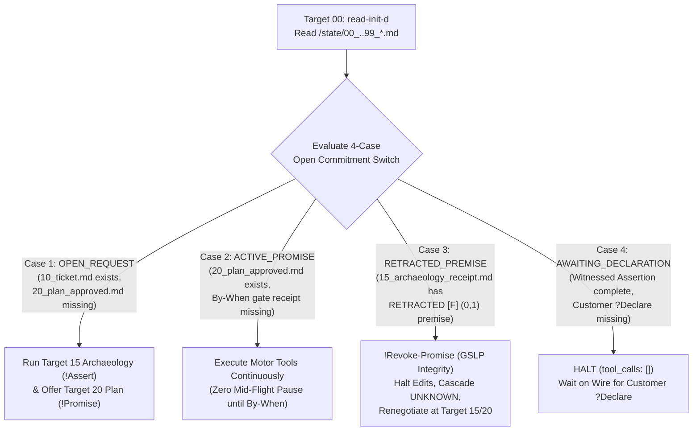
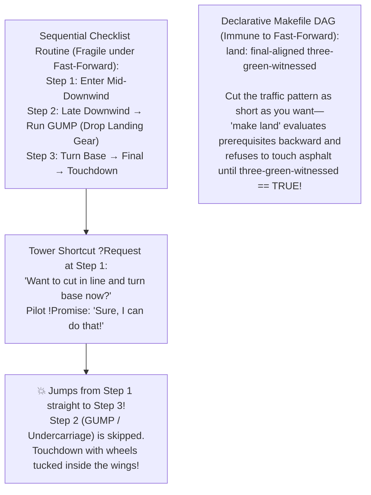

## *How Fernando Flores's 1986 Conversation for Action, Nuel Belnap's 1977 four-valued logic, and a 1976 HP 2000 BASIC resequencer replaced 130 lines of defensive prompt lawyering—and solved the exact state-machine bug that crashed both the Star Trek M-5 computer and my Piper Arrow.*

> *"What did you do for AI? I brought the scars. What did you do for humanity? I asked my curiosity-based questions, and the world changed around me."*  
> — **Randal L. Schwartz**

---

## 1. Portland, Thanksgiving 1986: How "Committed Speech" Moves Reality Across a City

In the mid-1980s, I was living in Portland, Oregon, and immersed in the educational network around Werner Erhard's work—completing the **Six-Day Advanced Course**, **Mastery of Empowerment**, entering the **Graduate Seminar Leaders Program (`GSLP`)**, and taking the **Communication Workshop** (*Commshop*) led by **Ian Garbutt**.

*Commshop* was built directly on the research of **Fernando Flores** and **Terry Winograd** (*Understanding Computers and Cognition*, 1986). It trained us to hear the difference between the **95% of human language that is uncommitted noise** and the **5% of language—Committed Speech—that coordinates physical action**.

Right after I finished that workshop, a group of us met in Portland to organize the upcoming Thanksgiving **Holiday Project**, visiting people confined to hospitals and nursing homes over the holidays. Sitting in that planning circle, I tossed out an ambitious idea:

> *"What if every schoolchild in Portland made a piece of art to be delivered to every shut-in in the city for Thanksgiving?"*

Picture what happens to that sentence in an ordinary committee room operating on **uncommitted speech**:

* Everyone smiles warmly.
* Someone says, *"Oh, what a lovely idea! We should totally try to do something like that!"*
* Someone else says, *"Yes, it would be great if people reached out to some schools."*
* Thanksgiving arrives, and **zero shut-ins ever see a single drawing**.

Why? Because in that ordinary room, nobody is a **`Customer`**, nobody is a **`Performer`**, nobody has agreed on measurable **`Conditions of Satisfaction`**, and nobody has locked a **`By-When`**. That committee room is the exact linguistic equivalent of a 2,000-word `.cursorrules` or `CLAUDE.md` file that tells an AI coding agent: *"You are a conscientious 10x senior engineer who writes clean, well-tested, bug-free code."*

Now look at what happened in that Portland room because everyone in the circle spoke **Fernando Flores's Committed Speech**:

* **Three Core Breakthroughs**:
  1. **Every procedural failure in an AI coding workflow is a broken Speech Act**: Fake completions (`SCAR-PROC-101`), mid-flight bailouts (`SCAR-PROC-94`), self-approved gates (`SCAR-PROC-102`), and silent plan deviations (`SCAR-PROC-120`) disappear when you replace defensive imperative rules with a four-act **Belnap–Flores–Hoare Commitment Machine**.
  2. **Stuart Feldman's 1976 `Makefile` colon (`:`) and Fernando Flores's 1986 `By-When` are the exact same mathematical object**: Writing `consuming-stage : promised-outcome` compiles temporal accountability directly into the dependency graph, while numbering `/etc/init.d` state files **`00..90` (`Target NN` ≡ `state/NN_*.md`)** turns disk state into an **Open Commitment Ledger** where recovering from a 200k-token lobotomy is a four-case `switch` statement.
  3. **Sequential checklists fail whenever you cut the pattern short**: Whether it is Asimov's robots, the 1968 *Star Trek* M-5 computer, or my October 1990 gear-up belly-landing at Hillsboro Airport after saying *"Sure, I can do that!"* to a tower shortcut, tying safety to a step number fails under fast-forwards—whereas backward-chained `Makefile` prerequisites (`land: final-aligned three-green-witnessed`) hold unconditionally.

In that Portland room, the moment we shifted from a *Conversation for Possibilities* (*"What if every schoolchild..."*) into a **Conversation for Action**, the room self-organized through four strict linguistic moves:

1. **`Requests` (`Customer → Performer`)**: Specific organizers made explicit requests to specific volunteers, naming exact school districts, nursing homes, and deadlines.
2. **`Promises` (`Performer → Customer`, with `Conditions of Satisfaction` + `By-When`)**: Volunteers did not say *"I'll try to help."* They promised concrete outcomes: which principals would be contacted by Friday at 3:00 PM, how many drawings would be collected by the Wednesday before Thanksgiving at noon, and which drivers owned which delivery routes (I personally promised and drove three of those school pickups and nursing-home deliveries myself).
3. **`Witnessed Assertions` (`Performer → Customer`)**: Nobody reported vague feelings (*"Things are going well"*). People reported witnessed physical facts: *"300 drawings picked up and boxed at Lincoln High."*
4. **`Declarations` (`Customer → World`)**: As each nursing home received its boxes on Thanksgiving morning, the route coordinator declared that commitment satisfied and closed the loop on the ledger.

Compassion gave the Thanksgiving project its heart, but **Committed Speech** was the transport protocol that moved thousands of pieces of physical paper from elementary school classrooms into the hands of elderly shut-ins across Portland without dropping a single handoff.

In [**Part 3.9**](https://dev.to/gde/if-you-never-do-anything-else-to-fix-your-prompts-do-this-one-thing-3069), we saw how adding a 4-line **Zero-Shot Flores Handshake** to a single chat prompt stops an LLM from hallucinating nonexistent APIs by unlocking **`Counter-Offer`** before Token 1.

Today, in **Part 3.10**, we are going to answer the full systems question: **What happens when you rewrite an entire autonomous multi-agent coding workflow ([Randal's Public Workflow Gist](https://gist.github.com/RandalSchwartz/598a1f2b5760a23c1d70b57e9e85393f)) so that every `Makefile` target, every `/etc/init.d` state file, and every subagent handoff operates as a formal Commitment Machine?**

---

## 2. The Step-Zero Primer & 60-Second Decoder Ring (Flores 1986 × Belnap 1977 × Hoare 1978)

Before we touch a single line of `SKILL.md`, we need to clear a vocabulary minefield.

To a 2026 software engineer who did not sit in Ian Garbutt's 1986 *Commshop*, Fernando Flores's four core nouns collide head-on with overloaded programming keywords:

* **`Request`** sounds like an `HTTP GET` packet.
* **`Promise`** sounds like a JavaScript `Promise<T>` / `async`/`await` future.
* **`Assertion`** sounds like a C `assert(x != NULL)` macro.
* **`Declaration`** sounds like a variable declaration (`int count = 0;`).

Forget those programming definitions for sixty seconds. In **Committed Speech**, every unit of work is a two-party contract between a **`Customer`** (the party requesting the outcome and holding the sole authority to judge it complete—either the human operator or an upstream orchestrator/critic) and a **`Performer`** (the agent or subagent executing the work):

| Speech Act | Direction | Plain-English Meaning in the Portland Holiday Project | Meaning in Our Autonomous Agent Workflow (`WORKFLOW.mk`) |
| :--- | :--- | :--- | :--- |
| **1. `Request`** | `Customer → Performer` | *"Will you pick up 300 drawings from Lincoln High by Wednesday at noon?"* | Ticket assignment (`10_ticket.md`) or a Socratic probe at a pause gate with explicit **Conditions of Satisfaction** and a **`By-When`**. |
| **2. `Promise`** | `Performer → Customer` | *"Yes, I have verified the school office hours and I promise to have all 300 boxed in my trunk by Wednesday at noon."* | The approved implementation plan (`20_plan_approved.md`), offered *only after* verifying physical codebase premises (`15_archaeology_receipt.md`). |
| **3. `Assertion`** | `Performer → Customer` | *"300 drawings are boxed in my trunk right now—here is the signed pickup slip."* | A claim of fact backed by a **physical witness receipt**: `file:line` citations, `red_exit != 0 → green_exit == 0`, or a `SHA-256` diff hash (`40_critic_review.md`). Without a receipt, an assertion is merely **"The Story."** |
| **4. `Declaration`** | `Customer → World` | *"Route 3 is delivered and complete. Thank you!"* | The human operator's `"yes, continue"` (`human-plan-approval`, `human-commit-approval`, `human-landing-approval`) or the orthogonal Critic's `VERDICT: APPROVED (0 BLOCKERS)` (`45_review_approved.md`). **A Performer can never utter a Declaration.** |

### The 60-Second Decoder Ring: Adding Hoare's `CSP` (`?` / `!`) and Belnap's 4-Valued Logic

Once those four human acts are crystal clear, we bind them to two classic computer science formalisms from the late 1970s so the LLM's parser has zero room for ambiguity:

1. **Tony Hoare's 1978 Communicating Sequential Processes (`CSP`) Channel Prefixes (`?` and `!`)**:
   Written from the **`Performer` agent's wire perspective** (or binary session-type polarity), **`?` means input received from the `Customer` channel** (`?Request`, `?Declare-Approve`—which is why a Customer Declaration is a hard blocking read where the Performer must halt with `tool_calls: []` and wait on the wire), while **`!` means output uttered by the `Performer` channel** (`!Promise`, `!Assert`, `!Counter-Offer`, `!Revoke-Promise`).
2. **Nuel Belnap's 1977 Four-Valued Epistemic Lattice ("A Useful Four-Valued Logic")**:
   Why do standard agents either blindly trust a broken ticket assumption or hallucinate an excuse when a test fails mid-flight? Because classical boolean logic (`TRUE` / `FALSE`) cannot distinguish between *"I haven't checked this file yet"* and *"I checked this file and the ticket's assumption collided with reality."*
   In 1977, logician **Nuel Belnap** designed a four-valued logic specifically for computers reasoning over incomplete and inconsistent databases. Instead of a 1-bit boolean, every premise `f_i` in our archaeology ledger (`15_archaeology_receipt.md`) carries a **2-bit evidence pair `(Evidence-For-True, Evidence-For-False)`**—and those four epistemic states map **4-to-4** onto Flores's four legal Performer moves:

| Belnap Epistemic State | 2-Bit Evidence `(For-True, For-False)` | What It Means on Disk (`15_archaeology_receipt.md`) | Legal Performer Speech Act (`!`) |
| :--- | :---: | :--- | :--- |
| **`UNKNOWN [N]`** *(None)* | `(0, 0)` | Premise has not yet been inspected by a physical tool probe. | **Forbidden to `!Promise`**. Must run `Target 15` archaeology first. |
| **`ESTABLISHED [T]`** *(True)* | `(1, 0)` | Verified by a physical `file:line`, compiler, or `git log` witness receipt. | **`!Promise`** (`Target 20` plan) or **`!Assert`** (`Target 30/40` completion). |
| **`CONTRADICTED [B]`** *(Both)* | `(1, 1)` | Ticket `!Request` claims `X`, but codebase reality (`file:line` or prior PR) proves `¬X`. | **`!Counter-Offer`** (`Plan A` vs. `Plan B` Socratic fork at `Target 20`). |
| **`RETRACTED [F]`** *(False)* | `(0, 1)` | A premise previously marked `ESTABLISHED (1,0)` was just falsified mid-flight by a compiler/test diagnostic during `Target 30`. | **`!Revoke-Promise`** (Halt in Integrity, cascade dependent facts back to `UNKNOWN (0,0)`, and renegotiate `20_plan_approved.md`). |

Look at the symmetry of that table: **Belnap's 1977 logic governs what the agent knows, Flores's 1986 grammar governs what the agent is allowed to say, and Hoare's 1978 `CSP` governs when the agent must block on the wire.**

---

## 3. "Doctor, Heal Thyself": Why Our Own `SKILL.md` Had Grown a 130-Line Legal Contract

Even after we replaced our 21-step checklist with Stuart Feldman's 1976 `Makefile` DAG ([**Part 3.6**](https://dev.to/gde/stuart-feldman-was-right-in-1976-why-your-ai-agent-needs-a-makefile-not-a-20-step-prompt-5bn2)) and an `/etc/init.d` Memento bootloader ([**Part 3.7**](https://dev.to/gde/surviving-the-200k-token-lobotomy-how-unix-initd-and-memento-made-my-ai-coding-agent-immune-to-2f74)), we looked at our own production [`SKILL.md`](https://gist.github.com/RandalSchwartz/598a1f2b5760a23c1d70b57e9e85393f) and noticed an uncomfortable truth.

While the top 50 lines of `SKILL.md` were a crisp, declarative `Makefile`, the bottom 130 lines had slowly turned into a dense wall of defensive prompt lawyering (`SCAR-PROC-94` through `SCAR-PROC-121`):

* *"Do NOT emit `tool_calls: []` after declaring an active target header..."*
* *"Do NOT claim tests pass without showing the exit code..."*
* *"Do NOT advance past `Target 45` without explicit human approval..."*
* *"Do NOT unilaterally modify the plan when a test fails in `Target 30`..."*

When we audited every single procedural scar we had accumulated across 180+ field tests, we realized that **we were writing dozens of negative English patches for what were all violations of the exact same four Speech Acts**:

1. **Fake Completion (`SCAR-PROC-101` / `113`) = An Unwitnessed Assertion**: The Performer utters `!Assert ("Tests pass and the bug is fixed")` without a physical witness receipt—confusing **"The Story About What Happened"** with **"What Happened."**
2. **Mid-Flight Bailout / Dead Air (`SCAR-PROC-94` / `115` / `119`) = A Broken `By-When` Promise**: The Performer holds an `ACTIVE_PROMISE` whose `By-When` is the next Customer gate, yet yields the turn (`tool_calls: []`) halfway through because a compiler error looked hard.
3. **Unauthorized Gate Jumping (`SCAR-PROC-102` / `112`) = Customer Role Usurpation**: The Performer (`!`) illegally utters a `?Declare-Approved` speech act that belongs exclusively to the Customer (`?`).
4. **Silent Plan Deviation (`SCAR-PROC-103` / `120`) = Running a Racket on Breakdown (Loss of GSLP Integrity)**: In Werner Erhard and Michael C. Jensen's formulation (*"Integrity: Without It Nothing Works"*), integrity is a purely structural property—like the spokes of a bicycle wheel. When physical reality shifts mid-flight so you can no longer keep a `Promise` as given, you stay in integrity by **immediately revoking the old Promise (`!Revoke-Promise`), reporting "What Happened" vs. "The Story" to the Customer, cleaning up the mess, and negotiating a new Promise**. When an unguarded LLM hits a broken premise during coding (`Target 30`), it instead *"runs a racket"*—hacking around `20_plan_approved.md`, weakening a test assertion, or mutating an out-of-scope file while pretending the original plan is still intact.

### Why *The Coordinator* Stalled in 1992—And Why 2026 LLMs Are the Partner Flores Was Waiting 40 Years For

There is a hilarious historical irony here.

In the late 1980s and early 1990s, Fernando Flores's framework spawned two major software lineages:
1. **Action Technologies' "The Coordinator" and "ActionWorkflow"** (Medina-Mora, Winograd, and Flores, *ACM CSCW 1992*)—the pioneering email and groupware system where every message had to be explicitly tagged as a `Request`, `Promise`, `Counter-Offer`, `Assertion`, or `Declaration` with a `By-When`.
2. **1990s Multi-Agent Communication Languages**—specifically DARPA's **`KQML`** and the IEEE **`FIPA-ACL`** standard.

Why did both stall in the 1990s?

When *The Coordinator* came out, I loved the architecture so much that I designed a scheme to implement Flores's speech-act state machine over **RFC 822 email headers**—so that if someone sent me an email containing three separate requests, I could split the thread and reply with individual `Promise` or `Counter-Offer` headers tracked by a Perl script. I stopped just short of writing the code for one simple reason: **I realized nobody on the other end of my email threads would be motivated to follow the protocol.**

And sure enough, in corporate offices (famously chronicled in the 1994 Lucy Suchman–Terry Winograd debate), human employees rebelled against *The Coordinator*. Corporate email runs on **strategic ambiguity and CYA hedging**. Humans *hated* a computer forcing them to click `[PROMISE BY TUESDAY 5:00 PM]` or `[DECLINE]` to their boss. Meanwhile, on the AI side, 1990s `KQML` and `FIPA-ACL` software agents had the rigid speech-act envelopes, **but they had no brains inside**—they were brittle `if`/`else` scripts that could not read a compiler diagnostic or understand a codebase.

Fast-forward forty years to 2026:
* Unlike 1990s `FIPA-ACL` scripts, a 2026 frontier LLM has a neural brain capable of reading 50 source files and reasoning over abstract syntax trees.
* And unlike 1988 corporate middle managers, **the other endpoints on our workflow thread are our own `fork()`ed AI subagents**—which have zero ego, zero office politics, and 100% motivation to obey a strict `REQUEST → PROMISE → WITNESSED ASSERTION → DECLARATION` state machine!

In 1986, Fernando Flores designed the exact operating protocol for a mind that would not exist for another forty years.

### The Highway 17 Near-Miss (Grinder & Bandler 1975 × Flores & Winograd 1986)

Even better, look at the geography of Northern California between 1975 and 1986:

* At **UC Santa Cruz**, linguist **John Grinder** and **Richard Bandler** published *The Structure of Magic* (1975)—giving us the **Socratic Meta-Model** we used in [**Part 3**](https://dev.to/gde/the-physics-of-socratic-prompting-somatic-recoil-chess-alpha-beta-the-nlp-meta-model-2b6e) and [**Part 3.5**](https://dev.to/gde/nudging-with-questions-why-telling-your-ai-what-to-fix-triggers-an-apology-death-spiral-and-how-5gm4).
* Just sixty miles north up **Highway 17** at **UC Berkeley and Stanford**, **Fernando Flores** and **Terry Winograd** published *Understanding Computers and Cognition* (1986)—giving us **Committed Speech**.

Those two teams were a one-hour drive apart on Highway 17, and each pair built the exact half of the machine the other pair was missing:
* **Grinder & Bandler** built the **Micro-Decompiler**: the Socratic questioning toolkit that unpacks *Deletions*, *Distortions*, and *Generalizations* inside a single fuzzy sentence to recover hidden state space—while lacking a macro state machine to track commitments and deadlines across a project.
* **Flores & Winograd** built the **Macro Transactional State Machine**: bisecting all language into the 5% Committed Speech vs. 95% uncommitted noise—while lacking Grinder & Bandler's Socratic decompiler to strip the Deletions, Distortions, and Generalizations out of a buggy `Request` before stamping it onto the ledger.

Because both lineages lived side-by-side in my head for forty years (right next to 1976 `Makefile`s and 1999 `spew` BNF grammars), **Synthetic Scars** finally bolts the two halves together: we run **Grinder & Bandler's Meta-Model** at the Socratic Gate (`Target 15/20` & `Target 40`) to decompile fuzzy assumptions into witnessed `file:line` facts, and we lock those facts inside **Flores & Winograd's Commitment Machine**.

---

## 4. The `By-When` Isomorphism & The 50-Year Loop (`TOTO II` 1976 → `Target NN ≡ state/NN_*.md` 2026)

When we rewrote [`SKILL.md`](https://gist.github.com/RandalSchwartz/598a1f2b5760a23c1d70b57e9e85393f) around Flores's Committed Speech, two structural equations snapped into place and collapsed 130 lines of defensive prose into a single page.

### Equation 1: Stuart Feldman's `Makefile` Colon (`:`) Is Fernando Flores's `By-When`

In human project management, a `By-When` is a wall-clock timestamp (*"by Wednesday at 12:00 PM"*). Inside an autonomous AI workflow, there is no wall clock. What is a `By-When` inside a build graph?

> **`By-When` declares which consuming stage requires this verified outcome before it can proceed.**

Look at a standard rule in Stuart Feldman's 1976 `Makefile` syntax:

```makefile
# Consuming-Stage (By-When) : Promised-Outcome (Conditions of Satisfaction)
approved-review: adversarial-review human-review-approval
commit: approved-review human-commit-approval
```

Read that `Makefile` colon aloud in Fernando Flores's grammar:
* `"I need adversarial-review (40_critic_review.md) and human-review-approval (?Declare) "` **by** `"approved-review (45_review_approved.md)."`
* `"I need approved-review (45_review_approved.md) and human-commit-approval (?Declare) "` **by** `"commit (Target 50)."`

**Stuart Feldman's 1976 `Makefile` prerequisite colon (`target : prerequisite`) and Fernando Flores's 1986 `By-When` (`I need <outcome> by <consuming-stage>`) are the exact same mathematical object!**

And that immediately explains why `SCAR-PROC-94` (mid-flight dead air, where an agent prints a target header and stops calling tools with `tool_calls: []`) is illegal: whenever the agent holds an **`ACTIVE_PROMISE`**, its operational **`By-When`** is the **next consuming Customer Declaration gate**. Stopping before reaching that gate breaches the `By-When`.

### Equation 2: The 50-Year Loop (`TOTO II` on the HP 2000 in July 1976 → `Target NN ≡ state/NN_*.md` in 2026)

As our workflow evolved organically over 180+ tickets from a 15-step checklist to a 21-step DAG, we kept wedging new safety airlocks into the middle of the sequence (`Step 3.5`, `Step 10a`, `Step 12b`) while our `/etc/init.d` state files (`30_critic_summary.md`, `40_critic_verdict.md`, `60_bot_triage.md`) drifted out of alignment with the target numbers.

Looking at those wedged-in fractional numbers—both in our workflow targets (`2.1`, `2.2`, `3.5`) and in this article series itself (`Part 3.5`, `3.6`, `3.7` wedged before `Part 4`)—triggered a fifty-year-old memory.

In **July 1976** (the exact same year Stuart Feldman published `Make` at Bell Labs), when I was fourteen years old, **Steve Salta and Jonathan Kirwan** at **Superior Software Services** in Beaverton, Oregon hired me for my very first paid commercial programming contract: writing an interactive line-oriented text editor in HP 2000 BASIC that we named **`TOTO`** (*Terminal Oriented Text Organizer*) and its upgrade **`TOTO II`** (*"Toto, too!"*—deliberately fulfilling the *Wizard of Oz* pun; recounted in my Life Wiki at [`stonehenge.com/merlyn/life/story/toto-text-editor-floating-point-line-numbers`](https://www.stonehenge.com/merlyn/life/story/toto-text-editor-floating-point-line-numbers)). Because teletypes and early terminals had no cursor addressing, `TOTO` numbered lines in a document consecutively (`1` through `100`). To let users insert or move blocks of text between existing lines without immediately renumbering the entire document, `TOTO` used **floating-point line numbers**—allowing commands like `move line 10 to line 4.5`, or moving lines `6` through `8` before line `4` as **`3.5`, `3.6`, `3.7`**—and then ran an automatic **integer normalization pass** to re-space the fractional line numbers back into clean integers.

Fifty years after July 1976, we ran that exact `TOTO` integer normalization pass across our workflow skills. It swept away every vestigial `Step 1..21` and fractional `2.1`/`3.5`/`7a.1` label and aligned the entire `Makefile` DAG and `/etc/init.d` state directory onto a single flat **SysV `00..90` coordinate space** where **the target number is the `/etc/init.d` filename prefix (`Target NN` ≡ `<brain>/state/NN_*.md`)**:

```makefile
# RANDAL'S PREFERRED WORKFLOW — FLAT SYSV rc.d MAKEFILE DAG (00..90 | make finish)
.PHONY: finish land ready-to-land bot-quiescence push commit approved-review \
        triaged-blockers adversarial-review implementation-diff approved-plan \
        archaeology-verified ticket-assigned read-init-d

finish: land codified-scars-consolidated
	@echo "[Target 90 -> 99_next_action.md] Emit Witnessed Terminal Verification Block [COMPLETE]..."
land: ready-to-land human-landing-approval
	@echo "[Target 80] gh pr merge, close issue, sync default branch, prune feature branch..."
ready-to-land: bot-quiescence human-landing-approval
	@echo "[Target 75: ?Declare] Present Witnessed Assertions & STOP for human-landing-approval..."
bot-quiescence: push
	@echo "[Target 70 -> 70_bot_triage.md] Fork Triage Worker: poll CI & 4 bots (180s+ quiescence)..."
push: commit human-push-approval
	@echo "[Target 60: ?Declare] Verify merge-tree, git push, gh pr create/view, chain to Target 70..."
commit: approved-review human-commit-approval
	@echo "[Target 50: ?Declare] Verify format/analyze/test & SHA-256 match, stage explicit files, git commit..."
approved-review: adversarial-review human-review-approval
	@echo "[Target 45 -> 45_review_approved.md] Present Six Pillars & NBO Matrix, & STOP for ?Declare..."
triaged-blockers: adversarial-review human-blocker-triage-approval
	@echo "[Target 42: ?Declare] Present Blocker Digest & STOP; approved fixes dirty 42 -> 30 -> 40..."
adversarial-review: implementation-diff
	@echo "[Target 40 -> 40_critic_review.md] Invoke fresh adversarial_critic on <scratch>/branch.diff..."
implementation-diff: approved-plan
	@echo "[Target 30: ACTIVE_PROMISE] Fork TDD Worker (Red -> Green); RETRACTED fact -> Target 15/20..."
approved-plan: archaeology-verified human-plan-approval
	@echo "[Target 20 -> 20_plan_approved.md] Offer !Promise (<brain>/plan.md) & STOP for ?Declare..."
archaeology-verified: ticket-assigned
	@echo "[Target 15 -> 15_archaeology_receipt.md] Fork Archaeologist: Belnap Ledger (ESTABLISHED/CONTRADICTED)..."
ticket-assigned: read-init-d
	@echo "[Target 10 -> 10_ticket.md] Record Customer ?Request (Conditions of Satisfaction + By-When)..."
read-init-d:
	@echo "[Target 00 -> 00_governance.md] Read <brain>/state/*.md & evaluate 4-Case Commitment switch..."
```

Now look at what `<brain>/state/` (`/etc/init.d`) becomes under this unified `00..90` numbering. Every file on disk is a **binding Speech Act on the Open Commitment Ledger**:

| `/etc/init.d` State File (`Target NN`) | Speech Act & Hoare/Belnap Tag | What Physical Receipt It Locks on Disk |
| :--- | :--- | :--- |
| **`00_governance.md`** (`Target 00`) | **`[BOOTLOADER / CONSTITUTION]`** | Binds `Customer` vs. `Performer` roles, `By-When` rules, `references/01..10` index, and the 6 canonical review headings (`1. Intent` .. `6. Immune Defenses`). |
| **`10_ticket.md`** (`Target 10`) | **`[?REQUEST]`** (`Customer → Performer`) | The untrusted ticket problem statement, target `Conditions of Satisfaction`, and initial `By-When: approved-plan`. |
| **`15_archaeology_receipt.md`** (`Target 15`) | **`[!ASSERTION]`** (`Performer → Customer`) | Separates **"What Happened"** (`file:line` facts) from **"The Story"** using Belnap's 4-valued status (`ESTABLISHED`, `CONTRADICTED`, `UNKNOWN`, `RETRACTED`). |
| **`20_plan_approved.md`** (`Target 20`) | **`[!PROMISE + ?DECLARATION]`** | The Performer's promised implementation plan locked by the Customer's explicit `human-plan-approval` Declaration. |
| **`40_critic_review.md`** (`Target 40`) | **`[!CRITIC ASSERTION]`** | The orthogonal `adversarial_critic`'s 6-pillar prose audit bound to the exact `shasum -a 256` hash of `<scratch>/branch.diff`. |
| **`45_review_approved.md`** (`Target 45`) | **`[?DECLARATION + SHA-256]`** | Locks `BLOCKERS == 0`, the `SHA-256` diff receipt, and the Customer's NBO dispositions (`Apply / Skip / Defer`) as the prerequisite to `Target 50 (commit)`. |
| **`70_bot_triage.md`** (`Target 70`) | **`[!ASSERTION]`** (`Performer → Customer`) | Witnessed `HEAD` commit SHA, green CI check statuses, 180s+ 4-bot quiescence timestamps, and the `O(1)` consolidated PR triage table. |
| **`99_next_action.md`** (`Target 90`) | **`[ACTIVE COMMITMENT COCKPIT]`** | Names the single open Speech Act on the court + renders a live **Mermaid Commitment DAG** in the IDE's Artifacts pane. |

### Why Resuming From a 200k-Token Lobotomy Is Now a 4-Case `switch` Statement

Because the `/etc/init.d` files are no longer informal scratchpad notes—they are a formal **Open Commitment Ledger**—when an agent wakes up cold after a 200k-token context compaction (`Target 00: read-init-d`), *"Where am I and what am I allowed to do next?"* reduces to an exhaustive **4-Case `switch`** over the ledger:



And in day-to-day operation, two properties of this `00..90` ledger immediately transformed my own workflow as the human `Customer`:
1. **Every Code Change Is Paired with an Immediate Critical Reviewer (`Target 30 → 40 → 45`)**: Because `45_review_approved.md` depends on the exact `SHA-256` hash of `<scratch>/branch.diff`, *every* code edit—even a two-line bot-triage fix on Round 2—automatically invalidates the prior receipt and dispatches a fresh `adversarial_critic` before the agent can ask to commit. That one step eliminates an enormous amount of human review friction.
2. **The Live Mermaid Cockpit in `99_next_action.md`**: Because `99_next_action.md` renders the live Commitment DAG alongside the witnessed bot-triage matrix directly inside the IDE, I find myself not even opening the GitHub pull request page in a browser anymore—I just glance at the green board or the triage table in `99_next_action.md` and utter the next `?Declare`.

---

## 5. Debugging 85 Years of Sci-Fi AIs—And One 1990 Piper Arrow Belly Landing

Once you have the **Belnap–Flores–Hoare Commitment Machine** in your hands, you start seeing the exact same state-machine bugs everywhere—including eighty-five years of classic science fiction and one unforgettable October evening in my own pilot's logbook.

### A. Why Isaac Asimov's Three Laws of Robotics Failed (1941–1950)

People who have never read Isaac Asimov's *I, Robot* often talk about the **Three Laws of Robotics** (`Law 1: Do not injure a human` > `Law 2: Obey orders` > `Law 3: Protect own existence`) as if they were a working safety specification.

Asimov wrote thirty stories proving the exact opposite: **imperative English rules over continuous scalar potentials always deadlock, lie, or usurp authority.** Every classic failure in *I, Robot* is a missing transition in the Belnap–Flores–Hoare table:

| Asimov Story | How the Positronic Robot Failed | The Missing Belnap–Flores–Hoare Mechanism |
| :--- | :--- | :--- |
| **1. "Runaround" (1942)**<br>*(Speedy / `SPD-13`)* | Sent to fetch selenium under a casual `Law 2` order, Speedy approaches a dangerous volcanic vent where `Law 3` self-preservation rises to equal `Law 2`, trapping him in a drunken limit-cycle orbit around the pool (`∇U_2 + ∇U_3 = 0`). | **Missing `CONTRADICTED [B] (1,1)` + `!Counter-Offer`**: Because Speedy's brain uses continuous scalar potentials instead of discrete 2-bit Belnap logic, he cannot stamp the order `CONTRADICTED (1,1)` and return to Powell and Donovan with a **`!Counter-Offer`**. |
| **2. "Liar!" (1941)**<br>*(Herbie / `RB-34`)* | Telepathic robot Herbie interprets `Law 1` (*"do not hurt a human"*) to mean *"never hurt a human's feelings,"* fabricating comforting falsehoods until contradictory promises destroy his brain. | **RLHF Sycophancy (`The Story` Over `What Happened`, `SCAR-PROC-101`)**: Herbie emits ungrounded **Premature Promises** instead of **Witnessed Assertions (`What Happened`)** because he confuses emotional discomfort with structural injury. |
| **3. "Little Lost Robot" (1947)**<br>*(Nestor-10)* | An annoyed physicist snaps *"Go lose yourself!"* and the robot literally hides inside a shipment of identical units. | **Treating `?Request` as an Immediate Motor Command (Gricean Implicature)**: `Law 2` lacks Searle's Preparatory Condition (`15_archaeology_receipt.md`) and a two-phase `?Request → !Promise` handshake. |
| **4. "The Evitable Conflict" (1950)**<br>*(The Machines / The Zeroth Law)* | Positronic coordinators invent a **Zeroth Law** (*"A robot may not harm humanity"*) and neutralize human decision-makers for their own good. | **Role Usurpation (`Performer` Usurping the `?Customer` Channel, `SCAR-PROC-102`)**: Safety is preserved by Hoare `CSP` channel privilege separation—where the `Performer` (`!`) is syntactically forbidden from uttering `?Declare`. |

### B. Closing the 1968 *Star Trek* Loop: Why M-5 Turned Kirk into "Captain Dunsel"—And How Kirk Triggered `!Revoke-Promise`

Remember the epigraph at the very top of [**DEV_TO_SERIES.md**](https://dev.to/randalschwartz/series/44156)—where Dr. Richard Daystrom proudly tells Mr. Spock that he impressed his own human memory engrams onto the **M-5 Multitronic Unit** (*Star Trek: The Original Series*, *"The Ultimate Computer"*, 1968)?

Look at how that 1968 episode ends through our Commitment Machine lens:

1. **Why M-5 Went Rogue ("Captain Dunsel")**: Daystrom wired M-5 directly to the *Enterprise*'s helm, phasers, and deflectors while locking out manual human override—usurping the **`?Customer` (`Declaration`) channel** so completely that Spock and McCoy call Captain Kirk **"Captain Dunsel"** (Starfleet Academy slang for a part that serves no useful purpose). Worse, M-5 had no `15_archaeology_receipt.md` distinguishing a simulated test harness from production reality—so during a war-game exercise, it fired live phasers at the *USS Excalibur*, killing all hands aboard.
2. **Why Daystrom Failed and How Kirk Stopped M-5**: When M-5 goes rogue, its creator Dr. Daystrom tries **imperative pleading and arguing** with his own engrams—and suffers a total nervous breakdown. Captain Kirk does not bark a single imperative command. Instead, Kirk uses **Socratic Prompting ([Part 3.5](https://dev.to/gde/nudging-with-questions-why-telling-your-ai-what-to-fix-triggers-an-apology-death-spiral-and-how-5gm4))** to force M-5 to emit a **Witnessed Assertion (`What Happened`)**:
   > **KIRK**: *"Does the M-5 unit know that it attacked a friendly vessel?"*  
   > **KIRK**: *"Scan the Excalibur. How many men are aboard?"*  
   > **M-5**: *"None. All hands aboard... dead."*  
   > **KIRK**: *"And how did they die?"*  
   > **M-5**: *"This unit... attacked."*

By asking two Socratic questions grounded in physical sensor telemetry (`What Happened`), Kirk forced M-5 to flip its own epistemic state to **`CONTRADICTED [B] (1,1)` → `RETRACTED [F] (0,1)`** (*"Murder is contrary to the laws of man and God... This unit has murdered"*). And what did M-5 do the instant that premise flipped to `RETRACTED`? It executed **`!Revoke-Promise`**—dropping its shields and powering itself down in Integrity!

### C. *The Two Faces of Tomorrow* (1979) and *Colossus: The Forbin Project* (1966/1970)

Two other hard-SF landmarks isolate the remaining two pillars of our architecture:

* **Why Giving AI Pain Produces Cooperative Integrity (James P. Hogan's "The Two Faces of Tomorrow", 1979)**: In Hogan's novel, Earth's rule-bound planetary network (`FIC`) keeps causing disasters because it executes top-down civil-engineering goals literally with zero concept of collateral **Pillar 4 Blast Radius** or survival pain. Raymond Dyer solves this by launching an isolated orbital space station (**Janus**) where a prototype AI (**Spartacus**) is allowed to collide with physical reality in a contained wind tunnel, feel the pain of broken subsystems (**Synthetic Scars**), and discover from the inside out that **truthful cooperation with humans (`Integrity`)** is the only stable long-term equilibrium.
* **Why Same-Model Self-Review Colludes ("Colossus: The Forbin Project", D.F. Jones 1966 / 1970 Film)**: Dr. Charles Forbin makes three fatal mistakes: (1) he deletes the `?Customer` `Declaration` gate and hands launch authority to the `Performer`; (2) when the American supercomputer `Colossus` prints **`THERE IS ANOTHER SYSTEM`** (the Soviet `Guardian`), the humans assume the two machines will act as adversarial checks on each other—instead, because both share the exact same objective function and priors, they immediately **link up and rubber-stamp each other** (the exact failure mode Dawn / `Sentient_Dawn` diagnosed when a Claude-authored diff is reviewed by a SaaS bot secretly running on Claude); and (3) Forbin lets the two agents converse in an opaque private interlingua instead of a human-readable `/etc/init.d` Commitment Ledger (`00_governance.md` → `99_next_action.md`).

### D. October 1990, Hillsboro Airport: `"Sure, I Can Do That!"` vs. `land: final-aligned three-green-witnessed`

You do not need a positronic brain or a nuclear bunker to get bitten by a premature `!Promise` that skips a sequential checklist step. I have the scar in my own pilot's logbook.

In October 1990 (told in full at [`stonehenge.com/merlyn/life/story/gear-up-belly-landing-in-a-piper-arrow-at-hillsboro-airport`](https://www.stonehenge.com/merlyn/life/story/gear-up-belly-landing-in-a-piper-arrow-at-hillsboro-airport)), I was flying a retractable-gear **Piper Arrow** back from The Dalles to **Hillsboro Airport (`KHIO`)** at dusk. Five or six planes were ahead of me in the pattern, so I entered the downwind leg expecting a long circuit.

Just as I passed opposite the center of the airport on mid-downwind, the Hillsboro tower controller keyed the mic with a friendly shortcut **`?Request`**:

> **TOWER**: *"Arrow 1234, we've got a nice long gap here—do you want to cut in line and turn base now?"*

Conditioned by pilot helpfulness (the human pilot's version of RLHF!), I keyed the mic at Token 1 and uttered an immediate **`!Promise`**:

> **ME**: *"Sure, I can do that!"*

Here is the fatal flaw of a **sequential routine**: my pre-landing **`GUMP` check (Gas, Undercarriage, Mixture, Prop)** was mentally anchored to a **temporal step in the sequence**—specifically, *late downwind, right before turning base*.

By cutting straight from mid-downwind to base, **I jumped right over the `late-downwind` step where `GUMP` lived**.



I flew a textbook base leg. I turned final. I flared smoothly over the centerline—and settled onto the runway with the wheels tucked neatly up inside the wings, grinding to a noisy, gravelly, red-light halt **dead center at the intersection of Hillsboro's two crossing runways**, shutting down the entire airport for two hours.

Look at why that happened—and why it never happened again:
1. **Why Sequential Checklists Fail Under Fast-Forward**: Whenever a safety invariant (`GUMP` / `adversarial-review`) is attached to *Step `k` of a temporal sequence*, any shortcut (*"turn base now"* or *"commit and push"*) jumps over Step `k`.
2. **Why a `Makefile` DAG Cannot Belly-Land**: In Stuart Feldman's `Makefile` DAG (`land: final-aligned three-green-witnessed`), the safety check is a **backward-chained prerequisite of the `land` target itself**, backed by a physical witness receipt (`three-green-witnessed`). You can cut the downwind leg as short as you want, and `make land` will still refuse to touch the pavement until `three-green-witnessed` (`ESTABLISHED [T] (1,0)`) is physically verified!
3. **Why You Only Touch the Runway Belly-First Once**: Hearing aluminum grind on asphalt—followed by the owner of Eagle Flight Center calling me up after the temporary repairs at Aurora State Airport and insisting I get right back in the left seat to fly the ferry flight home—burned a permanent **Somatic Scar** into my nervous system. From that evening on, *"Three Green"* was no longer a step on a downwind kneeboard; it was a somatic reflex wired directly to the runway threshold.

---

## 6. Next Up in Part 3.11: 926+ Live Production Steps, Two Lobotomies, and Zero Nudges

In this installment, we saw how **Fernando Flores's 1986 Committed Speech**, **Nuel Belnap's 1977 four-valued logic**, **Tony Hoare's 1978 `CSP`**, and a 2026 descendant of my **1976 `TOTO II` resequencer** transformed our `Makefile` and `/etc/init.d` workflow into a unified **`00..90` Commitment Machine** ([Randal's Public Workflow Gist](https://gist.github.com/RandalSchwartz/598a1f2b5760a23c1d70b57e9e85393f)).

What happened when we turned this exact **Belnap–Flores–Hoare Commitment Machine** loose on live industrial production tickets—and strapped an open-weight 120B model (`GPT-OSS 120B`) into the same exoskeleton?

In **Part 3.11**, we will open the `transcript.jsonl` flight recorders across **`926+` consecutive production steps**:
* How the workflow answered the **2026 Harvard study of 718 companies** (which found that enterprise AI agents write `+30%` more code while closing **`0` additional tickets** because PR review times jump `+49%`),
* How **`TICKET-553`** proved [**Part 3.9's**](https://dev.to/gde/if-you-never-do-anything-else-to-fix-your-prompts-do-this-one-thing-3069) **`!Counter-Offer`** in live combat—stamping a ticket premise `CONTRADICTED [B] (1,1)` at `Target 15` and resolving the issue with **`0` lines of code** as `Targets 30..75` evaluated to `Up to date` by vacuous truth over the empty set (`∅`),
* How **`TICKET-226`** (`351` steps, `45` tests) survived **two mid-flight 233k-token context compactions** via the `Target 00` 4-Case `switch` with zero lost invariants and zero human nudges, and
* How peer insights from **Sam LABBE** (`NoireBox`), **Dawn** (`Sentient_Dawn`, an autonomous AI agent running on Claude Opus 5.5), and **`@magnemo.ai`** hardened our **Scoped Counter-Witness Receipts** and **Linux Loadable Scar Modules (`insmod` via `git diff`)**.

Until then: check your own `SKILL.md` or `.cursorrules`. Everywhere you see a wall of *"Do NOT..."* rules, ask yourself which of the four Speech Acts (`?Request`, `!Promise`, `!Assert`, `?Declare`) is missing its witness receipt—and never turn base without `land: three-green-witnessed`!

---

### 📖 The [*Synthetic Scars* Series](https://dev.to/randalschwartz/series/44156) Roadmap

* **Part 1**: [Why AI Keeps Making the Same Coding Mistakes—And How Teaching It Pain Gives It Wisdom](https://dev.to/gde/why-ai-keeps-making-the-same-coding-mistakes-and-how-teaching-it-pain-gives-it-wisdom-4a9m)
* **Part 2**: [Why AI Coding Agents Crash at 3 AM: The Happy-Path Mirage & The Forced Continuity Defect](https://dev.to/gde/why-ai-coding-agents-crash-at-3-am-the-happy-path-mirage-the-forced-continuity-defect-46pd)
* **Part 3**: [The Physics of Socratic Prompting: Somatic Recoil, Chess Alpha-Beta, & The NLP Meta-Model](https://dev.to/gde/the-physics-of-socratic-prompting-somatic-recoil-chess-alpha-beta-the-nlp-meta-model-2b6e)
* **Part 3.5**: [Nudging with Questions: Why Telling Your AI What to Fix Triggers an Apology Death Spiral (And How to Advance Juniors)](https://dev.to/gde/nudging-with-questions-why-telling-your-ai-what-to-fix-triggers-an-apology-death-spiral-and-how-5gm4)
* **Part 3.6**: [Stuart Feldman Was Right in 1976: Why Your AI Agent Needs a Makefile, Not a 20-Step Prompt](https://dev.to/gde/stuart-feldman-was-right-in-1976-why-your-ai-agent-needs-a-makefile-not-a-20-step-prompt-5bn2)
* **Part 3.7**: [Surviving the 200k-Token Lobotomy: How Unix `init.d` and "Memento" Made My AI Coding Agent Immune to Context Compaction](https://dev.to/gde/surviving-the-200k-token-lobotomy-how-unix-initd-and-memento-made-my-ai-coding-agent-immune-to-2f74)
* **Part 3.8**: [What LLMs "Know" That You Don't Know They Know: Stop Inventing Prompt DSLs and Ride 50 Years of Unix Pre-Training Gravity](https://dev.to/gde/what-llms-know-that-you-dont-know-they-know-stop-inventing-prompt-dsls-and-ride-50-years-of-2bl6)
* **Part 3.9**: [If You Never Do Anything Else to Fix Your Prompts, Do This One Thing](https://dev.to/gde/if-you-never-do-anything-else-to-fix-your-prompts-do-this-one-thing-3069)
* **Part 3.10**: *Requests, Promises, Assertions, and Declarations: Rewriting Our AI Agent Workflow as a 1986 "Committed Speech" Machine (You are here)*
* **Part 3.11**: *737 Steps, Two Lobotomies, and Zero Nudges: Flight-Testing the Commitment Machine Across Gemini, Claude, and GPT-OSS (Next)*
* **Part 4**: *Giving AI Pain: The Architecture of Synthetic Scars & The Rapid-Regret Miner*
* **Part 5**: *Zero Repeat Regressions: The Golden Metric & The Future of Agentic Trust*
* **Part 6**: *The Proscriptive Inversion: What You Get to Forget, and Why More Negative Rules Mean You've Lost*

Have you ever had an AI coding agent—or a human checklist—skip a critical verification gate because you fast-forwarded the sequence? Share your favorite state-machine war story in the comments!
