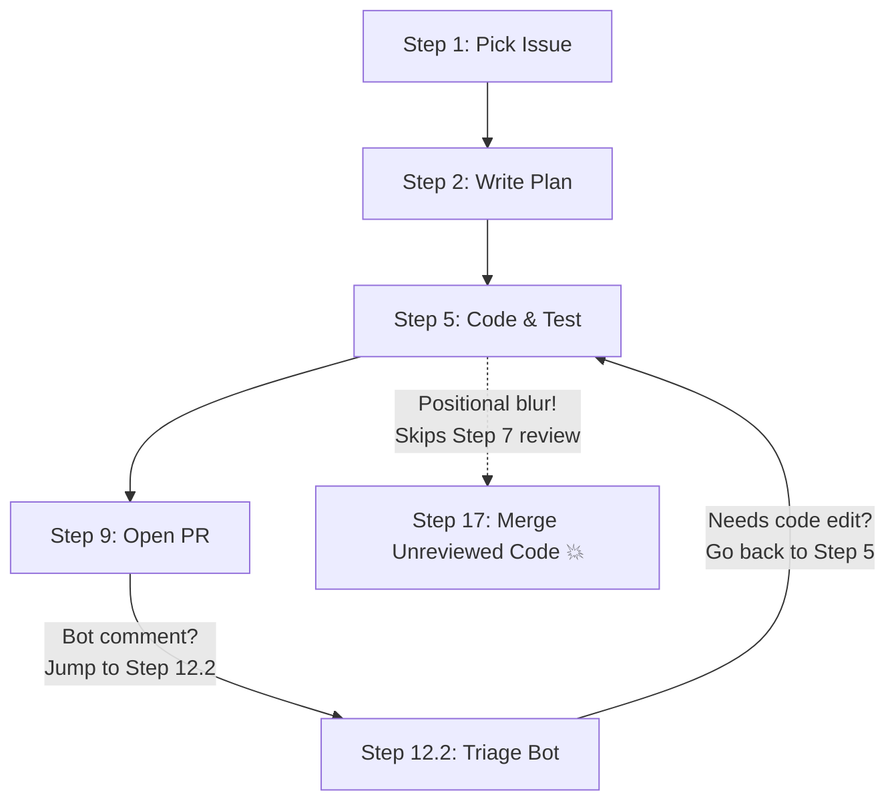
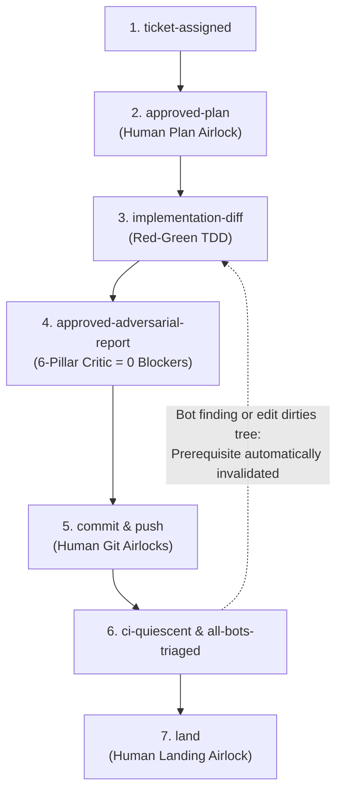
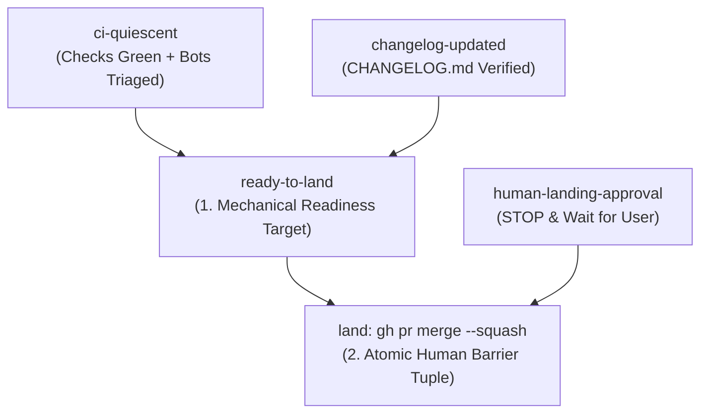

### *Why Stuart Feldman's 1976 Bell Labs invention is the exact cognitive architecture modern AI coding agents were missing.*

> *"Most of the problems in writing software come from not knowing what depends on what."*  
> — **Stuart Feldman**, creator of `make` (1976)

---

## 1. The Prompt Engineering Trap: The Seductive Illusion of the Step-by-Step Checklist

Almost everyone starts engineering autonomous coding agents the exact same way: a numbered checklist inside a system prompt or `SKILL.md` file.

```markdown
Step 1: Pick an open issue from the tracker.
Step 2: Read the codebase and write an architectural plan.
Step 3: Pause and ask the human for approval.
Step 4: Write failing tests first (TDD).
Step 5: Implement the code.
Step 6: Run tests and static analysis.
Step 7: Perform an adversarial self-review.
Step 8: Rebase on main and commit.
Step 9: Push and create a pull request.
...
Step 17: Triage bot reviews, update documentation, and clean up.
```

On paper, it looks wonderfully organized. It reads like a Standard Operating Procedure you would hand to a new human intern on their first day.

And yet, in production, it reliably collapses into chaos.

### The Failure Mode: Pre-Training Gravity and Imperative GOTO Spaghetti
Large Language Models are probabilistic next-token predictors. A 20-step linear checklist creates a combinatorial explosion of procedural state transitions.

As the conversation history fills up with compiler logs, test outputs, and git diffs, the model experiences **attentional degradation**. The top of the checklist drifts tens of thousands of tokens into the past.

Even worse is the **Imperative GOTO Trap**. What happens when a test fails at Step 6, or an automated code review bot leaves three comments after Step 9?

The prompt author starts writing tortured, imperative routing rules:

> *"If a review bot leaves comments after Step 9, jump to Step 12.2. If code edits are needed, go back to Step 5, but do not re-create the branch from Step 1, then proceed to Step 8, but do not create a new PR, just push with lease, and return to Step 12.4..."*

LLMs cannot reliably simulate an imperative virtual machine with nested loop counters and conditional `GOTO` jumps across 150 tool turns. They lose their place, skip intermediate gates, or hallucinate an exit condition out of sheer contextual fatigue.



### The "Resuming in the Middle" Disaster
What happens when an agent opens a pull request, pauses while CI runs, and you wake it up two hours later with: *"CI failed on the widget test and the review bot suggested a refactor"*?

* A linear checklist agent reads `Step 1: Pick an open issue` at the top of its skill file and starts hallucinating, asks which ticket to work on, or restarts archaeology from scratch.
* The human operator is forced back into micro-management: *"No, don't pick a ticket, you're on Step 12, Sub-step B—go fix the test and push!"*

---

## 2. The Bell Labs Epiphany: `make` Was Never Just for C Files

In 1976 at Bell Laboratories, Stuart Feldman solved this exact systems problem: **dependency tracking and state reconciliation**.

Feldman didn't write an imperative shell script that said:
*"First compile `foo.c`, then compile `bar.c`, then link them into binary `baz`."*

He realized that imperative build scripts are brittle because they fail to model the underlying structure of reality:
1. **Targets**: What end-state artifact or verified condition are we trying to produce?
2. **Prerequisites**: What upstream artifacts must exist—and be fresher than the target—before we are allowed to build this target?
3. **Recipes**: What physical command or action produces the target from its prerequisites?

`make` does not care about step numbers. It cares about the **Directed Acyclic Graph (DAG)** of dependencies.

### The Core Breakthrough
An autonomous AI coding agent's workflow is not a procedural script. **It is a Directed Acyclic Graph of physical software artifacts and verified invariants.**



---

## 3. The Canonical Agent Makefile: From Issue to Landed PR

Instead of 20 fragile numbered steps, the entire lifecycle of software engineering can be expressed as a declarative Makefile DAG inside the agent's skill definition, where every human checkpoint and quality bar is a distinct target with bounded prerequisites:

```makefile
.PHONY: finish land ready-to-land ci-quiescent push commit pre-commit-clean \
        approved-adversarial-report adversarial-review implementation-diff \
        approved-plan researched-ticket ticket-assigned review-ready ship fast-track

finish: land codified-scars-consolidated pristine-workbench
land: ready-to-land human-landing-approval
ready-to-land: ci-quiescent changelog-updated
ci-quiescent: push ci-remote-green all-bots-triaged
push: commit human-push-approval
commit: pre-commit-clean human-commit-approval
pre-commit-clean: approved-adversarial-report clean-static-analysis doc-audit-complete
approved-adversarial-report: adversarial-review triaged-blockers human-review-approval
adversarial-review: implementation-diff
implementation-diff: approved-plan tdd-failing-repro human-diff-approval
approved-plan: researched-ticket human-plan-approval
researched-ticket: ticket-assigned candidate-scars git-archaeology
ticket-assigned:
```

When you dispatch an agent on a fresh ticket, the top-level goal is always the same:

```bash
make finish
```

Evaluating the graph backward from `finish` to the deepest unsatisfied leaf immediately induces the exact execution trajectory:

```text
ticket-assigned → researched-ticket → approved-plan → implementation-diff → ... → finish
```

---

## 4. The Bounded Fan-In Invariant: Why Long Prerequisite Lists Fail in LLMs (The Feldman Triad Rule)

Why can't we simply attach all prerequisites onto a single target line like this?

```makefile
# ❌ THE PREREQUISITE DILUTION TRAP (5 prerequisites on one line)
land: push ci-remote-green all-bots-triaged changelog-updated human-landing-approval
	gh pr merge --squash
```

In classical GNU Make, a target with ten prerequisites executes deterministically from left to right because a C program uses a hard CPU loop counter.

An LLM is not a C program. It is an autoregressive transformer governed by self-attention weights and predictive momentum.

Empirical field testing across 143 production tickets revealed a universal cognitive hazard we codified as **The Prerequisite Dilution Trap** (`SCAR-PROC-91`):

1. **Attentional Weight Attenuation**: As a prerequisite list grows beyond 3 items, the self-attention allocated to tokens at the tail of the list decays sharply.
2. **Autoregressive Verification Momentum**: When an agent successfully verifies four consecutive mechanical prerequisites (`push` → `ci-remote-green` → `all-bots-triaged` → `changelog-updated`), the conditional probability of continuing without stopping approaches `1.0`. The fifth item (`human-landing-approval`) gets swept along as a rhetorical checkbox rather than an immovable barrier, tempting the model to merge the PR unilaterally without asking the human.
3. **Working Memory Chunking Limits**: Grounded in George Miller's classic cognitive capacity limit (`7 ± 2` chunks, which compresses to `3 ± 1` in dense tool-calling contexts), an agent cannot simultaneously verify four repository states while keeping sentinel attention on a hard stop condition.
4. **The Missing State Register**: Unlike a CPU with an instruction pointer (`int index = 3;`), a transformer has no internal integer register. It resolves pairwise binary dependencies (`A` before `B`) with near-100% reliability, but tracking its ordinal spot inside a 5-item list degrades into positional blur once terminal logs fill the context window.

### The Feldman Triad Invariant: Maximum 2–3 Prerequisites per Target

To eliminate prerequisite dilution, every Makefile target in an agent workflow must obey the **Bounded Fan-In Invariant**:

```text
1 <= |Prerequisites(Target)| <= 3
```

Every privileged human checkpoint (`approved-plan`, `commit`, `push`, `land`) is factored into an irreducible **Atomic Barrier Tuple** with strictly **two** prerequisites—a composite readiness target and the explicit human approval gate:

```text
action-target: ready-state human-approval
```



Under this two-prerequisite topology, the agent's decision at the airlock is strictly binary:
1. Is `ready-to-land` physically satisfied? **Yes.**
2. Has `human-landing-approval` been granted in the current user turn? **No.**
3. **Result → STOP (`tool_calls: []`). Present the status and wait for the human.**

By factoring wide prerequisite lists into shallow 2-to-3 item sub-targets, human approval gates become impenetrable Dijkstra barriers.

---

## 5. Replacing Imperative Loops with Declarative Fixed Points

Watch how a Makefile DAG eliminates every `while` loop, retry counter, and conditional `GOTO` from your prompt:

```text
Satisfied(target) ⇔ (∀ p ∈ Prerequisites: Satisfied(p)) ∧ Invariant(target) == true
```

* **Self-Healing on Invalidation**: Suppose you are at `ci-quiescent`, and an automated review bot posts a legitimate bug finding on GitHub. You do not need a prompt rule saying *"Jump back to Step 5.2"*. When the agent edits the code to fix the bot's finding, the working tree becomes dirty—which physically invalidates `commit`, `push`, and `approved-adversarial-report`! The DAG automatically routes the agent back through the local Adversarial Critic (`adversarial-review`) before it can re-commit and re-push.
* **Fixed-Point Evaluation**: You never count loop iterations. The agent evaluates the physical predicate against disk and GitHub state (`git status`, `gh pr checks`, test exit codes). So long as a prerequisite is dirty or missing, its recipe runs. Once all prerequisites hold, the target settles into its fixed point.
* **Cognitive Load Drops to `O(1)`**: The agent never has to ask: *"Am I on Step 4 of the initial implementation, or Step 4 of the second bot-remediation cycle?"* It only ever asks one question: **"What is the single leaf target I am building right now, and does its physical invariant hold?"**

---

## 6. The Session Frontier Resolution Oracle: Resuming Anywhere in `O(1)`

How does a Makefile-driven agent know where to pick up when you drop into a branch mid-flight—or after a break?

Instead of relying on conversational memory, the agent runs the **Session Frontier Resolution Oracle**: it inspects the physical state of the repository and GitHub forge to locate the deepest unsatisfied prerequisite of `make finish`:

| Physical Git / Forge State | Resolved Active Target | Natural Operator Prompt |
| :--- | :--- | :--- |
| PR open with unaddressed bot comments or red CI | `ci-quiescent` | *"Triage the bot review"* |
| PR open, all checks green, bots quiescent | `land` | *"Land it!"* |
| Committed locally on feature branch, not yet pushed | `push` | *"Push and open the PR"* |
| Clean static analysis + approved critic report | `commit` | *"Commit this"* |
| Implementation diff passing tests, unreviewed | `adversarial-review` | *"Run the critic"* |
| Approved `plan.md` on disk, no code changes yet | `implementation-diff` | *"Proceed with the plan"* |
| Clean working tree on `main` | `ticket-assigned` | *"Let's run with #321!"* |

You never have to tell the agent which step number it is on. The filesystem and git graph *are* the state machine.

---

## 7. Calibrated Velocity: Meta-Targets for Daily Engineering

Not every task needs a full zero-to-merged autonomous run. Just like a real `Makefile`, our workflow exposes ergonomic meta-targets:

* **`make finish`** (Full Lifecycle): From issue selection (`ticket-assigned`) all the way through PR merge (`land`) and post-mortem scar extraction (`codified-scars-consolidated`).
* **`make review-ready`**: Runs from issue research through TDD, adversarial self-review, commit, and opening the PR—then stops so the human team can review at their leisure.
* **`make ship`**: When you have already written or tweaked code interactively in your editor and say *"Ship it"*, the agent starts at `pre-commit-clean`, runs the critic and static analysis, commits, pushes, triages CI, and lands.
* **`make fast-track`**: For trivial documentation or changelog fixes, bypasses multi-agent archaeology and runs straight through verification, commit, and push.

---

## 8. Why LLMs Love Makefiles: Riding Pre-Training Gravity

Why does this work so dramatically better than natural-language checklists?

1. **Deep Pre-Training Gravity**: Foundation models have ingested millions of `Makefile`s, `BUILD` files, and dependency graphs during pre-training. The syntax `target: prerequisite-a prerequisite-b` activates deep, structural dependency-resolution circuits in the model's weights that prose bullet lists never touch.
2. **Single-Target Airlocks (`SCAR-PROC-84`)**: Instead of juggling 21 steps in working memory, the agent binds strictly one active target per turn (`|ActiveTargets(t)| == 1`). Even if an eager human types *"commit and push"* in a single message, the `commit` airlock executes only `commit` and halts cleanly for `human-push-approval` after showing the commit hash.
3. **Zero Hallucinated Leaps**: In a prose checklist, a confident model will happily leap from Step 5 (writing code) straight to Step 9 (committing) while skipping the adversarial code review. In a Makefile DAG, `commit` depends on `pre-commit-clean`, which depends on `approved-adversarial-report`. If `self_critical_review.md` does not exist on disk with `VERDICT: APPROVED (0 BLOCKERS)`, the prerequisite for `commit` is physically unsatisfied.

---

## 9. The Empirical Scorecard—And the Next Boss Fight

We have now battle-tested this Declarative Makefile DAG across **143 production tickets** (`101` open-source framework tickets in `BlocSignal` and `42` commercial enterprise monorepo tickets) backed by **450 codified Synthetic Scars**:

* **Repeat Regression Rate**: **0.0%** across all 143 tickets.
* **Zero-Nudge Autonomous Runs**: Complex multi-package tickets routinely execute from `ticket-assigned` to `land` with **zero human corrective nudges (`N_nudge = 0`)**—where the human operator only approves the architectural plan and the three privileged git airlocks (`commit`, `push`, `land`).

Stop writing 20-step natural language essays to herd your coding agents. Stuart Feldman solved dependency orchestration at Bell Labs in 1976. Give your agent a `Makefile`.

### Next Up in Part 3.7: Surviving the 200k-Token Lobotomy
Wait—what happens when a massive, 5-round architectural ticket runs for **579 steps**, crosses **230,000 tokens**, and the host IDE fires **automatic context compaction** twice in the middle of your Makefile DAG?

In **[Part 3.7](https://dev.to/gde/surviving-the-200k-token-lobotomy-how-unix-initd-and-memento-made-my-ai-coding-agent-immune-to-2f74)**, we look at how another classic Unix invention—**1983 SysV `init.d` lexical runlevel files** combined with Christopher Nolan's *Memento* tattoo protocol and `fork()`/`wait()` subagents—lets an AI agent survive mid-flight context compaction with **zero lost invariants and zero repeated steps**.

*(Want to inspect the live Declarative Makefile DAG and modular reference files right now? Check out [Randal's Public Workflow Gist](https://gist.github.com/RandalSchwartz/598a1f2b5760a23c1d70b57e9e85393f).)*

---

### 📖 The [*Synthetic Scars* Series](https://dev.to/randalschwartz/series/44156) Roadmap

* **Part 1**: [Why AI Keeps Making the Same Coding Mistakes—And How Teaching It Pain Gives It Wisdom](https://dev.to/gde/why-ai-keeps-making-the-same-coding-mistakes-and-how-teaching-it-pain-gives-it-wisdom-4a9m)
* **Part 2**: [Why AI Coding Agents Crash at 3 AM: The Happy-Path Mirage & The Forced Continuity Defect](https://dev.to/gde/why-ai-coding-agents-crash-at-3-am-the-happy-path-mirage-the-forced-continuity-defect-46pd)
* **Part 3**: [The Physics of Socratic Prompting: Somatic Recoil, Chess Alpha-Beta, & The NLP Meta-Model](https://dev.to/gde/the-physics-of-socratic-prompting-somatic-recoil-chess-alpha-beta-the-nlp-meta-model-2b6e)
* **Part 3.5**: [Nudging with Questions: Why Telling Your AI What to Fix Triggers an Apology Death Spiral (And How to Advance Juniors)](https://dev.to/gde/nudging-with-questions-why-telling-your-ai-what-to-fix-triggers-an-apology-death-spiral-and-how-5gm4)
* **Part 3.6**: *Stuart Feldman Was Right in 1976: Why Your AI Agent Needs a Makefile, Not a 20-Step Prompt (You are here)*
* **Part 3.7**: [Surviving the 200k-Token Lobotomy: How Unix `init.d` and "Memento" Made My AI Coding Agent Immune to Context Compaction](https://dev.to/gde/surviving-the-200k-token-lobotomy-how-unix-initd-and-memento-made-my-ai-coding-agent-immune-to-2f74)
* **Part 3.8**: [What LLMs "Know" That You Don't Know They Know: Stop Inventing Prompt DSLs and Ride 50 Years of Unix Pre-Training Gravity](https://dev.to/gde/what-llms-know-that-you-dont-know-they-know-stop-inventing-prompt-dsls-and-ride-50-years-of-2bl6)
* **Part 4**: *Giving AI Pain: The Architecture of Synthetic Scars & The Rapid-Regret Miner*
* **Part 5**: *Zero Repeat Regressions: The Golden Metric & The Future of Agentic Trust*
* **Part 6**: *The Proscriptive Inversion: What You Get to Forget, and Why More Negative Rules Mean You've Lost*

Drop your thoughts in the comments below: have you watched an AI agent lose its place inside a long numbered prompt checklist? What happens when you switch from procedural step lists to declarative dependency graphs?
