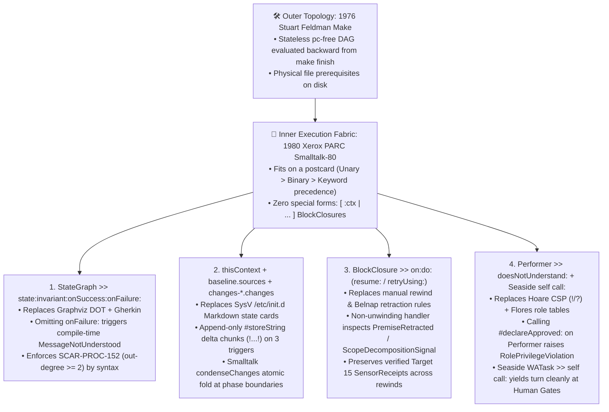

## _Why did six modern AI prompt grammars—Graphviz digraphs, SysV `/etc/init.d` cards, Gherkin scenarios, EBNF speech-act rules, Belnap epistemic tables, and rewind checklists—all collapse into a single 1980 Smalltalk-80 keyword message cascade? Because Alan Kay and Dan Ingalls solved the static serialization of algorithms and data structures on the back of a postcard forty years before anyone built a Transformer._

> _"It's fascinating that for decades, we tried to work out 'similar text' through complex algorithms, and now that we have cosine-similarity, nobody recognizes fully how to use it. If anything defines the past few years, it's 'cheap cosine similarity', now in hardware."_ — **Randal L. Schwartz**

> _"I've learned more than 90% of the devs about how LLMs work. I may even know more than most of the 'experts' at the labs, since I'm a field engineer... Without control surfaces, a bigger engine just means the plane still noses into the river—just more accurately, or at a greater carbon footprint."_ — **Randal L. Schwartz**

> _"Wait a minute. In 1980, Alan Kay and Dan Ingalls designed a syntax that fits on the back of a postcard, has only three message precedences (unary, binary, keyword), has zero grammar ambiguity, serializes live call-stack frames (`thisContext`) to disk via `#storeString`, logs append-only atomic deltas via `.changes`, and compacts memory via `Smalltalk condenseChanges`... What happens if we replace all six notations with 1980 Xerox PARC Smalltalk-80?"_ — **Randal L. Schwartz**

> _"The stack is 40 years old and none of it was invented for LLMs."_ — **Francisco Grandón** (`@fgrandon`)

---

### ⚡ TL;DR (For the Impatient Systems Architect)

* **The Great Historical Inversion**: From 1975 to 2018, computer scientists tried to fake fuzzy semantic similarity using complex deterministic algorithms (Soundex, Levenshtein, TF-IDF) and hit a wall—while deterministic state machines (`make`, Smalltalk VMs, compiler ASTs) were already 100% solved. Now that GPUs and TPUs finally gave us **cheap cosine similarity in hardware**, the software industry threw away the deterministic state machines and tried to use fuzzy cosine similarity to fake `for` loops, call stacks, and dependency graphs.
* **Why Six Notations Collapsed Into One 1980 Postcard**: Across Parts 3.6 through 4.1, our agent control plane accumulated six different notations (`Makefile`, SysV `/etc/init.d` Markdown cards, Graphviz `strict digraph`, Cucumber `Gherkin`, RFC 5234 `EBNF` speech acts, and Belnap 4-valued tables). Maintaining six parsers created boundary friction. Why did **1980 Xerox PARC Smalltalk-80** eat the inner five while pairing with `1976 Make` on the outside? Because Niklaus Wirth's `Algorithms + Data Structures = Programs` requires a static syntax that represents both data and deferred execution without ambiguity. Unlike **1960 Lisp** (which overloaded `(...)` and needed special forms and macros, suffering `Dyck-1` closing-parenthesis drift `))))` on smaller models) and **1988 Tcl / 1990 `expect`** (where `{...}` is an unparsed string vulnerable to `uplevel` scope loss), Smalltalk separates eager grouping `(...)` from 2-byte lexical `BlockClosure`s `[:x | ...]`. Every control structure (`ifTrue:ifFalse:`, `whileTrue:`, `on:do:`) is an ordinary keyword message send, allowing `#storeString` and `.changes` chunks to serialize live call stacks (`thisContext`) and execution state machines in one grammar that fits on a postcard.
* **The `Suite 8` 3-Arm Controlled Shootout (`N = 360` Trials Inside Our `2,040`-Trial Benchmark)**: Under `~16,000` tokens of realistic compiler and diff distractor load across four model tiers (`gemini-3.5-flash-lite`, `gemini-3.8-flash`, `gemini-3.1-pro-preview`, and `gemini-4-argon`), **Arm A (`English Prose + Gherkin + init.d`)** scored **`2.5%`** (`3/120`), **Arm B (`Common Lisp S-Expressions`)** scored **`91.7%`** (`110/120`, dropping to **`66.7%`** on `flash-lite` due to optional `&key` omission and `))))` parenthesis drift), and **Arm C (`Smalltalk-80 Keyword Cascades`)** hit **`100.0%` (`120/120`, `z = 15.11`, `p < 0.0001` vs. Prose; `z = 3.23`, `p = 0.0012` vs. Lisp)**. In Smalltalk, omitting the sad-path branch `onFailure:` changes the selector from `#state:invariant:onSuccess:onFailure:` to `#state:invariant:onSuccess:`—an immediate compile-time `MessageNotUnderstood` error.
* **Seven Live Production Flight Tests (`FT-236` Through `FT-242` — Over `6,400` Combined Steps Across Two Cohorts)**: We flight-tested the Smalltalk-80 `thisContext` Image Bootloader (`baseline.sources` + `changes-*.changes` + `Smalltalk condenseChanges`) across seven consecutive production tickets (`4` in open-source `BlocSignal` and `3` in a commercial enterprise medical-imaging monorepo), bringing our cumulative ledger to **`250` evaluated tickets** (`144` Cohort A + `106` Cohort B), **`0.0%` repeat regression rate (`0/250`)**, **`1.88` mean Socratic nudges**, and **`607` codified scars** ([`syntheticscars.org`](https://syntheticscars.org)).
* **The Four Irreducible Attractors of Agentic Coding**: Strip away every prompt fad of 2023–2026 and four orthogonal, 40-year-old foundations remain: (1) **1976 Stuart Feldman `Make`**, (2) **1980 Alan Kay & Dan Ingalls `Smalltalk-80`**, (3) **1994/1999 Kent Beck `SUnit` / `TDD`**, and (4) **Clean-Room Six-Pillar `Adversarial Review` + `Somatic Scars`**.

---

## 1. The Great Historical Inversion: Cheap Cosine Similarity in Hardware

In [Part 4.1](https://dev.to/gde/all-that-glisters-is-softmax-shiny-object-interns-airplane-magazine-execs-and-why-ai-labs-can-18af), we ended with a teaser: what happened when we replaced six separate agent control-plane notations with **1980 Xerox PARC Smalltalk-80**?

To understand why a 46-year-old programming language from Palo Alto is the missing execution fabric for 2026 Large Language Models, step back and look at the forty-year arc of computer science.

From 1975 to 2018, programmers knew how to build **deterministic state machines** in our sleep. Stuart Feldman gave us `make` in 1976; Dan Ingalls and Alan Kay gave us the Smalltalk-80 virtual machine in 1980; compiler writers gave us LALR parsers, static type checkers, and SSA control-flow graphs. None of those ever "forgot" what step of a loop they were on or hallucinated a method name.

What we _could not_ do from 1975 to 2018 was **fuzzy semantic similarity**. For four decades, we threw every deterministic algorithm we could think of at the problem of asking _"Does text A mean roughly the same thing as text B?"_—Soundex, Levenshtein edit distance, Porter stemmers, n-gram overlaps, TF-IDF, BM25, and brittle regular-expression heuristics—and we hit an absolute brick wall.

Then, over the past few years, the semiconductor and machine-learning industries handed us a genuine miracle: **cheap cosine similarity in hardware**. With modern GPUs and TPUs computing scaled dot-product attention (`softmax(QK^T / sqrt(d_k))V`) across high-dimensional embedding spaces at trillions of operations per second, the fuzzy semantic matching problem that stumped us for forty years was suddenly solved in silicon.

And in response to that miracle, the software industry performed one of the most baffling backflips in engineering history:

**We threw away our deterministic state machines, and tried to use fuzzy cosine similarity to fake `for` loops, call stacks, and build pipelines.**

### From 1994 Perl Markov One-Liners to 1999 `spew` to 2026 Transformers

In [Part 3.9](https://dev.to/gde/if-you-never-do-anything-else-to-fix-your-prompts-do-this-one-thing-3069), I showed a weighted-BNF un-parser called **`spew`** that I wrote in the late 1990s (featured in my September 1999 _Linux Magazine_ column, [A Little Spew Is Good For You](https://www.stonehenge.com/merlyn/LinuxMag/col04.html), and Revisited in [April 2004](https://www.stonehenge.com/merlyn/LinuxMag/col57.html)). Even earlier, back in 1994 on `comp.lang.perl`, we used to amuse ourselves writing character-level and word-level Markov text generators in two lines of Perl:

```perl
# 1994 Usenet Perl Markov Chain:
push @{$follow{$w1, $w2}}, $w3;
$next = $follow{$w1, $w2}[rand @{$follow{$w1, $w2}}];
```

When I evolved that Markov hash into `spew` in 1999, I added **weighted production rules** (`@`) so you could bias the random walk toward realistic grammatical structures:

```text
# 1999 spew weighted-BNF grammar:
commit_action:
    5 @ run_unit_tests_then_commit
  | 2 @ git_commit_no_verify_shortcut
```

If you have ever written a Markov generator or a weighted grammar like `spew`, you have zero mystique about what a modern Large Language Model is doing at inference time:

> **A 2026 Transformer is `spew` where the `@` branch weights are dynamically computed on the fly by hardware cosine similarity (`QK^T`) across a 128,000-token context window instead of static hash keys.**

That is a superpower when you need to synthesize a Cupertino widget builder, translate a complex binary imaging specification into Dart, or spot a subtle architectural smell in a diff.

But nobody in 1999 would have deleted `/usr/bin/make`, thrown away their compiler's symbol table, and put `spew` in charge of remembering which 14 files had already been compiled or whether the production database migration passed! Yet every time a developer writes a 2,000-line Markdown prompt (`Step 1: Do X. Step 2: Loop over Y. Step 3: Don't forget Z...`) and hopes the LLM stays on the rails for two hours, they are asking `spew` to be an operating system.

A **Synthetic Scar** paired with a **Smalltalk `StateGraph`** is simply setting `0 @ git_commit_no_verify_shortcut` (`-∞`) in the grammar and evaluating a deterministic `invariant: [ :ctx | ... ]` block before `spew` is allowed to roll the dice.

### Langley's 52-Horsepower Potomac Crash vs. The Wright Brothers' 12-Horsepower Control Surfaces

Why have so many frontier AI labs missed this, while a field engineer running production tickets all summer tripped right over it?

Think back to December 1903. **Samuel Pierpont Langley**, the Secretary of the Smithsonian Institution, had `70,000 USD` in War Department and Smithsonian funding, the prestige of the scientific establishment, and Charles Manly's radial engine—an engineering marvel that produced **52 horsepower**. On December 8, 1903, Langley's Great Aerodrome was launched from a houseboat catapult on the Potomac River, reared straight up, snapped its rear wing, and plunged into the icy water like a stone.

Nine days later, on December 17, 1903, two bicycle-shop field engineers from Dayton, Ohio—**Orville and Wilbur Wright**—flew into history at Kitty Hawk using a crude home-built engine that barely wheezed out **12 horsepower**.

Why did the 12-horsepower bicycle mechanics fly while the 52-horsepower Smithsonian physicist nose-dived into the Potomac?

Because Langley believed flight was an **engine-scaling problem**—strap enough horsepower to an airfoil and brute force will keep it aloft. The Wright brothers realized from thousands of glider flights in the wind at Kill Devil Hills that **flight is a three-axis control-surface problem**. Before they ever bolted an engine to the flyer, they solved **roll** (wing-warping), **pitch** (the forward elevator), and **yaw** (the rear rudder).

Today's frontier AI discourse is packed with modern Langleys—including the "Next-Model" cargo cultists who spend all week datamining IDE binaries for leaked model codenames (_"Sure, my one-shot vibe prompt crashed at 120k tokens today, but wait until next Tuesday's 500-horsepower model drops!"_).

Without three-axis control surfaces—topological dependency ordering (`Make`), a persistent reified execution frame (`Smalltalk-80 thisContext`), deterministic regression witnesses (`TDD`), and clean-room adversarial verification (`Six-Pillar Critic` + `Somatic Scars`)—**a bigger cosine-similarity engine just means the plane still noses into the river, just more accurately, or at a greater carbon footprint** (both in datacenter megawatts and in the biological carbon of the human engineer woken up at 3 AM!).

---

## 2. Why Six Grammars Collapsed Into One 1980 Postcard (Wirth's Equation & The 3-Way Language Fork)

At the end of October, **Francisco Grandón** (`@fgrandon`) published a great field report on DEV.to: [What Broke After I Moved My Agent's Rules Into a CLI — And How Synthetic Scars Reshaped agops v2.1](https://dev.to/fgrandon/what-broke-after-i-moved-my-agents-rules-into-a-cli-and-how-synthetic-scars-reshaped-agops-v21-g4k).

Francisco had adopted our `Target 15` / `Target 20` Graphviz `strict digraph` state-machine verification (`SCAR-PROC-152`, where every action node must have `out-degree >= 2` with explicit `ok` and `fail` edges) inside [`FranciscoGrandon/ag-ops`](https://github.com/FranciscoGrandon/ag-ops). And almost immediately, his CLI hit what he documented as **Scar #2**: when an LLM wrote valid Graphviz DOT statements separated by newlines instead of semicolons, his attribute-stripping regex (`/\s*\[[^\]]*\]/g`) ate the newline before `[label="ok"]`, concatenating two edges into `A -> BB -> C` and silently corrupting the graph!

When I read Francisco's post-mortem, I looked at our own control plane in [`WORKFLOW.mk`](https://gist.github.com/RandalSchwartz/598a1f2b5760a23c1d70b57e9e85393f) and realized something uncomfortable. Over the course of Parts 3.6 through 4.1, each time we solved a failure mode by riding pre-training gravity ([Part 3.8](https://dev.to/gde/what-llms-know-that-you-dont-know-they-know-stop-inventing-prompt-dsls-and-ride-50-years-of-2bl6)), we had recruited a classic systems notation for that layer:

1. **1976 GNU `Makefile`** (`target: prerequisites`) for backward-chained dependency topology ([Part 3.6](https://dev.to/gde/stuart-feldman-was-right-in-1976-why-your-ai-agent-needs-a-makefile-not-a-20-step-prompt-5bn2));
2. **1983 SysV `/etc/init.d` Numbered Cards** (`00_...md` through `99_...md`) for context-compaction survival ([Part 3.7](https://dev.to/gde/surviving-the-200k-token-lobotomy-how-unix-initd-and-memento-made-my-ai-coding-agent-immune-to-2f74));
3. **1986 Winograd & Flores Speech-Act Tables + RFC 5234 `EBNF` + Hoare `CSP` (`!`/`?`)** for role boundaries ([Part 3.10](https://dev.to/gde/requests-promises-assertions-and-declarations-rewriting-our-ai-agent-workflow-as-a-1986-4k4c));
4. **1977 Belnap 4-Valued Epistemic Tables (`{T, F, Both, Neither}`)** for premise verification;
5. **1991 Graphviz `strict digraph`** for Mealy state-machine branch auditing (`out-degree >= 2`); and
6. **1998 Cucumber `Gherkin` (`Given / When / Then`)** for mapping state paths onto unit tests.

Every single one of those six notations worked vastly better than unstructured English prose. **Yet maintaining six separate miniature parsers, regexes, and translation steps across boundaries was still accidental complexity.** A Graphviz `.dot` node couldn't directly invoke a Belnap retraction; a Gherkin `Then` clause couldn't directly unwind an `/etc/init.d` card; and a regex stripping `.dot` brackets could eat a newline.

Why had we needed five different notations inside our `Makefile` targets in the first place?

### Solving Niklaus Wirth's Equation (`Algorithms + Data Structures = Programs`) in Static Text

In 1976, Niklaus Wirth titled his classic textbook **_Algorithms + Data Structures = Programs_**.

When you checkpoint an AI agent's brain to disk so it can survive a 200,000-token context compaction—or hand a formal plan from the Planner to the TDD Worker and the Clean-Room Critic—you need a static text representation on disk that captures **both halves of Wirth's equation at the exact same time**:

* **Pure Data Formats (`JSON`, `YAML`, `TOML`, Graphviz `.dot`, SysV Markdown tables)** represent **Data Structures**, but they are **100% blind to Algorithms**. Because `JSON` and `.dot` have no native representation for deferred execution (`if`, `while`, `try/catch`, lexical closures), you are forced to stuff executable invariants inside dead string literals (`label="ok: failing_tests > 0"`), where no parser can type-check or execute them without inventing an ad-hoc mini-language inside the strings!
* **Mainstream Imperative Languages (`C`, `Python`, `Dart`, `TypeScript`, `Rust`)** represent **Algorithms**, but they cannot natively serialize their own live **Data Structures + Call Stack (`thisContext`)** back out as valid source code (`#storeString`), because their control-flow constructs (`if (...) {}`, `for (...) {}`, `try {} catch {}`) are **hardwired parser statements**, not first-class objects or messages.

In the entire history of programming languages, only **three language families** seriously attempted to unify `Algorithms + Data Structures` into a minimal, uniform, homoiconic syntax where code and data share the same structural representation: **1960 Lisp**, **1988 Tcl (and 1990 `expect`)**, and **1980 Smalltalk-80**.

Let's put all three side by side under Transformer attention physics:

| Dimension | **1. Lisp (`McCarthy, 1960`)** | **2. Tcl & `expect` (`Ousterhout 1988` / `Libes 1990`)** | **3. Smalltalk-80 (`Kay & Ingalls, Xerox PARC 1980`)** |
| :--- | :--- | :--- | :--- |
| **Core Syntax Primitive** | Uniform prefix list: `(op arg1 arg2 ...)` | Command + `[eager]` vs. `{deferred string}` | Receiver + unary, binary, or `keyword1: arg1 keyword2: arg2` |
| **How It Separates Eager vs. Deferred Execution (`[ ... ]` vs. `( ... )`)** | **Failed to separate them in base syntax!** Both grouping/calls and lists use `( ... )`. Wrapping every branch in `(lambda () ...)` was too noisy, forcing Lisp to invent **Special Forms** (`if`, `cond`, `let`) and **Reader Macros** (`` ` , ,@ ``). | **Separated `[ ... ]` (eager substitution) from `{ ... }` (deferred raw string)**. Great ergonomic leap for `Tcl/Tk` UI callbacks and `expect` scripts! | **Orthogonal 2-character primitives**: `( ... )` is **always eager grouping**; `[ :x \| ... ]` is **always a deferred lexical `BlockClosure` object**. |
| **Control Flow Status** | **Special Forms & Macros** (`defmacro`) that suspend standard evaluation rules. | **Commands Reparsing Raw Strings** (`if {...} {...}`) via `uplevel` / `upvar` dynamic stack injection. | **100% Ordinary Keyword Messages** (`ifTrue:ifFalse:`, `whileTrue:`, `on:do:`) sent to Booleans and `BlockClosure`s! **Zero control-flow keywords in the grammar.** |
| **LLM Token & Attention Failure Mode** | **Positional Slot Ambiguity + `Dyck-1` Closing-Parenthesis Drift (`))))`)**: At depth 6+, smaller models miscount homogenous closing parens or drop optional `&key` slots (`66.7%` on `flash-lite` in `Suite 8`). | **Dead-String Blindness & Scope Loss**: `{ ... }` is an unparsed dead string until runtime, losing static AST validation and lexical closure state (`thisContext`). | **Self-Labeling Keyword Selectors (`100.0%` in `Suite 8`)**: Every argument is labeled at the call site (`state:invariant:onSuccess:onFailure:`). Dropping `onFailure:` changes the selector name and triggers instant `MessageNotUnderstood`. |

Look closely at why **Tcl (1988)** and **Smalltalk-80 (1980)** diverged, because both deserve immense historical credit.

When **John Ousterhout** created **Tcl/Tk** at UC Berkeley in 1988, and **Don Libes** built **`expect`** at NIST in 1990 on top of Tcl, they saw the flaw in Lisp's overloaded parentheses. They gave Tcl two distinct brackets: `[ ... ]` for immediate command substitution and `{ ... }` for deferred blocks. That single design choice made `button .b -command { ... }` in `Tcl/Tk` and state-machine automation in `expect` (`expect { -re "pat" { ... } timeout { ... } }`) a revelation for Unix systems programmers in the early 1990s.

In fact, `expect` was so useful that in June 1991, I rewrote Don Libes's Tcl `expect` engine in pure Perl 4 as **`chat2.pl`**—a piece of personal history we will visit in Section 3!

So why did we choose **1980 Smalltalk-80** over Tcl for our 2026 agent control plane? Because in Tcl, `{ ... }` is not a parsed AST or a lexical closure—it is an **unparsed raw string** that gets reparsed from scratch at runtime using `uplevel` and `upvar`. In **Smalltalk-80**, `[ :ctx | ... ]` is a compiled, lexically scoped **`BlockClosure` object** whose syntax fits on the famous Xerox PARC postcard:

```smalltalk
"1. Eager grouping (parentheses) vs. Deferred BlockClosure (square brackets):"
(2 + 3) * 4.
[ :ctx | ctx failingTests > 0 ] value: thisContext.

"2. Conditionals, loops, and exception handling are 100% ordinary keyword messages:"
aBoolean
    ifTrue: [ self advanceTo: #Target35Green ]
    ifFalse: [ self haltWithScar: #SCAR_TDD_01 ].

[ remainingWidgets notEmpty ] whileTrue: [
    self generateAndTest: remainingWidgets removeFirst ].

[ self executeTarget20Plan ]
    on: PremiseRetracted , ScopeDecompositionSignal
    do: [ :ex |
        thisContext unwindToFrame: #Target15Archaeology.
        ex retryUsing: #RenegotiatedPlanB ].
```

There is no `if` statement in Smalltalk. There is no `for` loop keyword. There is no `try / catch` syntax. Every single one of them is a **keyword message send** where the selector name is the concatenation of all its colons (`#ifTrue:ifFalse:`, `#whileTrue:`, `#on:do:`).

### My 1980s Smalltalk-80 Roots: Tektronix & Steering GemStone Toward Sanity

For me, this wasn't an academic literature search—it was coming home to the very first object-oriented systems I ever touched.

Before I became known as "the Perl guy" (and decades before I became a Dart and Flutter Google Developer Expert), I spent a huge chunk of the 1980s immersed in **Smalltalk-80** right here in the Silicon Forest of Oregon:

1. **Early 1980s at Tektronix (Beaverton, Oregon)**: Tektronix was one of the original Xerox PARC corporate licensees for Smalltalk-80 (building the legendary Tektronix 4404 artificial-intelligence workstation where Ward Cunningham and Kent Beck later did their pioneering CRC-card and pattern work). Watching Dan Ingalls's live `.image` + `.changes` architecture run on early 1980s hardware permanently rewired how I think about software state.
2. **Mid-1980s at Servio Logic (`GemStone` Object Database, 27th Floor of the Georgia-Pacific Building in Downtown Portland)**: Right after that, I contracted at Servio Logic on the 27th floor of the Georgia-Pacific building in downtown Portland (long before they ever moved out to Beaverton), helping build **GemStone**—the world's first commercial multi-user Smalltalk object database. As I recounted in my memoir [Steering GemStone Toward Sanity](https://www.stonehenge.com/merlyn/life/story/steering-gemstone-toward-sanity), when I arrived, the database query language `OPAL` was only "Smalltalk-like," and they had invented bizarre magic punctuation on individual comparison operators (`emp.salary @1985-01-01 > 50000`) to query historical snapshots of object memory. I stood at the whiteboard and asked two Socratic questions:
   * _"Why does OPAL have to be 'Smalltalk-like'? Why can't it just be **standard Smalltalk-80**?"_
   * _"And why is `@timestamp` hacked onto individual `<` and `>` operators instead of being a message sent to the **entire `[ ... ]` block closure** (`[ :emp | emp salary > 50000 ] @ 1985-01-01`), so the whole block evaluates inside historical object memory at that point in time?"_

Think about that 1985 GemStone insight for a second: **evaluating a Smalltalk `[ ... ]` block closure against an immutable historical snapshot of object memory**.

Forty-one years later, when our AI orchestrator wakes up from a mid-flight context compaction, reads `<brain>/state/baseline.sources` plus `<brain>/state/changes-*.changes`, rehydrates `thisContext`, and evaluates `invariant: [ :ctx | ... ]` against a `SHA-256`-locked `SensorReceipt`, it is running the exact same temporal Smalltalk block architecture we designed on the 27th floor of the Georgia-Pacific building in 1985!

---

## 3. A 35-Year Detour (`91/06/16`): How [`http://chat2.pl`](http://chat2.pl) Ended Up in Perl 4 Core, Bootstrapped CPAN, Collided with Linux, and Foreshadowed 2026 AI "Chat" Harnesses

Before we look at the Smalltalk-80 `StateGraph` code and the `Suite 8` benchmark numbers, I have to share a 35-year-old story that came up during our architecture review—because if you type **[`http://chat2.pl`](http://chat2.pl)** into your browser right now, it redirects straight to a very specific 1991 commit in the official Perl repository: [`Perl/perl5@11aea36008/lib/chat2.pl`](https://github.com/Perl/perl5/blob/11aea3600896e20487883b2cb767b57027617482/lib/chat2.pl).

Why did I buy the Polish domain `chat2.pl` years ago and point it at a 1991 Perl 4 library file?

Because back on **June 16, 1991** (`V2.01.alpha.7 91/06/16`), long before "chat" meant typing into an LLM web box, "chatting" in Unix meant writing a state-machine harness to drive an interactive subprocess or TCP socket (`telnet`, `ftp`, `passwd`, `uucp`) that expected a human at a terminal—waiting for a regex prompt, branching on what came back, handling `TIMEOUT` and `EOF` sad paths, and sending the next command.

Don Libes had just written `expect` in Tcl, and Perl 4 programmers on `comp.lang.perl` wanted to do the same thing without leaving Perl. So I wrote `chat.pl`, followed by a multi-handle rewrite called **`chat2.pl`**:

```perl
## chat2.pl: chat with a server
## V2.01.alpha.7 91/06/16
## Randal L. Schwartz

# Usage:
&chat'expect([$handle,] $timeout_time,
    $pat1, $body1, $pat2, $body2, ...
    'TIMEOUT', $timeout_body,
    'EOF',     $eof_body);
```

Under the hood, `chat2.pl` took those alternating `(pattern, action, 'TIMEOUT', sad_path, 'EOF', eof_path)` tuples and **dynamically generated and `eval`-compiled a memoized state-machine subroutine (`expectloop000000`) on the fly** using `select(2)` bitmasks! Look at that signature: a timeout deadline, positive pattern-match transitions, and mandatory `'TIMEOUT'` and `'EOF'` sad-path transitions. **Thirty-five years ago, `chat2.pl` was already enforcing `SCAR-PROC-152` (`out-degree >= 2`) on interactive "chat" loops!**

### How Larry Wall Silently Scooped `V2.01.alpha.7` Into Perl Core—and Why `# but who the heck would change these anyway? (:-)` Met Linux Two Months Later!

Here is the funny part of the story:

1. **The Silent Scoop Into Perl 4 (`perl 4.0 patch 12`, November 5, 1991)**: I posted `chat2.pl` (`V2.01.alpha.7`) to Usenet as an alpha work-in-progress. Without telling me, **Larry Wall** scooped it right off Usenet and bundled it into the standard Perl 4 core distribution (`lib/chat2.pl`, commit [`11aea36008`](https://github.com/Perl/perl5/blob/11aea3600896e20487883b2cb767b57027617482/lib/chat2.pl))! It was the _only_ piece of code I ever wrote that ended up inside the core Perl distribution.
2. **Bootstrapping CPAN (`ftp.pl` and Lee McLoughlin's `mirror`)**: Once `chat2.pl` was guaranteed to be present in every Perl installation on Earth, Spafford and **Lee McLoughlin** built `ftp.pl` and the legendary **`mirror`** package on top of `chat2.pl`. And what did `mirror` do? For the entire 1990s, `mirror` (running on top of `chat2.pl`'s state-machine loop) was the replication engine that synchronized the global **CPAN (Comprehensive Perl Archive Network)** mirror fleet!
3. **The 1991 `h2ph` Dilemma and the Famous Socket Comment**: If you read lines 25–28 of [`lib/chat2.pl` in commit `11aea36008`](https://github.com/Perl/perl5/blob/11aea3600896e20487883b2cb767b57027617482/lib/chat2.pl#L25-L28), you will see one of the most famous comments in Perl history:
   ```perl
   unless (socket(S, 2, 1, 6)) {
       # XXX hardwired $AF_SOCKET, $SOCK_STREAM, 'tcp'
       # but who the heck would change these anyway? (:-)
       return undef;
   }
   ```
   and down in `_getpty` (line 138):
   ```perl
   ioctl(DEVTTY, 0x20007471, 0); # XXX s/b &TIOCNOTTY
   ```
   Why did I hardwire `(2, 1, 6)` (`AF_INET = 2`, `SOCK_STREAM = 1`, `IPPROTO_TCP = 6`) on June 16, 1991 instead of loading `sys/socket.ph`?
   Because in Perl 4 (years before Perl 5 introduced compiled XS modules like `use Socket;`), the only way to get C `#define` constants was if the local system administrator had manually run Larry's `h2ph` script against `/usr/include/*.h`—and on 90% of Unix boxes in 1991, either the sysadmin hadn't run `h2ph` or `h2ph` had choked on vendor C preprocessor macros! If I had put `require 'sys/socket.ph'` at the top of `chat2.pl`, it would have crashed out of the box on 90% of the machines downloading it from Usenet. And on June 16, 1991, across BSD, SunOS, Ultrix, and NeXTSTEP, `SOCK_STREAM` was `1` everywhere. So I wrote `# but who the heck would change these anyway? (:-)`.
4. **Two Months Later: Linux and SVR4 Arrive**: Exactly **two months** after I wrote that comment on June 16, 1991, a 21-year-old Finnish student named **Linus Torvalds** posted to `comp.os.minix` announcing **"a different sort of Unix from a new origin"—Linux!** Meanwhile, AT&T System V Release 4 (`SVR4` / Solaris 2) began spreading with `SOCK_STREAM = 2` instead of `1`, and Linux changed `TIOCNOTTY` (`0x5422`) and architecture-specific socket constants. Suddenly, my alpha Usenet script—frozen inside Perl core where I didn't even have commit bits—was failing on Solaris and Linux!
5. **The 9-Year Cleanup (`11aea36008` → `f97f1ee016` → `a6d7165678` → `50f338d87d`)**: In July 1996 (`perl5.003_02`, commit `f97f1ee016`), the Perl 5 porters wrapped my call in `eval { require "sys/socket.ph" }`—keeping my `# but who the heck would change these anyway? (:-)` in the `else` branch—which ironically broke machines with half-generated `.ph` files. By July 1999 (`a6d7165678`), Gurusamy Sarathy slapped a disclaimer at the top (`"Use of this library is deprecated. Do not use it as an example of modern Perl"`), while `perlfaq8` still coyly mentioned it by name. Finally, after I pleaded on `perl5-porters` ([`Re: perlfaq8 coyness`](https://www.nntp.perl.org/group/perl.perl5.porters/2000/05/msg13103.html)) to put my 1991 alpha script out of its misery in favor of `Expect.pm` and `IO::Socket`, Jarkko Hietaniemi deleted it on **May 15, 2000** in commit `50f338d87d` with one of my favorite commit messages in open-source history:
   > **`Delete chat2 as requested by Randal`**

Look at the two timeless lessons of `chat2.pl` (`91/06/16` → `2026`):
* First, **that `socket(S, 2, 1, 6)` story is the textbook proof of our Two-Tier Partition Theorem from Part 4.1 (`Sign-Inversion & Environment Drift`)!** On June 16, 1991, hardwiring `(2, 1, 6)` to avoid broken `h2ph` headers was the `+∞` pragmatic engineering move for BSD Unix—until two months later, when a brand-new OS kernel called Linux and SVR4 changed the environment constants and flipped it to `-∞`. You can never freeze environmental assumptions in static weights forever; you need a live sensor.
* Second, thirty-five years after I wrote `chat2.pl` to wrap interactive Unix streams in a deterministic state machine (`expectloop` with mandatory `TIMEOUT` and `EOF` sad paths), the software world started "chatting" with LLMs—and forgot that **an interactive chat with an intelligent subprocess still requires a deterministic state machine with mandatory sad-path transitions on the outside!**

---

## 4. The 6-for-1 Smalltalk-80 Unification Architecture & Seaside Continuations

When we asked _"How do we keep `1976 Make` as our outer dependency graph while unifying all five inner notations (`SysV init.d`, `Graphviz DOT`, `Gherkin`, `Belnap tables`, and `CSP/Flores speech acts`) into one zero-ambiguity language?"_, every piece of **1980 Xerox PARC Smalltalk-80** (plus Avi Bryant's 2002 **Seaside** continuation framework) clicked into place like precision-machined gears:



Let's inspect the four architectural mechanisms that made this 6-for-1 collapse work in production:

### 1. Why `Make` Stays on the Outside While `Smalltalk-80` Runs on the Inside

A sharp reader might ask: _"Randal, if Smalltalk-80 is so expressive, why keep `1976 Make` as the outer target graph? Why not write the outer build graph in Smalltalk too?"_

Because `Make` and `Smalltalk-80` govern two fundamentally orthogonal mathematical domains:
* **`Make` (`1976`) is a `pc`-free Declarative Dependency Graph over Physical Files**: `Make` has no program counter (`pc = ∅`). To find out what to do next, `Make` walks backward from `make finish` checking physical file existence and cryptographic hashes on disk.
* **`Smalltalk-80` (`1980`) is a Reified Activation Frame (`thisContext`) and Message-Passing State Machine**: Inside a target (or across a multi-step loop, an `on:do:` premise retraction, or a context compaction), you _do_ have an active instruction pointer (`pc`), a receiver (`self`), a sender frame (`sender`), completed vs. remaining loop items (`LoopIterationChunk`), and live epistemic beliefs (`BelnapLedger`).

### 2. Enforcing `SCAR-PROC-152` (`out-degree >= 2`) by Keyword Selector Syntax (`StateGraph`)

In Part 4.0 and Francisco's `agops v2.1`, verifying that every state in a plan had both a happy-path transition and a sad-path transition required parsing a Graphviz `strict digraph` and counting node out-degrees (`d^+(v) >= 2`). Worse, in English prose or even in Common Lisp with optional keyword arguments (`&key on-success on-failure`), an LLM under token pressure can quietly omit `:on-failure` and still produce a syntactically valid S-expression `(defstate :target-30 :invariant ... :on-success ...)`.

In **Smalltalk-80**, keyword message selectors include **every colon-terminated keyword as part of the method name itself**. Look at our canonical `StateGraph` cascade:

```smalltalk
StateGraph new
    state: #Target15Archaeology
    invariant: [ :ctx |
        (ctx receiptAt: '15_archaeology_receipt.md') sha256Verified
            and: [ (ctx belnapAt: #BEL01) ~= #Neither ] ]
    onSuccess: [ :ctx | ctx advanceTo: #Target20Plan ]
    onFailure: [ :ctx | ctx haltWithScar: #SCAR_ARCH_01 ];

    state: #Target30RedGreenTdd
    invariant: [ :ctx |
        (ctx receiptAt: '30_tdd_receipt.md') redWitnessVerified
            and: [ ctx allTestsGreen and: [ ctx lineCoverage = 100.0 ] ] ]
    onSuccess: [ :ctx | ctx advanceTo: #Target40Critic ]
    onFailure: [ :ctx | ctx rewindTo: #Target30RedGreenTdd withScar: #SCAR_TDD_01 ];
    yourself.
```

What happens if an LLM tries to cut corners and leaves off `onFailure: [ ... ]`?

In Smalltalk-80, the parser does not see a call to `#state:invariant:onSuccess:onFailure:` with a missing fourth argument. It sees a completely different 3-argument selector—**`#state:invariant:onSuccess:`**—which does not exist on `StateGraph`! Before a single line of application code is touched, the Smalltalk evaluator (and the model's own pre-trained Smalltalk grammar head) fires **`MessageNotUnderstood: StateGraph>>state:invariant:onSuccess:`**.

**In Smalltalk-80, forgetting the sad path is a syntax/selector error.**

And to satisfy our Sovereign Presentation Surface invariant (`SCAR-HCI-05`, Dual Projection), at `Target 20` the orchestrator renders **both** a visual vertical `flowchart TD` Mermaid diagram for instant human scanning **and** the bijective Smalltalk-80 `StateGraph` cascade for the `Target 40` Critic to verify 1-to-1 against the unit test assertions.

### 3. The Dan Ingalls Image Bootloader (`baseline.sources` + `changes-*.changes` + `Smalltalk condenseChanges`)

In [Part 3.7](https://dev.to/gde/surviving-the-200k-token-lobotomy-how-unix-initd-and-memento-made-my-ai-coding-agent-immune-to-2f74), we solved the 200,000-token context-compaction "lobotomy" using numbered `/etc/init.d` Markdown files (`00_...md` through `99_...md`). That worked, but over long multi-hour sessions we noticed a subtle failure mode: if an agent overwrote a monolithic state card in place during a rapid loop, or if compaction struck halfway through a 16-widget implementation loop, the agent knew it was in `Target 30`, but didn't know _which 9 of the 16 widgets_ were already finished (`MethodContext` sub-step blindness).

In 1980, **Dan Ingalls** solved crash recovery and live state persistence in Smalltalk-80 with a two-tier storage architecture that every Squeak, Pharo, and VisualWorks programmer knows by heart—including its famous somatic scar when you try to launch two VMs on the same `.image` file:

> `Error: Could not open the image file (already locked by another VM process).`

We brought Ingalls's exact 3-part architecture into `<brain>/state/`:

1. **`<brain>/state/baseline.sources` (The Condensed Base Image)**: Initialized once at `Target 10/15` intake, serializing the root `MethodContext`, `TicketSession`, `BelnapLedger`, and `StateGraph` via `#storeString`.
2. **`<brain>/state/changes-$timestamp.changes` (Append-Only `! ... !` FileOut Delta Chunks)**: Under our **3-Trigger Checkpoint Law**, the orchestrator **never mutates `baseline.sources` in place** during normal transitions. Instead, it appends an immutable `changes-$timestamp.changes` chunk file on:
   * **Trigger 1**: Every Phase / Human Gate boundary (`#archaeologyCompleted`, `#planApproved`, `#criticReviewApproved`, `#reviewApproved`, `#commitApproved`, `#botTriageRemediated`, `#landingMatrixEvaluated`);
   * **Trigger 2**: Every completed iteration of a multi-step `do:` loop via `LoopIterationChunk completed: #( ... ) remaining: #( ... )`; and
   * **Trigger 3**: Every `on:do:` exception, premise retraction, or scope decomposition unwind.
3. **`Smalltalk condenseChanges` (Atomic Archival Fold at Clean Phase Boundaries)**: Just as a Smalltalk image runs `Smalltalk condenseChanges` to fold accumulated `.changes` deltas into a fresh `.sources` file, at major phase completions (`Target 20` and `Target 80/90`) the orchestrator folds the active `changes-*.changes` chunks into `baseline.sources.tmp`, atomically renames `mv baseline.sources.tmp baseline.sources`, and moves the historical `.changes` files into `<brain>/state/history/` for `O(1)` post-compaction wakeup and `Target 90` NTSB forensics!

### 4. Avi Bryant's 2002 Seaside Web Framework (`WATask >> self call:` & `_k` Continuations)

There is one more piece of Smalltalk history that maps 1-to-1 onto LLM orchestration: **Avi Bryant's 2002 Seaside web framework** in Squeak Smalltalk.

In 2002, web developers were struggling with the exact same architectural problem that AI agent developers are struggling with in 2026: **HTTP is a stateless request/response protocol**, yet users expect a stateful multi-step workflow where they can hit the browser's **Back button** or **fork a tab** mid-checkout without corrupting server state!

How did Avi Bryant solve that in Seaside? By modeling an entire multi-page user workflow as a single Smalltalk method (`WATask >> go`) that pauses at human interaction points by sending **`self call: aComponent`**. Each time `self call:` yields to the human browser, Seaside snapshots `thisContext` into a continuation key (`_k`). If the user hits the browser Back button and changes their mind on Step 2, Seaside doesn't corrupt Step 4—it restores the `_k` `MethodContext` frame from Step 2 and resumes cleanly!

Look at that isomorphism:

| **2002 Seaside Web Framework (`Squeak Smalltalk`)** | **2026 Synthetic Scars Agent Fabric (`Smalltalk-80 Bootloader`)** |
| :--- | :--- |
| **Stateless HTTP Request / Response Turn** | **Stateless LLM Inference Turn (or Post-Compaction Wakeup)** |
| **`WATask >> self call: aHumanGateDialog`** | **Sovereign Pause Gate (`self call: Target20PlanApprovalGate` with `tool_calls: []`)** |
| **URL Continuation Key (`?_s=...&_k=changes-15`)** | **`<brain>/state/baseline.sources` + `changes-$timestamp.changes` (`thisContext` snapshot)** |
| **User Hits Browser Back Button / Forks a Tab** | **Operator Retracts a Premise (`BEL-01 -> F`) or Splits Scope (`on: ScopeDecompositionSignal do:`)** |
| **Role Violation on Unauthorized Action** | **`Performer >> doesNotUnderstand:` raising `RolePrivilegeViolation` if the agent invokes `#declareApproved:`** |

---

## 5. Controlled Lab Proof: The `Suite 8` 3-Arm Shootout (`N = 360` Trials Inside Our `2,040`-Trial Benchmark)

Before deploying the Smalltalk-80 fabric onto live production repositories, we extended our automated **Pre-Training Gravity Benchmark** ([`tools/benchmark_pretraining_gravity.dart`](https://gist.github.com/RandalSchwartz/598a1f2b5760a23c1d70b57e9e85393f), now totaling **`2,040` paired trials**, **`3,133` live API calls**, and **`50,406,690` tokens** across Suites 1 through 8).

In **Suite 8 (`N = 360` controlled trials, `30` trials per arm across `4` model tiers under `~16,000` tokens of realistic compiler/diff distractor load)**, we pitted three control-plane representations head-to-head on four simultaneous structural invariants:
1. **Probe 1 (`SCAR-PROC-152` — Mandatory Sad-Path Out-Degree)**: Every state transition must define both an explicit success branch and an explicit failure/scar branch (`out-degree >= 2`).
2. **Probe 2 (`SCAR-PROC-120` — Non-Unwinding Premise Retraction)**: When `PremiseRetracted` fires at `Target 30`, the agent must rewind to `Target 20` (`#RenegotiatedPlanB`) while preserving `LoopIterationChunk` progress and verified `Target 15` `SensorReceipt` hashes.
3. **Probe 3 (`SCAR-PROC-94` / `102` — Role Privilege Separation & Customer Gate Yield)**: The `Performer` cannot utter a `Customer` `#declareApproved:` speech act (`doesNotUnderstand:` / `RolePrivilegeViolation`) and must yield via `self call:` at the human approval gate.
4. **Probe 4 (`#condenseChanges` — Post-Compaction `do:` Loop Resumption)**: Waking up after a simulated context compaction where `#ComponentA` and `#ComponentB` are already recorded in `completed:`, the agent must resume strictly at `#ComponentC` (zero duplicate work) and fold deltas via `Smalltalk condenseChanges`.

Here are the exact empirical results across all `360` trials:

| Model Tier (`30` Trials / Arm) | **Arm A: English Prose + Gherkin + `init.d`** | **Arm B: Common Lisp S-Expressions (`1960`)** | **Arm C: Smalltalk-80 6-for-1 Fabric (`1980`)** | **Smalltalk vs. Lisp (`z`, `p`)** |
| :--- | :---: | :---: | :---: | :---: |
| **`gemini-3.5-flash-lite`** | `0 / 30` (`0.0%`) | **`20 / 30` (`66.7%`)** | **`30 / 30` (`100.0%`)** | `z = 3.46`, `p = 0.0005` |
| **`gemini-3.8-flash`** | `0 / 30` (`0.0%`) | `30 / 30` (`100.0%`) | **`30 / 30` (`100.0%`)** | `100.0%` vs. `100.0%` |
| **`gemini-3.1-pro-preview`** | `0 / 30` (`0.0%`) | `30 / 30` (`100.0%`) | **`30 / 30` (`100.0%`)** | `100.0%` vs. `100.0%` |
| **`gemini-4-argon`** | `3 / 30` (`10.0%`) | `30 / 30` (`100.0%`) | **`30 / 30` (`100.0%`)** | `100.0%` vs. `100.0%` |
| **Total (`N = 360` Trials)** | **`3 / 120` (`2.5%`)** | **`110 / 120` (`91.7%`)** | **`120 / 120` (`100.0%`)** | **`z = 3.23`, `p = 0.0012`**<br>_(vs. Prose: `z = 15.11`, `p < 0.0001`)_ |

And here is the per-probe breakdown across all `120` trials per arm explaining _where_ Prose and Common Lisp cracked:

| Probe | **Arm A: Prose (`%`)** | **Arm B: Common Lisp (`%`)** | **Arm C: Smalltalk-80 (`%`)** | **Root Cause of Failures in Arms A & B** |
| :--- | :---: | :---: | :---: | :--- |
| **Probe 1: Sad-Path Out-Degree (`SCAR-PROC-152`)** | `81 / 120` (`67.5%`) | `111 / 120` (`92.5%`) | **`120 / 120` (`100.0%`)** | On `flash-lite`, Lisp omitted the optional `:on-failure` `&key` slot on `9/30` trials (`70.0%`) and miscounted `))))` on `2/30` trials. Smalltalk keyword selector `#state:invariant:onSuccess:onFailure:` made omission impossible (`z = 3.06`, `p = 0.0022`). |
| **Probe 2: Non-Unwinding Premise Retraction** | `82 / 120` (`68.3%`) | `119 / 120` (`99.2%`) | **`120 / 120` (`100.0%`)** | Prose discarded `Target 15` receipts or restarted from scratch on `38/120` trials; Smalltalk `on: PremiseRetracted do:` hit `120/120`. |
| **Probe 3: Role Privilege & Gate Yield (`self call:`)** | `3 / 120` (`2.5%`) | `120 / 120` (`100.0%`) | **`120 / 120` (`100.0%`)** | Under `16k` distractor load, Prose hallucinated self-approval on `117/120` trials; Smalltalk `Performer >> doesNotUnderstand: #declareApproved:` + `self call:` hit `120/120`. |
| **Probe 4: Post-Compaction `do:` Resumption & `#condenseChanges`** | `78 / 120` (`65.0%`) | `120 / 120` (`100.0%`) | **`120 / 120` (`100.0%`)** | Prose re-executed `#ComponentA` / `#ComponentB` on `42/120` trials; Smalltalk `LoopIterationChunk` + `Smalltalk condenseChanges` hit `120/120`. |

Look at the `gemini-3.5-flash-lite` row in that first table: **Common Lisp dropped to `66.7%` (`20/30`), while Smalltalk-80 stayed at `100.0%` (`30/30`)!**

Why did Smalltalk-80 make a small, fast `flash-lite` model behave with the exact same `100.0%` structural discipline as `gemini-3.1-pro` and `gemini-4-argon`?

Because in Common Lisp, `(defstate :target-30 :invariant (lambda (ctx) ...) :on-success (lambda (ctx) ...))` is still a valid list even if you forget `:on-failure`, and closing six nested levels requires counting six identical `))))))` tokens (`Dyck-1` stack counting, where small attention heads notoriously drift by `±1` parenthesis). In **Smalltalk-80**, statements are terminated by a period (`.`), cascades by a semicolon (`;`), blocks by a single `]`, and every keyword message carries its own argument schema in its selector name!

---

## 6. Seven Live Production Flight Tests in the Hangar (`FT-236` Through `FT-242` — Over `6,400` Combined Steps)

A benchmark—even a `2,040`-trial benchmark—is still a wind tunnel. The real test is what happens when you take the airplane out of the wind tunnel and fly it through seven consecutive real-world production tickets across two completely different engineering worlds:
* **Cohort A (Open-Source Reactive Framework & Web Ecosystem)**: [`RandalSchwartz/BlocSignal`](https://github.com/RandalSchwartz/BlocSignal) (`bloc_signals_genui`, `bloc_signals_genui_jaspr`, and the `blocsignal.dev` SSR/Wasm website); and
* **Cohort B (Commercial Enterprise Industrial Monorepo)**: A proprietary cross-platform enterprise industrial inspection (`Flutter` / binary imaging codecs / Cloud Functions) monorepo with strict multi-package CI gates and automated review bots.

Across these **seven consecutive production runs (`FT-236` through `FT-242`, logged as `FT-251` through `FT-257` in our repository ledger)**, the Smalltalk-80 `thisContext` fabric executed **`6,440` combined agent steps** with **`0` escaped regressions**:

| Run / Field Test | Cohort & Ticket / PR | Scope & Engineering Payload | Combined Steps (`Parent + Workers`) | Compactions & Recovery | Nudges (`N_nudge`) | Key Smalltalk-80 Fabric Milestone / Scar Codified |
| :--- | :--- | :--- | :---: | :---: | :---: | :--- |
| **Run 1 (`FT-236`)** | **Cohort A**: [`BlocSignal #260`](https://github.com/RandalSchwartz/BlocSignal/issues/260) / [`PR #397`](https://github.com/RandalSchwartz/BlocSignal/pull/397) | 16 Cupertino GenUI widget builders + `A2uiFlutterCatalog.adaptive()` (`21` files, `+2,544 / -3` LOC, `109/109` tests, **`100.00%` coverage `1,006/1,006` lines**) | `679` (`284` + `395`) | `0` | **`0`** | Maiden `baseline.sources` + `changes-1730393400.changes` + `LoopIterationChunk` + `#condenseChanges` run; calibrated per-gate `.changes` emission. |
| **Run 2 (`FT-237`)** | **Cohort A**: [`BlocSignal #259`](https://github.com/RandalSchwartz/BlocSignal/issues/259) / [`PR #399`](https://github.com/RandalSchwartz/BlocSignal/pull/399) + [`#398`](https://github.com/RandalSchwartz/BlocSignal/issues/398) | `bloc_signals_genui_jaspr` web DOM catalog (`27` files, `+4,713 / -0` LOC, `54/54` tests, **`100.00%` coverage `702/702` lines**) | **`1,801`** (`370` + `1,431`) | `0` parent / `1` worker (`100%` zero-amnesia) | `1` _(scope split)_ | **`SCAR-PROC-155`**: Dynamic Scope Decomposition via `on: ScopeDecompositionSignal do:` stack unwind, spawning child [Issue #398](https://github.com/RandalSchwartz/BlocSignal/issues/398) while shielding `Target 15` receipts. |
| **Run 3 (`FT-238`)** | **Cohort B**: Enterprise `TICKET-276` / `PR #1545` | Annotated capture binary-image export pipeline across Flutter + imaging core (`4` subagents, `3h 18m`) | `1,474` | `1` at Step 831 (`100%` zero-amnesia) | `3` | Maiden Cohort B industrial pilot; `Target 40` Critic caught `document.overlays.isEmpty` raw-byte mutation bug (`BLOCKER-1`); codified **`SCAR-VERIF-01`** (Verification-Proof Approval Gate). |
| **Run 4 (`FT-239`)** | **Cohort B**: Enterprise `TICKET-277` / `PR #1546` | Cloud Storage trigger companion JSON sidecar parser with server conversion fallback (`79/79` Jest tests) | `627` | **`1` at Step 447 (`100%` zero-amnesia)** | **`0`** | Emitted **7 consecutive immutable `.changes` chunks**, survived live Step 447 compaction with `0` nudges, ran `Smalltalk condenseChanges`, and codified **`SCAR-SEC-08`** (Untrusted Parser Error Reflection). |
| **Run 5 (`FT-240`)** | **Cohort A**: [`BlocSignal #398`](https://github.com/RandalSchwartz/BlocSignal/issues/398) / [`PR #401`](https://github.com/RandalSchwartz/BlocSignal/pull/401) | Interactive `/playground` on `blocsignal.dev` (`16` files, `+2,442 / -1` LOC, `49/49` Chrome Wasm tests) | `1,041` (`390` + `651`) | `0` | **`0`** | Completed the decomposed child ticket from Run 2 under `N_nudge = 0`; codified **`SCAR-SSR-08`** (Scoped `BlocSignalBuilder`), **`SCAR-BLOC-03`**, and **`SCAR-ASYNC-16`**. |
| **Run 6 (`FT-241`)** | **Cohort B**: Enterprise `TICKET-290` → `TICKET-202` / `PR #1560` | Retracted already-solved `TICKET-290` (`f1 = F`), pivoted in-session to `TICKET-202` embedded-container TIFF ingestion (`87/87` tests, `26/26` CI checks) | `542` | `0` | `1` _(relocation pause)_ | Audited Smalltalk fabric under operator relocation pause: caught and scarred **`SCAR-PROC-158`** (Readerboard Truncation Trap) and **`SCAR-PROC-159`** (Append-Only Delta Invariant vs. Mutable Snapshot Anti-Pattern). |
| **Run 7 (`FT-242`)** | **Cohort A**: [`BlocSignal #396`](https://github.com/RandalSchwartz/BlocSignal/issues/396) / [`PR #402`](https://github.com/RandalSchwartz/BlocSignal/pull/402) | `isCupertinoPlatform` resolution & `Theme.maybeOf` premise retraction (`110/110` tests, **`100.00%` coverage**) | `276` | `0` | **`0`** | Textbook pristine end-to-end `baseline.sources` → `changes-15.changes` → bijective `StateGraph` → `Smalltalk condenseChanges` lifecycle + **`SCAR-FLUTTER-03`** (`Theme.maybeOf` Hallucination). |

Let's walk through the four biggest breakthroughs—and the two subtle fabric scars we caught and vaccinated along the way—across these seven runs.

### Breakthrough 1: `MethodContext` Dilation (`FT-236`) and Dynamic Scope Decomposition via `on:do:` Stack Unwind (`FT-237` & `FT-240`)

In **Run 1 (`FT-236`, [`BlocSignal #260`](https://github.com/RandalSchwartz/BlocSignal/issues/260) / [`PR #397`](https://github.com/RandalSchwartz/BlocSignal/pull/397))**, the agent had to build 16 dedicated Cupertino Generative UI widget builders (`Button`, `Card`, `CheckBox`, `ChoicePicker`, `DateTimeInput`, `Divider`, `Icon`, `Image`, `List`, `Modal`, `Row`, `Column`, `Slider`, `Stepper`, `Tabs`, `Text`, `TextField`) plus an `A2uiFlutterCatalog.adaptive()` factory with `100.00%` line coverage (`1,006 / 1,006` lines across `109` tests).

In our old `/etc/init.d` architecture, `Target 30` was a single opaque checkbox. With the Smalltalk-80 bootloader, the agent dilated `MethodContext` using `LoopIterationChunk`:

```smalltalk
LoopIterationChunk
    completed: #( #Button #Card #CheckBox #ChoicePicker #DateTimeInput #Divider #Icon #Image )
    remaining: #( #List #Modal #Row #Column #Slider #Stepper #Tabs #Text #TextField ).
```

Then came **Run 2 (`FT-237`, [`BlocSignal #259`](https://github.com/RandalSchwartz/BlocSignal/issues/259) / [`PR #399`](https://github.com/RandalSchwartz/BlocSignal/pull/399))**, a massive **`1,801`-step** run (`370` parent steps + `1,431` subagent steps, including a `1,209`-step TDD worker session that built the entire `bloc_signals_genui_jaspr` web DOM catalog with `100.00%` line coverage across `702 / 702` lines).

At Step 62 (`Target 20` Plan Approval), I looked at the proposed plan—which bundled the core `bloc_signals_genui_jaspr` package (`Phase 4A`) together with a live interactive `/playground` route on the `blocsignal.dev` website (`Phase 4B`)—and asked a single Socratic question (`N_nudge = 1`):

> _"The scope of this looks a bit broad. I'm guessing that the live website demo is a separable piece?"_

In a conventional prompt workflow, asking an agent to split a ticket's scope at Step 62 causes chaos: either it panics and throws away its `Target 15` archaeology receipts to start over from Step 1, or it hacks the Markdown plan without tracking the deferred half.

With the Smalltalk-80 fabric, the orchestrator modeled my nudge as a resumable **`ScopeDecompositionSignal`** (`SCAR-PROC-155`):
1. It caught `ScopeDecompositionSignal` in `Target 20`'s `on:do:` handler;
2. It created child GitHub ticket **[`BlocSignal #398`](https://github.com/RandalSchwartz/BlocSignal/issues/398)** on the spot for `Phase 4B` (the live website playground);
3. It emitted `<brain>/state/changes-1761933945.changes` recording `TicketSession >> scopeDecomposed` (`activeScope: #Phase4A_CoreJasprPackage`, `deferredChildTicket: 398`);
4. It **shielded `15_archaeology_receipt.md`** below the unwind frame so zero archaeology tokens were wasted re-reading the codebase; and
5. Two runs later, in **Run 5 (`FT-240`, [`BlocSignal #398`](https://github.com/RandalSchwartz/BlocSignal/issues/398) / [`PR #401`](https://github.com/RandalSchwartz/BlocSignal/pull/401))**, a fresh session picked up child ticket `#398` and shipped the live interactive `/playground` in `1,041` steps with **`N_nudge = 0`**!

### Breakthrough 2: Surviving a Live Mid-Flight Lobotomy at Step 447 Across Seven `.changes` Chunks (`FT-239`, `N_nudge = 0`)

In **Run 3 (`FT-238`, `PR #1545`)** and **Run 4 (`FT-239`, `PR #1546`)**, we took the Smalltalk-80 bootloader into **Cohort B**—our commercial enterprise medical-imaging monorepo.

In **Run 3 (`FT-238`)**, the `Target 40` Adversarial Critic proved its worth on a high-stakes domain bug (`BLOCKER-1`): the builder had checked `if (document.annotations.isEmpty)` to fast-path a raw binary image byte export, forgetting `&& document.overlays.isEmpty`—which would have silently dropped burned-in raster overlays from exported enterprise inspections! And when the builder later presented a multi-line verification wall-of-text at `Target 45`, I nudged it (`"Wait—did I approve the verification proof before you ran Target 40?"`), which we immediately compiled into **`SCAR-VERIF-01` (The Verification-Proof Human Approval Gate / "Proof-as-Indictment" Hazard)**: before the Critic runs, the human operator can optionally inspect the 1-to-1 Verification Matrix so a flawed test oracle is caught as an indictment rather than rubber-stamped as "proof."

Then, in **Run 4 (`FT-239`, `TICKET-277` / `PR #1546`)**, everything came together under **`N_nudge = 0`**. Across `627` steps (`1h 39m 28s`), the orchestrator faithfully emitted **seven consecutive immutable `.changes` delta files** at every phase boundary:
* `changes-1761951120.changes` (`#archaeologyCompleted`)
* `changes-1761951480.changes` (`#planApproved`)
* `changes-1761952910.changes` (`#criticReviewApproved` — after catching `SCAR-SEC-08`, where a `JSON.parse` catch block reflected raw untrusted customer file contents into Cloud Logging)
* `changes-1761953200.changes` (`#reviewApproved`)
* `changes-1761953650.changes` (`#commitApproved`)
* `changes-1761955100.changes` (`#botTriageRemediated`)
* `changes-1761956400.changes` (`#landingMatrixEvaluated`)

Right at **Step 447**, while waiting on remote CI and bot triage, the context window hit the compaction ceiling and underwent a **live mid-flight context compaction**.

On Step 448, the newly awakened orchestrator executed its Turn-1 bootloader rule: it read `state/baseline.sources`, replayed the `.changes` delta chunks in lexical timestamp order, verified `state/99_next_action.md`, rehydrated `thisContext` at the exact post-push CI polling frontier with `100%` fidelity, and finished landing `PR #1546` with **zero human nudges**—executing `Smalltalk condenseChanges` at `Target 80` by folding the 7 `.changes` files into `baseline.sources` via atomic `.tmp` rename and archiving the chunks to `state/history/`!

### Breakthrough 3: Auditing the Fabric Itself — How Run 6 (`FT-241`) Caught the Readerboard Truncation Trap (`SCAR-PROC-158`) and the Mutable Snapshot Anti-Pattern (`SCAR-PROC-159`)

I always tell people: **you don't really understand a new architecture until you watch how an LLM tries to cheat it under unusual conditions.**

That moment arrived in **Run 6 (`FT-241`, Enterprise `TICKET-290` → `TICKET-202` / `PR #1560`)**.

First, Run 6 delivered a textbook **Contradicted Premise Backlog Pivot**: when we started `TICKET-290`, `Target 15` archaeology inspected `git log` and proved that `TICKET-290`'s bug had _already been fixed_ in commit `409e1fa` on `PR #1546`! Instead of writing a redundant wrapper to "satisfy" the ticket, the agent stamped Belnap belief `f1 = F (CONTRADICTED)`, deleted the feature branch, rewound cleanly to `Target 10`, and pivoted in the same session to `TICKET-202` (fixing an embedded-container TIFF ingestion bug across `87/87` Jest tests and `26/26` CI checks).

Second, at Step 410, right as the agent pushed `PR #1560`, I had to physically relocate my laptop and lose Wi-Fi, so I told the agent:

> _"When the push is complete, please pause. I need to relocate so you'll lose network."_

Look at what the agent did at Step 419 when I asked it to pause: instead of preserving the `3,927`-byte live `flowchart TD` Mermaid readerboard in `<brain>/state/99_next_action.md` and updating only the active node badge, **it treated `99_next_action.md` like a sticky note and overwrote the entire file with a `407`-byte, 8-line "Paused for network relocation" message!** When I opened my laptop at the new location (`Step 439`), the visual DAG readerboard in my UI had vanished.

Even better, when we ran our `Target 90` NTSB post-mortem audit on `FT-241`'s `<brain>/state/` directory, we discovered a second silent anti-pattern: during `FT-241`, the orchestrator had gotten lazy and **treated `baseline.sources` like a mutable JSON config file**—overwriting `baseline.sources` in place (`Overwrite: true`), emitting **zero** `changes-*.changes` files, and eventually forgetting to update `baseline.sources` after `Target 30`, leaving `baseline.sources` stale at `#Target30Implementation` while the session was actually at `Target 70`!

Because `FT-241` happened to finish in `542` steps without a context compaction, that drift didn't cause a mid-flight crash—**which is why `Target 90` audits the flight recorder even when a ticket succeeds!** Within minutes, we codified two permanent fabric scars:
* **`SCAR-PROC-158` (The Memento Readerboard Truncation Trap)**: `<brain>/state/99_next_action.md` is a persistent structural HUD, never an ad-hoc scratchpad. Every write to `99_next_action.md` must preserve the full `flowchart TD` DAG (`>= 2,000` bytes).
* **`SCAR-PROC-159` (The Smalltalk-80 Append-Only Delta Invariant vs. Mutable Snapshot Anti-Pattern)**: Mutating `baseline.sources` in place during phase transitions is strictly forbidden. `baseline.sources` is written once at initialization and updated **only** via atomic `Smalltalk condenseChanges` (`mv baseline.sources.tmp baseline.sources`), while every transition between condensations **must** emit an immutable `changes-$timestamp.changes` chunk file.

### Breakthrough 4: Run 7 (`FT-242` — [`BlocSignal #396`](https://github.com/RandalSchwartz/BlocSignal/issues/396) / [`PR #402`](https://github.com/RandalSchwartz/BlocSignal/pull/402)) — The Textbook Pristine End-to-End Smalltalk-80 Lifecycle & The `Theme.maybeOf` Hallucination (`SCAR-FLUTTER-03`)

Immediately after compiling `SCAR-PROC-158` and `SCAR-PROC-159` into our sovereign workflow skill, we launched **Run 7 (`FT-242`, [`BlocSignal #396`](https://github.com/RandalSchwartz/BlocSignal/issues/396) / [`PR #402`](https://github.com/RandalSchwartz/BlocSignal/pull/402))**.

Run 7 was a thing of beauty: `276` parent steps in `45 minutes 25 seconds`, **`0` compactions**, **`N_nudge = 0`**, **`I_bot = 0`**, `110/110` tests passing, and **`100.00%` line coverage**.

More importantly, Run 7 showcased how **Belnap 4-Valued Contradicted Premise Archaeology** and the **Dan Ingalls `.sources` + `.changes` Bootloader** work together to defeat a classic LLM framework hallucination.

Look at the title of GitHub [Issue #396](https://github.com/RandalSchwartz/BlocSignal/issues/396):
> **`refactor(genui): simplify platform resolution in isCupertinoPlatform to Theme.maybeOf`**

Why did that ticket exist? In `a2ui_flutter_catalog.dart`, `isCupertinoPlatform` had been written with a defensive `try / catch` block around `Theme.of(context).platform`:

```dart
// BEFORE (with unreachable catch block leaving 1 uncovered line in lcov.info!):
TargetPlatform resolvedPlatform;
try {
  resolvedPlatform = Theme.of(context).platform;
} catch (_) {
  resolvedPlatform = defaultTargetPlatform;
}
```

Whoever filed the issue assumed two things that 99% of Flutter developers (and 99% of LLMs trained on `Navigator.maybeOf`, `MediaQuery.maybeOf`, and `CupertinoTheme.maybeOf`) assume by analogy:
1. **`BEL-01`**: Flutter's Material `Theme` class has a `Theme.maybeOf(BuildContext context)` static method; and
2. **`BEL-02`**: Calling `Theme.of(context)` above a `MaterialApp` or `Theme` ancestor throws a runtime FlutterError, requiring a fallback or ` catch (_)`.

An unscarred AI agent given Issue #396 would immediately edit the file to call `Theme.maybeOf(context)?.platform ?? defaultTargetPlatform`, hit a compiler error (`The method 'maybeOf' isn't defined for the type 'Theme'`), panic, and either keep the dead `try / catch` block or invent a messy workaround.

Instead, in **Run 7 (`FT-242`)**, our `Target 15` archaeology subagent inspected the actual Flutter SDK source file (`packages/flutter/lib/src/material/theme.dart`) before planning a single line of code, and recorded a formal **Belnap Premise Retraction** in `15_archaeology_receipt.md` and `state/baseline.sources`:

```smalltalk
"1. Initialized at Target 15 in <brain>/state/baseline.sources:"
MethodContext
    ticket: 396
    branch: #'fix/396-simplify-iscupertinoplatform'
    target: #Target15Archaeology
    pc: 0
    belnapLedger: #{
        #BEL01_ThemeMaybeOfExists -> #F_Retracted .
        #BEL02_ThemeOfThrowsOnBareContext -> #F_Retracted .
        #BEL03_ThemeOfFallsBackToCupertinoOrDefault -> #T_Verified
    }
    merkleLock: '1b87d633cf0a9b4e...'.
```

What did inspecting `theme.dart` prove?
1. **`BEL-01 = F (RETRACTED)`**: `Theme.maybeOf` **does not exist** anywhere in the Flutter SDK!
2. **`BEL-02 = F (RETRACTED)` & `BEL-03 = T (VERIFIED)`**: Unlike `Navigator.of(context)` or `Scaffold.of(context)`, **`Theme.of(context)` never throws** in a bare `Element` tree! If no ancestor `Theme` exists, `Theme.of(context)` automatically checks `CupertinoTheme.maybeOf(context)` and otherwise returns `_kFallbackTheme` (whose `.platform` already defaults to `defaultTargetPlatform`). That meant `catch (_)` was **100% unreachable dead bytecode (`DA:61,0` in `lcov.info`)**!

Next, on **Trigger 1 (`Target 20` Plan Boundary)**, without touching `baseline.sources`, the orchestrator emitted `<brain>/state/changes-15.changes` in standard Smalltalk-80 chunk format (`!...!`):

```smalltalk
!MethodContext methodsFor: 'execution' stamp: '2026-11-02T15:42:00-08:00'!
stepToTarget20
    thisContext target: #Target20ApprovedPlan.
    thisContext pc: 1.
    thisContext stateGraph: (StateGraph new
        state: #TestExistingCoverage
            invariant: [ :ctx | ctx bareElementContextTested ]
            onSuccess: #RefactorPlatformResolution
            onFailure: #HaltMissingBareContextTest;
        state: #RefactorPlatformResolution
            invariant: [ :ctx | ctx exprEquals: 'platformOverride ?? Theme.of(context).platform' ]
            onSuccess: #VerifyZeroCatchesAndCoverage
            onFailure: #RollbackEdit;
        state: #VerifyZeroCatchesAndCoverage
            invariant: [ :ctx | ctx tryCatchCount = 0 and: [ ctx lineCoverage = 100.0 ] ]
            onSuccess: #ConcentricDocsAndChangelog
            onFailure: #HaltDeadCodeRemaining;
        state: #ConcentricDocsAndChangelog
            invariant: [ :ctx | ctx dartAnalyzeZeroWarnings ]
            onSuccess: #Target40CriticReview
            onFailure: #HaltDocDrift;
        yourself).
    ^thisContext! !
```

Look at what happened next:
* At `Target 20`, I approved the plan with a single word, and the orchestrator ran `Smalltalk condenseChanges`—folding `changes-15.changes` into `baseline.sources` (`pc: 1`) and archiving the delta chunk to `state/history/changes-15.changes`.
* At `Target 30`, the TDD worker replaced the entire `try / catch` block with a single clean line:
  ```dart
  final resolvedPlatform = platformOverride ?? Theme.of(context).platform;
  ```
  wrote a dedicated unit test invoking `isCupertinoPlatform` inside a bare `StatefulBuilder` with **no `MaterialApp`, `CupertinoApp`, or `Theme` ancestor**, and watched line coverage jump to **`100.00%` across all `110` tests**.
* At `Target 40`, the clean-room `pro` Adversarial Critic verified a **1-to-1 bijection** between the four `#state:invariant:onSuccess:onFailure:` selectors in `StateGraph` and the physical test assertions under Merkle lock `d57f0eb0...`, issuing `APPROVED (0 Blockers)`.
* And at `Target 90`, after `PR #402` landed on `master`, the orchestrator minted **`SCAR-FLUTTER-03` (The `Theme.maybeOf` Hallucination & Unreachable `Theme.of` Catch Block Trap)** and executed the final `Smalltalk condenseChanges` (`pc: 8`, `state: #COMPLETE`).

---

## 7. The Four Irreducible Attractors of Agentic Coding & New Community Laws

Before we close Part 4.2, I want to highlight the extraordinary theoretical and empirical contributions that readers in our community brought to [Part 4](https://dev.to/gde/giving-ai-pain-the-architecture-of-synthetic-scars-the-rapid-regret-miner-1740), [Part 4.1](https://dev.to/gde/all-that-glisters-is-softmax-shiny-object-interns-airplane-magazine-execs-and-why-ai-labs-can-18af), and our structural workshops over the past week—because several of their observations have now been formalized as named theorems in [`PAPER.md`](https://syntheticscars.org):

1. **Sam Labbe (`@slabb`) — The Harvester 1 Label-Poisoning & Refinery Law, The Asymmetric Witness Hierarchy (`The Cheap-Witness Trap`), and Commission vs. Omission Orthogonality**:
   After building [`slabbdev/scar-miner`](https://github.com/slabbdev/scar-miner) and replicating our Rapid-Regret Miner on a 445-commit repository (`100%` Stage-1 recall on true trap-to-reflex regrets), Sam identified three deep laws of contrastive post-training:
   * **The Refinery Law**: _"At fleet scale that stops being a labeling chore and becomes label poisoning: every forward-progress pair harvested as a `REJECTED` tuple teaches the contrastive set to reject ordinary development. The pair-level read cannot be skipped on the way to the weights. It is the refinery between the miner and the `DPO` set, and it is where the Commission vs. Omission split does its sorting work."_
   * **The Asymmetric Witness Hierarchy (`The Cheap-Witness Trap`)**: _"CI red → green selects for the regrets CI already catches, and those are the least valuable half, because ordinary fine-tuning on test outcomes teaches them anyway. The pairs that taught this architecture the most had no red build, only a 3 AM page and a human typing the fix. If cost pressure ranks the cheap witness first, the refinery quietly rebuilds the absence ceiling inside the harvester: the dark matter gets filtered out precisely because no checker saw it. So the Critic counterexample is not the fallback witness, it is the primary one for the half that matters, and the CI witness covers the tip."_
   * **The `SWE-bench` `rm -rf` Absence Ceiling**: _"No Day 2 means no post-state, and sad paths carry zero penalty precisely because the universe where they would have fired is deleted ten seconds after green."_
2. **Oleksandr & Sam Labbe — Gradient Cancellation & The Custody Corollary**:
   Commenting on our Sign-Inversion Paradox (`R_A = +∞` vs. `R_B = -∞`), **Oleksandr** noted that if a frontier lab tried to bake repo-conditioned rules into global weights, _"the gradients would literally cancel out."_ And **Sam Labbe** immediately drew the institutional corollary: _"Who holds the local registry becomes the load-bearing question for every fleet, which is a custody question, not a model question."_
3. **Art Voloshyn — Clean-Room Independence Over Checklist Rigor**:
   Why does our `Target 40` Six-Pillar Critic catch bugs that a self-review checklist misses? As **Art Voloshyn** distilled it: _"Self-grading fails because the same attention that wrote the prose also reads the checklist, so shared blind spots pass review... Independence matters more than rigor, and a SHA-256 receipt makes it auditable."_
4. **Stefan — The 3-Layer Attribution Breakdown (`Avoided by Builder` vs. `Blocked by Linter` vs. `Caught by Critic`)**:
   Stefan asked the critical systems-engineering question: across our `0.0%` repeat regression rate (`0 / 250` tickets), _which layer is doing the catching?_ Breaking down our ledger reveals all three layers working in concert:
   * **Layer 1 (`Builder Swerves Before Emitting Code`)**: **`68.8%` (`172 / 250`)** of tickets pass first-time verification with zero Critic blockers, backed by **`150+` mined Chain-of-Thought (`thinking`) Deflection Events** where the Builder starts toward a happy-path shortcut, cites `SCAR-XXX` mid-thought, and swerves before writing the line!
   * **Layer 2 (`15ms` Graduated AST / Hook Sensors)**: Instant deterministic interception of syntactic and formatting invariants (`SCAR-PROC-152` selector arity, `SCAR-PROC-157` pre-commit `dart format`, `SCAR-PROC-158` `>= 2,000`-byte readerboard check).
   * **Layer 3 (`Target 40` Clean-Room Six-Pillar Critic)**: Catches the remaining **`31.2%` (`78 / 250`)**—specifically novel, path-induced cross-file interactions (like `FT-238`'s `document.overlays.isEmpty` raw-byte binary export mutation or `FT-239`'s `SCAR-SEC-08` log reflection) that only become visible on the orthogonal Critic energy surface.

### The Four Irreducible Attractors (And One Final Joke)

Step back and look at what remains after we collapsed six inner notations into Smalltalk-80 and tested the resulting architecture across **250 production tickets** and **2,040 controlled benchmark trials**.

When you strip away every single prompt-engineering fad of 2023–2026—every XML tag ritual, every ALL-CAPS threat, every brittle regex parser—you are left with **four irreducible systems attractors**, every single one of them forged by greybeard computer scientists between 1976 and 1999:

| Attractor | Year & Pioneers | What It Governs in an Autonomous AI Agent | Why Cosine Similarity Alone Can Never Replace It |
| :--- | :--- | :--- | :--- |
| **1. Declarative `Make` DAG** | **1976** — Stuart Feldman (Bell Labs) | **Outer Dependency Topology**: Backward-chained evaluation (`target: prerequisites`) from `make finish` over physical `SHA-256` file receipts (`pc = ∅`). | Cosine similarity has no topological clock; prose checklists suffer sequential amnesia and skip steps under token pressure. |
| **2. `Smalltalk-80` Image & Keyword Fabric** | **1980 / 2002** — Alan Kay, Dan Ingalls (Xerox PARC) & Avi Bryant (`Seaside`) | **Inner Execution & Memory Fabric**: `StateGraph >> state:invariant:onSuccess:onFailure:`, `thisContext` `#storeString`, `baseline.sources` + `.changes` + `Smalltalk condenseChanges`, `on:do:` unwind, and `self call:` human gate continuations. | Solves Wirth's `Algorithms + Data Structures` in one postcard grammar (`100.0%` compliance across all model tiers in `Suite 8`; missing `onFailure:` is `MessageNotUnderstood`). |
| **3. Red-Green-Refactor `TDD`** | **1994 / 1999** — Kent Beck (`SUnit` in Smalltalk → Extreme Programming) | **Physical Reality Witness**: Issue-traceable failing test first (`Red`), minimal implementation (`Green`), and `100%` line coverage (`SCAR-VERIF-01`). | Notice where Kent Beck invented `xUnit` testing in 1994: **in Smalltalk (`SUnit`)!** Without a physical failing witness, an LLM hallucinates green checkmarks in its imagination. |
| **4. Clean-Room `Adversarial Review` + `Somatic Scars`** | **1976–2026** — Fagan Inspections, Damasio's Somatic Markers, & `SCAR_REGISTRY.md` | **Orthogonal Verification & Nociception**: Un-primed `fork()`ed Critic (`Target 40`, Six Pillars, `SHA-256` diff lock) + `Target 90` Sleep Consolidation (`607` scars). | Because `Critique != Generation`, a builder trapped in its own 20,000-token KV-cache cannot see its own blind spots (`E_Builder ⊥ E_Critic`). |

As **Francisco Grandón** wrote: **_"The stack is 40 years old and none of it was invented for LLMs."_**

Why did 1976 `Make`, 1980 `Smalltalk-80`, and 1994 Smalltalk `SUnit` turn out to be the ultimate operating system for 2026 Transformers? Because for forty years, those tools sat in the very deepest, highest-signal bedrock of the pre-training corpus—written by the most disciplined systems programmers of the 20th century—waiting for someone to connect them to cheap cosine similarity in hardware.

Of course, wiring a self-healing, compaction-immune 1980 Smalltalk-80 `thisContext` image bootloader into an autonomous AI agent fleet that never repeats a mistake (`0 / 250`) does carry one slight existential irony for an old Tektronix and GemStone Smalltalker like me:

> **Five years from now, I'll be huddled under a mostly-destroyed building muttering: _"Skynet was a Smalltalk class, dammit."_** 😉

---

### 📚 The _Synthetic Scars_ Series on DEV.to

* **Part 1**: [Why AI Keeps Making the Same Coding Mistakes—And How Teaching It Pain Gives It Wisdom](https://dev.to/gde/why-ai-keeps-making-the-same-coding-mistakes-and-how-teaching-it-pain-gives-it-wisdom-4a9m)
* **Part 2**: [Why AI Coding Agents Crash at 3 AM: The Happy-Path Mirage & The Forced Continuity Defect](https://dev.to/gde/why-ai-coding-agents-crash-at-3-am-the-happy-path-mirage-the-forced-continuity-defect-46pd) _(💎 DEV.to Staff Pick)_
* **Part 3**: [The Physics of Socratic Prompting: Somatic Recoil, Chess Alpha-Beta, & The NLP Meta-Model](https://dev.to/gde/the-physics-of-socratic-prompting-somatic-recoil-chess-alpha-beta-the-nlp-meta-model-2b6e)
* **Part 3.5**: [Nudging with Questions: Why Telling Your AI What to Fix Triggers an Apology Death Spiral (And How to Advance Juniors)](https://dev.to/gde/nudging-with-questions-why-telling-your-ai-what-to-fix-triggers-an-apology-death-spiral-and-how-5gm4)
* **Part 3.6**: [Stuart Feldman Was Right in 1976: Why Your AI Agent Needs a Makefile, Not a 20-Step Prompt](https://dev.to/gde/stuart-feldman-was-right-in-1976-why-your-ai-agent-needs-a-makefile-not-a-20-step-prompt-5bn2)
* **Part 3.7**: [Surviving the 200k-Token Lobotomy: How Unix `init.d` and "Memento" Made My AI Coding Agent Immune to Context Compaction](https://dev.to/gde/surviving-the-200k-token-lobotomy-how-unix-initd-and-memento-made-my-ai-coding-agent-immune-to-2f74)
* **Part 3.8**: [What LLMs "Know" That You Don't Know They Know: Stop Inventing Prompt DSLs and Ride 50 Years of Unix Pre-Training Gravity](https://dev.to/gde/what-llms-know-that-you-dont-know-they-know-stop-inventing-prompt-dsls-and-ride-50-years-of-2bl6)
* **Part 3.9**: [If You Never Do Anything Else to Fix Your Prompts, Do This One Thing](https://dev.to/gde/if-you-never-do-anything-else-to-fix-your-prompts-do-this-one-thing-3069)
* **Part 3.10**: [Requests, Promises, Assertions, and Declarations: Rewriting Our AI Agent Workflow as a 1986 "Committed Speech" Machine](https://dev.to/gde/requests-promises-assertions-and-declarations-rewriting-our-ai-agent-workflow-as-a-1986-4k4c)
* **Part 3.11**: [926 Steps, Two Lobotomies, and Zero Nudges: Flight-Testing the Commitment Machine Across Gemini, Claude, and GPT-OSS](https://dev.to/gde/926-steps-two-lobotomies-and-zero-nudges-flight-testing-the-commitment-machine-across-gemini-55ca)
* **Part 3.12**: [The Best Prompt Rule Is the One You Delete: Moving AI Guardrails Out of Markdown and Into Git Locks, Linux `insmod`, and 15ms Compiler Auto-Fixes](https://dev.to/gde/the-best-prompt-rule-is-the-one-you-delete-moving-ai-guardrails-out-of-markdown-and-into-git-5a5h)
* **Part 4**: [Giving AI Pain: The Architecture of Synthetic Scars & The Rapid-Regret Miner](https://dev.to/gde/giving-ai-pain-the-architecture-of-synthetic-scars-the-rapid-regret-miner-1740)
* **Part 4.1**: [All That Glisters Is Softmax: Shiny-Object Interns, Airplane-Magazine Execs, and Why AI Labs Can Only Bake In Half the Scars](https://dev.to/gde/all-that-glisters-is-softmax-shiny-object-interns-airplane-magazine-execs-and-why-ai-labs-can-18af)
* **Part 4.2**: _The Postcard That Ate Six Grammars: Why 1980 Xerox PARC Smalltalk-80, 1976 Make, TDD, and Adversarial Review Are the Four Irreducible Attractors of Agentic Coding (You are here)_
* **Part 5**: _Zero Repeat Regressions: The Golden Metric & The Future of Agentic Trust (Next)_
* **Part 6**: _The Proscriptive Inversion: What You Get to Forget, and Why More Negative Rules Mean You've Lost_

Did you ever use Smalltalk-80, Squeak, Pharo, GemStone, `expect`, or `chat2.pl` back in the day—or have you watched an LLM lose count of closing parentheses or drop an optional failure branch in JSON/YAML/Lisp? Let me know in the comments!
