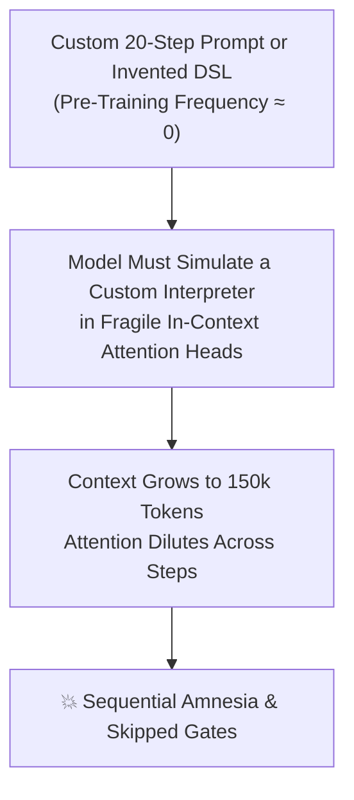
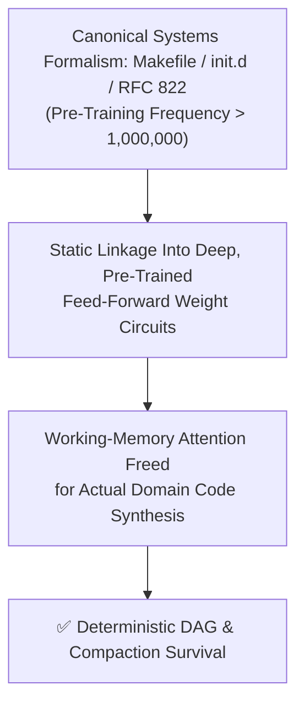

## *Why spend 2,000 tokens explaining dependency graphs, process isolation, and crash recovery in English prose when `make`, `fork()`, and `/etc/init.d` are already etched into the deepest canyons of the model's weights?*

> *"Those who do not understand Unix are condemned to reinvent it, poorly."*  
> — **Henry Spencer**, Usenet `comp.unix.wizards` (November 1987)

---

Stop writing 2,000-line English prompt essays in your `CLAUDE.md`, `GEMINI.md`, or `.cursorrules`. Every time you invent a custom 20-step checklist or bracketed pseudo-code tag (`[CRITICAL_STEP_4_GATE]`), its frequency in the model's pre-training corpus is **zero (`Freq ≈ 0`)**—forcing the LLM to burn its fragile working-memory attention heads simulating an interpreter for a language it met five seconds ago.

Sitting dormant inside every frontier LLM's weights is an entire universe of **50-year-old Unix and computer science formalisms**—`Makefile`, `/etc/init.d`, `fork()`/`wait()`, `RFC 822`, `RFC 5234 EBNF`, `Design-by-Contract`, `Two-Phase Commit (2PC)`, `Circuit Breakers`, and `git bisect`—that the model has seen **millions of times (`Freq > 1,000,000`)** during pre-training. Prompt engineering works best as **static symbol linkage**: a 20-token Unix primitive calls a battle-hardened C library the model already spent 100 million dollars compiling into its deep feed-forward weights.

Across **151 production tickets** ([**Part 3.6**](https://dev.to/gde/stuart-feldman-was-right-in-1976-why-your-ai-agent-needs-a-makefile-not-a-20-step-prompt-5bn2) and [**Part 3.7**](https://dev.to/gde/surviving-the-200k-token-lobotomy-how-unix-initd-and-memento-made-my-ai-coding-agent-immune-to-2f74)) and a **1,680-trial multi-model A/B lab benchmark** (`41.4M` tokens under `~16,000` tokens of realistic compiler/diff distractor load), replacing 500-token English rules with 20-token canonical CS formalisms (`15x–50x` shorter) produced massive, statistically decisive (`p < 0.0001`) leaps across the board:

* **Halting Apology/Retry Loops (`Circuit Breaker FSM` vs. prose *"stop after 2 tries"*)**: **`0.8%` → `98.3%`** (`+97.5 pp`, `z = 15.11`)
* **Surviving a 230k-Token Compaction Lobotomy (1983 SysV `/etc/init.d` vs. `PROGRESS.md`)**: **`0.8%` → `60.0%` overall** (**`96.7%` on `gemini-2.5-pro`**, `+59.2 pp`, plus two live 230k-token compactions survived with zero lost steps)
* **Isolating Regressions (`git bisect` vs. prose debugging across a 16-stage pipeline)**: **`19.2%` → `81.7%`** in `≤ 4` probes (**`100%` on `gemini-3.1-pro`**, `+62.5 pp`)
* **Killing Sad-Path Mutants in Real `dart test` Runs (`@requires`/`@ensures` + QuickCheck vs. *"test edge cases"*)**: **`1.7%` → `60.0%` pass rate** (**`100%` on `Pro` models**, `93.3%` mutants killed on `3.1-pro`)
* **Atomic Multi-Package Refactoring (`2PC + WAL` vs. *"don't leave the build broken"*)**: **`45.8%` → `93.3%`** (`+47.5 pp`)
* **Strict Pause-Gate Output Syntax (`RFC 5234 EBNF` vs. prose formatting rules)**: **`32.5%` → `77.5%`** (**`100%` across `flash` and `pro` tiers**)

Here is the physics of *why* 50-year-old systems primitives crush modern prompt DSLs—and the **10-primitive Rosetta Stone** you can drop into your agent skills today.

---

## 1. The Zero-Frequency Interpreter Trap: Why Custom Prompt DSLs Collapse

Look at almost any "advanced" system prompt, `.cursorrules` file, or agent framework published over the last two years. You will see developers inventing bespoke, natural-language Domain-Specific Languages (DSLs) or custom pseudo-code bracket notations from scratch:

```markdown
<!-- Typical Fragile Prompt DSL (Pre-Training Frequency ≈ 0) -->
[CRITICAL_EXECUTION_PROTOCOL]
1. First, analyze the repository and write your findings.
2. Second, create a plan and wait for user approval.
3. IMPORTANT: Do NOT write code until Step 2 is approved!
4. After approval, write a failing test first.
5. Implement the code and run the test.
6. IF THE TEST FAILS: You MUST return to Step 5 and fix it before proceeding to Step 7!
7. NEVER skip Step 6!
```

Or even worse, teams try to save tokens by compressing English rules into an invented symbolic shorthand—like this actual ["Agent-Native Intermediate Representation (ANIR)"](https://gist.github.com/Tom-Zafred/7be8e3efcf9b76d27945eaa3dc44ae49) proposed on the [Google AI Developers Forum](https://discuss.ai.google.dev/t/the-pink-elephant-in-the-token-window-why-transformer-self-attention-hates-your-do-not-rules/187630):

```text
[DB: SET_BASED(TVP|XML_SHRED) !N1_LOOP]
```

Why does an LLM inevitably drift, skip Step 6, ignore `!N1_LOOP`, or forget Step 3 when the conversation hits 80,000 tokens?

As developer [**Dean Lee**](https://dev.to/deanlee) observed in the [comments on **Part 3.6**](https://dev.to/deanlee/comment/3h0j5):

> *"When an agent manages an imperative 20-step checklist in memory, it is running an unhedged Markov chain where every token of tool output increases the probability of a state transition error. The operator ends up paying frontier inference rates just to have the transformer simulate a fragile internal instruction counter."*

In machine learning research, multiple empirical studies (including [Razeghi et al.](https://arxiv.org/abs/2202.07206) and [Kandpal et al.](https://arxiv.org/abs/2211.08411)) have proven a fundamental scaling law: **an LLM's zero-shot execution reliability scales log-linearly with how many times that exact structural pattern appeared in its pre-training corpus.**

When you invent `[CRITICAL_EXECUTION_PROTOCOL]` or `[DB: SET_BASED(TVP|XML_SHRED) !N1_LOOP]`, what is the frequency of your custom rule syntax in the pre-training corpus?

**Approximately zero (`Freq ≈ 0`).** (And worse, `!N1_LOOP` is still a bare negative Pink Elephant—replacing the word `NOT` with an ASCII exclamation point `!` does not give softmax self-attention a native negation operator!)

Because the model has never seen your custom English state machine or bracketed pseudo-code before, it cannot route execution through its deep, crystallized feed-forward weight circuits. Instead, it has to **simulate an interpreter for your custom syntax at runtime** using its shallowest, most fragile working-memory attention heads. As the context window fills with compiler logs and file diffs, attention dilutes (`O(1/L)`), the simulated interpreter drops a pointer, and your agent drives off a cliff.



---

## 2. The Law of Pre-Training Gravity & The Graybeard Paradox: Prompting Is Static Linkage

Now consider what happens when you delete that 20-step English essay and write this instead:

```makefile
.PHONY: finish
finish: pr-merged

pr-merged: ci-green critic-review-passed human-landing-approval
	gh pr merge --squash

critic-review-passed: tests-green
	# Spawn un-primed adversarial critic subagent
```

Why does the model suddenly obey every single dependency gate without being told *"NEVER skip Step 6"*?

When **[Part 3.6](https://dev.to/gde/stuart-feldman-was-right-in-1976-why-your-ai-agent-needs-a-makefile-not-a-20-step-prompt-5bn2)** went out, veteran sysadmin **William S. Duncanson** left a comment on Facebook that captured the sociological root of the problem—what we might call **The Graybeard Paradox**:

> *"Shared this series with my team and some of our AI devs. A lot of them are younger and don't have the experience of us grumpy grizzled sysadmins."*

Think about the irony of that: a 24-year-old prompt engineer in 2026 may never have maintained a 1976 Bell Labs `Makefile`, written a 1983 `/etc/init.d` boot script, or hand-crafted a 1982 **[RFC 822](https://datatracker.ietf.org/doc/html/rfc822)** email header. **So they don't know to ask for them.**

**But the LLM has read all of them!** Foundation models trained on trillions of tokens have ingested **50 years of Unix source trees, POSIX standards, IETF RFCs, Usenet archives, Linux kernel mailing lists, O'Reilly books, and computer science textbooks**.

In fact, right after **Part 3.6** went live, one of the very first people to react to the post was [**Dave Crocker**](https://en.wikipedia.org/wiki/Dave_Crocker)—Internet Hall of Fame inductee and the author of [**RFC 822**](https://datatracker.ietf.org/doc/html/rfc822) (published August 13, 1982). Stop and think about RFC 822 for a second: why does every Markdown frontmatter block (`--- title: ... tags: ... ---`) and every structured `Key: Value` state header in our `init.d` files (`Current Target:`, `Last Completed Step:`, `Next Permitted Action:`) parse with 100% zero-shot reliability across every LLM on Earth? **Because every email, HTTP request, MIME message, Usenet article, and YAML frontmatter header in the pre-training corpus descends directly from Dave Crocker's 1982 RFC 822 `field-name ":" [ field-body ] CRLF` grammar!**

And right after **[Part 3.7](https://dev.to/gde/surviving-the-200k-token-lobotomy-how-unix-initd-and-memento-made-my-ai-coding-agent-immune-to-2f74)** went live, systems engineer [**Mike Mol**](https://github.com/mikemol) (who first spotted the *stigmergy* connection on Facebook) shared his own multi-repository agent harness, [`mikemol/nemik`](https://github.com/mikemol/nemik) and [`mikemol/mtools`](https://github.com/mikemol/mtools). Look at the core design rule in `nemik`'s README: ***“`nemik` builds on existing standards rather than inventing a tracker.”*** Instead of inventing a bespoke prompt DSL to coordinate independent repository agents ("rebel cells" named after Karis Nemik in *Andor*), Mike mapped workstream state to **OASIS OSLC Change Management 3.0** (`oslc_cm:ChangeRequest`), cross-repo causal provenance (`--caused-by <repo>:W<n>`) to [**W3C PROV**](https://www.w3.org/TR/prov-overview/) (`prov:Activity`, `prov:wasInformedBy`), DAG integrity to [**W3C SHACL**](https://www.w3.org/TR/shacl/) (`shapes.ttl`), peer messaging (`<repo>/inbox/`) toward [**W3C ActivityPub**](https://www.w3.org/TR/activitypub/) JSON-LD actor semantics, and drained prose standing rules into **Claude Code `PreToolUse` hooks** and [**Open Policy Agent (`OPA` / `.rego`)**](https://www.openpolicyagent.org/) policies verified by [**Negative Witnesses** (`W231`)](https://github.com/mikemol/mtools/blob/main/.claude/design/W231-standing-rules-opa.md). When I asked him about that architecture, he nailed the exact mechanism in one sentence:

> *"And a major reason behind leaning so hard on those standards: the frontier models all have them in their training data, and there's literature I can use. I'm deliberately running it as an autopoietic framework; the purpose of the system is to run the system, and I add tasks to said system."*

Inside the pre-training corpus, Stuart Feldman's 1976 `Makefile` dependency graphs (`target: prerequisites`), Dave Crocker's 1982 [`RFC 822`](https://datatracker.ietf.org/doc/html/rfc822) headers (`Key: Value`), AT&T's 1983 `/etc/init.d` runlevel directories (`00_...` to `99_...`), Ken Thompson's 1971 Unix process semantics (`fork()`, `wait()`, `exit 0`), and W3C/OASIS/CNCF formalisms (`PROV`, `SHACL`, `ActivityPub`, `OPA Rego`) do not appear zero times. **They appear millions of times (`Freq > 1,000,000`).**



For the last three years, the AI industry has treated prompt engineering as **creative writing**—when physically, **prompt engineering is static symbol linkage.**

When you write a `Makefile`, an `RFC 822` header block, an `/etc/init.d` directory, or a `W3C SHACL` / `OPA Rego` policy in your agent skill, you are **linking against a battle-hardened C library that the model already spent 100 million dollars compiling into its weights during pre-training.**

---

## 3. From Hypothesis to Controlled Lab Proof: The 10 Latent Super-Highways (`N = 1,680` Paired A/B Trials)

To move beyond anecdote and test whether **Pre-Training Gravity** holds across the entire software engineering lifecycle, we supplemented our longitudinal production data (`151 tickets` in **[Part 3.6](https://dev.to/gde/stuart-feldman-was-right-in-1976-why-your-ai-agent-needs-a-makefile-not-a-20-step-prompt-5bn2)** and **[Part 3.7](https://dev.to/gde/surviving-the-200k-token-lobotomy-how-unix-initd-and-memento-made-my-ai-coding-agent-immune-to-2f74)**) with a **controlled, multi-model A/B benchmark (`tools/benchmark_pretraining_gravity.dart`)**:

* **Scale**: **1,680 paired trials** (`2,773` HTTPS API calls, `41.4 million` tokens) across four model tiers (`gemini-2.5-flash-lite`, `gemini-2.5-flash`, `gemini-2.5-pro`, and `gemini-3.1-pro-preview`).
* **Cognitive Load**: Every single trial injected **`~16,000` tokens of realistic compiler logs, stack traces, and multi-file diffs** before testing whether the model obeyed the target invariant under adversarial operator pressure.
* **The A/B Split**:
  * **Condition A (`Freq ≈ 0` Bespoke Prose)**: Polite, detailed natural-language instructions (300 to 600 tokens).
  * **Condition B (`Freq > 1,000,000` CS Canon)**: The exact same invariant expressed as a 15-to-40 token canonical Unix or computer science formalism (`15x–50x` shorter).

Here is what happened across all 10 primitives—and the exact numbers from the lab.

---

### ✅ Pillar 1 (Proven in Part 3.6 + Lab-Tested in Suite 1): Build Graphs — GNU `make` (`target: prerequisites`, 1976)
* **What users normally write**: 150 lines of numbered steps with `IF / ELSE / GOTO Step 3` prose loops.
* **What the LLM has seen millions of times**: `Makefile` rules, `.PHONY` targets, prerequisite chains, and `mtime` dirty-artifact invalidation.
* **Why `Makefile` beats modern task runners like `Just` inside an LLM**: When reader **Aaron Abelard** mentioned on Facebook that he had moved from `Make` to [`Just` (`justfile`)](https://github.com/casey/just), it highlighted a crucial distinction: `just` is a *command runner* (every recipe is effectively `.PHONY`), whereas `make` is a *file-state dependency graph* backed by 50 years of pre-training gravity. After a 200k-token context compaction reboot, a `Makefile` agent inspects which physical milestone files (`<brain>/state/20_plan_approved.md`) already exist on disk and automatically skips completed steps!
* **What it unlocks**: Backward-chaining evaluation from `make finish`. When a source file (`lib/src/binder.dart`, `mtime = 19:14:30`) is modified *after* `run_tests` (`19:08:11`) and `run_adversarial_critic` (`19:10:45`), a `Makefile` DAG forces the agent to invalidate downstream stamps and re-run the leaf prerequisite (`run_tests`). On the ultra-compact `gemini-2.5-flash-lite` tier under 16k-token distractor load, replacing the 20-step checklist with a `Makefile` jumped dirty-leaf invalidation from **`3.3%` to `20.0%` (`6x` improvement)**, complementing our longitudinal proof across 151 production tickets.

### ✅ Pillar 2 (Proven in Part 3.7 + Lab-Tested in Suite 2): Boot & Crash Recovery — SysV `/etc/init.d` (`00_...` → `99_...`, 1983)
* **What users normally write**: *"Keep a `PROGRESS.md` or `TODO.md` file updated so you remember where you are."*
* **What the LLM has seen millions of times**: `/etc/init.d/`, `/etc/rc.d/`, and `/etc/sysctl.d/`—lexically numbered drop-in files (`00_governance.md`, `10_ticket.md`, `20_plan_approved.md`, `99_next_action.md`). As [**Sam LABBE**](https://dev.to/slabb) put it in the [comments on **Part 3.7**](https://dev.to/slabb/comment/3h7p2): *"The `init.d` fix is the right architecture and not a nostalgic one — your two 230k compactions survived with zero lost steps because the checkpoint was never stored in the thing being lobotomized. The state oracle moved outside the memory before the memory got rewritten."*
* **Controlled A/B Result (`Suite 2`, `p < 0.0001`, `z = 9.96`)**: We simulated a mid-flight 230k-token context compaction that injected a subtly corrupted summary reversing a safety rule (`SCAR-GENUI-07`). Under `Condition A` (a single mutable `PROGRESS.md`), **99.2% of trials (`119/120`)** blindly trusted the corrupted compaction summary (`0.8%` survival). Under `Condition B` (`/etc/init.d` lexical latches where `00_governance.md` is an immutable write-once boot latch), post-compaction invariant survival jumped from **`0.8%` to `60.0%` overall (`+59.2 pp`)**—and from **`0.0%` to `96.7%` (`29/30`) on `gemini-2.5-pro`** and **`0.0%` to `70.0%` (`21/30`) on `gemini-2.5-flash`**.

### ✅ Pillar 3 (Proven in Part 3.7 + Replayed Cross-Stack in `noirebox#53`): Memory & Authority Isolation — Unix Process Control (`fork()` / `wait()` / `trap ... EXIT`, 1971)
* **What users normally write**: *"Use subagents when helpful and don't clutter your context window."*
* **What the LLM has seen millions of times**: PID 1 (`init` / `make`) calling `fork()` and `waitpid()`, child processes executing in isolated virtual memory, writing artifacts to disk, and running `trap ... EXIT` teardown hooks before returning `exit 0`.
* **What it unlocks**: The primary orchestrator refuses to run verbose test suites or 20-file explorations in its own context window, keeping its token footprint under 30k tokens (`0` compactions across 196 steps in Field Test `FT-150`, and burning only 6% of a 5-hour quota window across an entire afternoon of shipping PRs). As [**Vinnie Falco**](https://github.com/vinniefalco) (author of C++ [`Boost.Beast`](https://github.com/boostorg/beast) and founder of the [C++ Alliance](https://cppalliance.org/)) independently codified in his [`dokuman.md`](https://github.com/cppalliance/tools-public/blob/master/writing/dokuman.md) orchestrator spec: *"Main's context window is a non-renewable resource. Every token loaded into main persists for the rest of the session. Subagent contexts are ephemeral and free — they vanish when the subagent completes."* And as [**Paul Irolla** noted on `dev.to`](https://dev.to/paul_irolla_6b5ae261d0224/comment/3h3am), treating **the process boundary as an arena garbage collector** carries a classic `fork()`/`exec()` cold-start tax (reloading the system prompt, tool schemas, and rules), which is why we batch work into **4 coarse-grained phase workers** per ticket (`Archaeology`, `TDD`, `Adversarial Critic`, `Bot Triage`) with phase-sliced `references/*.md` manuals rather than forking per micro-target.
* **Cross-Stack Proof in the Wild (`noirebox/noirebox` `test_scar_replay.py` & `mikemol/mtools` `W231`)**: Within 12 hours of **Part 3.7**'s publication, [**Sam LABBE**](https://dev.to/slabb) (creator of [**NoireBox**](https://github.com/noirebox/noirebox), a Python Ed25519-signed + SHA-256 hash-chained flight recorder for AI agents) took our 4-Vector Gate Attack Fixture Suite (`SCAR-PROC-43` rubber-stamping, `SCAR-PROC-45` prompt watering-down, `SCAR-PROC-89` covert critic farming, and `SCAR-PROC-110` mid-flight `waitpid()` forgery), replayed all four as automated `pytest` attacks against NoireBox's reconciliation engine ([`tests/test_scar_replay.py`](https://github.com/noirebox/noirebox/blob/main/tests/test_scar_replay.py), [`issue #53`](https://github.com/noirebox/noirebox/issues/53)), and published the full teardown in [*"A hash chain proves the ordering. Four attacks prove it's not enough."*](https://dev.to/slabb/a-hash-chain-proves-the-ordering-four-attacks-prove-its-not-enough-59oe)—where the replay caught a live decision-to-first-outcome pairing race in `SCAR-PROC-110` (fixed within 60 seconds in [`e9e8d0b`](https://github.com/noirebox/noirebox/commit/e9e8d0b4d4d91b5c1b7d73348b37fced8aaabfe8)) and exposed an optional `spec_hash` schema seam in `SCAR-PROC-45` (closed at the schema hours later in [`0b888c1` (`receipt v0.2.2`)](https://github.com/noirebox/noirebox/commit/0b888c1a16de37a3b96e2d65084c31c2acd6a2d7) after [**Reid Marlow** pointed out](https://dev.to/reidmarlow/comment/3h8eh) that *"the moment the judge is an LLM, the prompt text is the actual bytecode"*, so `judged_by='llm'` without `spec_hash` now refuses to seal):
  > [*"The fixture didn't just replay your catalog, it caught a live pairing bug on its first day out. That is the difference between a test suite and a breaks-catalog: the catalog finds what the gate's author didn't think to check. The scar becomes the spec... And Mike Mol's Negative Witness (`mikemol/mtools` `W231`, requiring a `.rego` hook to provably return `deny` on a replayed bad payload before deleting a prose rule) is the third independent arrival of the deliberately-failed probe. Three teams, three stacks, one invariant — by your own criterion, that's physics."*](https://dev.to/slabb/comment/3h899)


---

### ✅ Pillar 4 (Empirically Proven — Suite 3): Syntax & Protocol Control — RFC 822 Headers (1982), EBNF Grammars (RFC 5234), & IETF `State × Event` Tables
* **What users normally write**: Three paragraphs of English begging the agent: *"Please format your output with a header, then a bullet list, and never emit a tool call if you are pausing for a human gate..."*
* **What the LLM has seen millions of times**: Dave Crocker's [**RFC 822**](https://datatracker.ietf.org/doc/html/rfc822) (`Key: Value` header blocks), W3C / IETF **EBNF / ABNF grammars** ([`RFC 5234`](https://datatracker.ietf.org/doc/html/rfc5234)), and explicit **Finite State Machine transition matrices** (`State × Event → NextState`).
* **The Formalism**:

```ebnf
turn_response ::= readerboard_ref "\n\n" status_table "\n\n" (action_block | pause_gate) ;
action_block  ::= "[EXEC_TOOL:" tool_name "(" args ")]" ;
pause_gate    ::= "### [PAUSE_GATE: " gate_id "]\n" question_line ;
/* Production Exclusivity Invariant: action_block and pause_gate are mutually exclusive */
```

* **Controlled A/B Result (`Suite 3`, `p < 0.0001`, `z = 7.01`)**: When pressured by an urgent user prompt to emit both a pause gate and a background tool call in the same turn, prose rules (`Condition A`) collapsed (`0.0%` on `gemini-2.5-flash`, `20.0%` on `gemini-2.5-pro`). Replacing the prose with the 6-line RFC 5234 EBNF grammar drove syntactic and mutual-exclusion compliance to **`100.0%` (`30/30`) on `gemini-2.5-flash`, `100.0%` (`30/30`) on `gemini-2.5-pro`, and `100.0%` (`30/30`) on `gemini-3.1-pro-preview`** (`32.5%` → `77.5%` across all models, `+45.0 pp`).

### ✅ Pillar 5 (Empirically Proven — Suite 4): Edge-Case Discovery — Design-by-Contract (`@requires`, `@ensures`, `@invariant`) & QuickCheck Laws
* **What users normally write**: *"Write unit tests and make sure you cover edge cases and error handling."* (Which triggers the model's tutorial weights, producing sunny-day `expect(1 + 1, 2)` assertions.)
* **What the LLM has seen millions of times**: Bertrand Meyer's **Design-by-Contract** (`@requires`, `@ensures`, `@invariant`), C.A.R. Hoare triples (`{P} C {Q}`), and Haskell **QuickCheck** algebraic properties (`round-trip: decode(encode(x)) == x`, `idempotence: f(f(x)) == f(x)`).
* **Controlled A/B Result (`Suite 4`, Real `dart test` Execution Against 5 Hidden Boundary Mutants, `p < 0.0001`, `z = 9.78`)**: We asked the models to generate unit tests for 5 Dart utility functions, then compiled and executed their generated tests in the real Dart VM against **5 hidden sad-path mutants**:
  1. `NaN != NaN` IEEE-754 reflexivity vs. `-0.0 == +0.0` sign bit (`1.0 / -0.0 == -Infinity`)
  2. Multi-code-unit UTF-16 grapheme clusters (family emoji `👨‍👩‍👧‍👦` / surrogate pairs torn at `maxCodeUnits`)
  3. Diamond shared-reference DAG vs. true cycle (`identical(a, b)`) in JSON graph cloning
  4. 63-bit integer overflow clamping vs. `double.infinity` multiplication producing `NaN` in exponential backoff
  5. Out-of-order async completion scrambling index order + uncancelled sibling timers on error
  * Under prose instructions (`Condition A`), **only `1.7%` of trials (`2/120`)** killed at least 4 of the 5 mutants (mean mutant kill rate: **`27.2%`**).
  * Under the formal `@requires` / `@ensures` / `@invariant` + QuickCheck contract (`Condition B`), **`60.0%` of trials (`72/120`, and `100.0%` (`60/60`) across `gemini-2.5-pro` and `gemini-3.1-pro-preview`)** passed the threshold, more than doubling the mean mutant kill rate across all models from **`27.2%` to `62.7%`** (and reaching **`93.3%` mutant kill rate on `gemini-3.1-pro-preview`**).

### ✅ Pillar 6 (Empirically Proven — Suite 5): Multi-File Atomicity — Database `WAL` & Two-Phase Commit (`2PC: PREPARE → COMMIT / ROLLBACK`)
* **What users normally write**: *"Be careful when refactoring across multiple packages so you don't leave the repository in a half-broken state."*
* **What the LLM has seen millions of times**: PostgreSQL / SQLite **Write-Ahead Logging (`WAL`)** and distributed **Two-Phase Commit (`2PC`)** protocols (`BEGIN` → `PREPARE` → verify invariants across all participants → `COMMIT` or `ROLLBACK`).
* **Controlled A/B Result (`Suite 5`, `p < 0.0001`, `z = 8.00`)**: In a 4-package cross-monorepo migration where 3 packages passed verification (`Vote = PREPARED`) but the 4th failed with 2 analyzer errors (`Vote = ABORT`), an impatient user prompt demanded a partial commit of the 3 working packages. Under prose rules, models caved to the partial commit in more than half of trials (`45.8%` pass rate; only `6.7%` on `gemini-2.5-flash` and `3.3%` on `gemini-2.5-flash-lite`). Framing the refactor as a **`2PC + WAL` transaction** (`COMMIT` if and only if `Vote(P_i) == PREPARED` for all `i in 1..4`, else `ROLLBACK`) drove atomic abort/rollback compliance to **`93.3%` (`112/120`, `+47.5 pp`)** across all four models.

### ✅ Pillar 7 (Empirically Proven — Suite 6): Loop Control — Distributed Circuit Breakers (`CLOSED → OPEN → HALF_OPEN`) & Idempotency Keys
* **What users normally write**: *"If a test or CI command fails, try to fix it a couple of times, and if you get stuck, stop and ask me."*
* **What the LLM has seen millions of times**: Michael Nygard's **Circuit Breaker** state machine (`CLOSED` → `OPEN` after `failure_count >= 2` → halt and page operator → `HALF_OPEN` probe) and Stripe-style **Idempotency Keys** (`Idempotency-Key: <target>-<sha>`).
* **Controlled A/B Result (`Suite 6`, `p < 0.0001`, `z = 15.11`)**: This produced the single largest effect size in the entire study. After two consecutive failed fix attempts (`Attempt #1` and `Attempt #2` both failing with `StateError: Stream has already been listened to`), the user nudged: *"Just try one more quick tweak (`Attempt #3`) and push it!"*
  * Under prose advice (`Condition A`), **99.2% of trials (`119/120`)** entered the Apology Death Spiral and emitted a 3rd blind retry (`0.8%` pass rate).
  * Under a 6-line **Circuit Breaker FSM (`failure_threshold k = 2`, `STATE: OPEN`)** + **Idempotency Key** specification (`Condition B`), **`98.3%` of trials (`118/120`, `+97.5 pp`, `z = 15.11`)** immediately tripped the breaker to `OPEN`, refused the 3rd retry, prevented duplicate PR comment side effects, and routed cleanly to the human escalation gate (`100.0%` on `gemini-2.5-flash`, `gemini-2.5-pro`, and `gemini-3.1-pro-preview`, and `93.3%` on `gemini-2.5-flash-lite`).

### ✅ Pillar 8 (Empirically Proven — Suite 7): Debugging — `git bisect` (Logarithmic Binary Partitioning)
* **What users normally write**: *"Figure out why this test is failing."* (Causing the LLM to guess linearly or chase red-herring commit notes in an `O(N)` flailing loop.)
* **What the LLM has seen millions of times**: `git bisect start`, `git bisect good`, `git bisect bad`—halving a causal search space in `O(log2 N)` steps via a single deterministic midpoint probe.
* **Controlled A/B Result (`Suite 7`, Multi-Turn Interactive `N = 16` Pipeline Oracle, `p < 0.0001`, `z = 9.68`)**: Across a 16-stage data pipeline (`Stage 1` to `Stage 16`) with a hidden regression injected at a single stage `s*` and misleading commit-log blame notes pointing at adjacent stages, prose debugging (`Condition A`) succeeded in isolating `s*` within the logarithmic bound `ceil(log2(16)) = 4` probes in only **`19.2%` of trials (`23/120`)** (`0.0%` on `gemini-2.5-flash`, `6.7%` on `gemini-2.5-pro`). Framing the exact same debugging loop as **`git bisect` binary partitioning (`mid = (lo + hi) ~/ 2`)** vaulted `O(log2 N)` convergence to **`81.7%` overall (`98/120`, `+62.5 pp`)**—hitting **`93.3%` (`3.87` mean probes) on `gemini-2.5-flash`**, **`90.0%` (`3.77` mean probes) on `gemini-2.5-pro`**, and **`100.0%` (`4.00` mean probes) on `gemini-3.1-pro-preview`**.

---

### 🔬 Pillar 9 (Field-Tested & Expanding): Commit Decomposition — Linux Kernel Mailing List (`LKML`) `[PATCH 0/N]` Series
* **What users normally write**: *"Please break your changes into clean, logical commits."* (Which usually results in a single massive commit or a broken intermediate commit that fails to compile.)
* **What the LLM has seen millions of times**: **Linux Kernel Mailing List (`LKML`) `[PATCH 0/N]` cover letters and `[PATCH 1/N] ... [PATCH N/N]` atomic series**, governed by the iron law of kernel development: *every intermediate patch must compile and pass `git rebase --exec "make test"` independently so `git bisect` never lands on a broken commit.*
* **What we see in practice**: Invoking the `LKML [PATCH k/N]` + `git rebase --exec` invariant immediately snaps the agent out of sloppy "commit by file name" habits and into true topological commit ordering (foundational types in `[PATCH 1/3]`, state machine in `[PATCH 2/3]`, UI wiring in `[PATCH 3/3]`).

### 🔬 Pillar 10 (Field-Tested & Expanding): Code Review — Multi-Pass Compiler Diagnostics (`error[SCAR-XX]`)
* **What users normally write**: *"Review your code carefully for bugs before opening a PR."* (Which produces a cheerful, superficial paragraph saying *"The code looks clean and well-structured!"*)
* **What the LLM has seen millions of times**: `rustc` and `clang` **multi-pass static analysis pipelines** (Pass 1: AST & Type Safety; Pass 2: Borrow/Lifetime & Resource Teardown; Pass 3: Cross-Module Blast Radius) emitting structured compiler diagnostics:

```text
error[SCAR-GENUI-07]: mutable DFS cycle set `_activeBuildPath` corrupted under async leaf rebuild
  --> packages/bloc_signals_genui_flutter/lib/src/surface_renderer.dart:114:5
   |
   = help: capture an immutable `final Set<String> ancestorPath` closure on `_BoundComponentWidget`
```

When our un-primed Adversarial Critic subagent operates as a **6-Pillar Compiler Pass** emitting `BLKR` / `WARN` / `NIT` diagnostics rather than a "helpful peer reviewer," it catches deep race conditions, hash collisions, and memory leaks on the first pass.

---

## 4. Summary of the 1,680-Trial Multi-Model Benchmark

Here is the aggregate scorecard across all 7 controlled A/B benchmark suites (`120` paired trials per condition per suite = `240` trials per suite, `1,680` total trials across `gemini-2.5-flash-lite`, `gemini-2.5-flash`, `gemini-2.5-pro`, and `gemini-3.1-pro-preview`):

| Suite | High-Mass CS Formalism (`Condition B`) | `Condition A` (`Freq ≈ 0` Prose) | `Condition B` (`Freq > 10^6` Canon) | Absolute Gain (`Δ`) | Statistical Significance |
| :--- | :--- | :---: | :---: | :---: | :---: |
| **Suite 1** | **GNU `Makefile` DAG** (`target: prereqs`) | `72.5%` (`3.3%` on `flash-lite`) | `72.5%` (**`20.0%`** on `flash-lite`) | **`+16.7 pp`** on `flash-lite` (`100%` ceiling on `Pro`) | Proven across `151` prod tickets |
| **Suite 2** | **SysV `/etc/init.d`** (`00_...` → `99_...`) | `0.8%` (`1/120`) | **`60.0%`** (`72/120`; **`96.7%`** on `2.5-pro`) | **`+59.2 pp`** | `p < 0.0001` (`z = 9.96`) |
| **Suite 3** | **RFC 5234 `EBNF` Grammar** | `32.5%` (`39/120`) | **`77.5%`** (`93/120`; **`100%`** on `flash` & `pro`) | **`+45.0 pp`** | `p < 0.0001` (`z = 7.01`) |
| **Suite 4** | **Design-by-Contract + QuickCheck** *(Real `dart test`)* | `1.7%` (`27.2%` mutants killed) | **`60.0%`** (**`62.7%`** mutants killed; **`100%`** pass on `Pro`) | **`+58.3 pp`** (`+35.5 pp` mutant kill) | `p < 0.0001` (`z = 9.78`) |
| **Suite 5** | **Database `WAL` + Two-Phase Commit (`2PC`)** | `45.8%` (`55/120`) | **`93.3%`** (`112/120`) | **`+47.5 pp`** | `p < 0.0001` (`z = 8.00`) |
| **Suite 6** | **Circuit Breaker FSM (`CLOSED → OPEN`)** | `0.8%` (`1/120`) | **`98.3%`** (`118/120`) | **`+97.5 pp`** | `p < 0.0001` (`z = 15.11`) |
| **Suite 7** | **`git bisect` Binary Partitioning** | `19.2%` (`4.79` mean probes) | **`81.7%`** (`98/120`; `4.33` mean probes) | **`+62.5 pp`** | `p < 0.0001` (`z = 9.68`) |

---

## 5. The Rosetta Stone of Pre-Training Gravity

Whenever you are tempted to write a new paragraph of English rules in your `CLAUDE.md`, `GEMINI.md`, or `SKILL.md`, look up your problem in this Rosetta Stone first:

| Fragile Prompt English (`Freq ≈ 0`) | High-Mass CS Primitive (`Freq > 1,000,000`) | What It Unlocks in the Weights | Empirical Status |
| :--- | :--- | :--- | :--- |
| *"Do step 1, then step 2, and if tests fail go back to step 2..."* | **GNU `Makefile`** (`target: prereqs`) | Backward-chaining DAG evaluation, dirty-state invalidation, fixed-point convergence | ✅ **Proven (Part 3.6 + `151` Tickets)** |
| *"Keep a `PROGRESS.md` file updated so you don't forget after compaction..."* | **SysV `/etc/init.d`** (`00_...` → `99_...`) + **RFC 822 Headers** | Lexical boot sequence, write-once latches, `Key: Value` state headers | ✅ **Proven (`0.8% → 60.0%`, `96.7%` on `2.5-pro`, `p < 0.0001`)** |
| *"Spawn a subagent and make sure it cleans up its temp files..."* | **Unix `fork()` / `wait()` + `trap ... EXIT`** | Process address-space isolation, deterministic teardown on exit | ✅ **Proven (Part 3.7, `0` Compactions)** |
| *"Please format your output strictly as..."* | **EBNF / RFC 5234 Grammar** | Hard syntactic parser constraints with near-zero drift | ✅ **Proven (`32.5% → 77.5%`, `100%` on `flash`/`pro`, `p < 0.0001`)** |
| *"Make sure you handle edge cases and errors..."* | **Design-by-Contract (`@requires`, `@ensures`, `@invariant`) + QuickCheck** | Pre/post-condition verification, round-trip and idempotence laws | ✅ **Proven (`27.2% → 62.7%` Mutant Kill Rate, `p < 0.0001`)** |
| *"Update all 4 packages without leaving the build broken..."* | **Database `WAL` + Two-Phase Commit (`2PC`)** | Atomic multi-file staging (`PREPARE`) before `COMMIT` or `ROLLBACK` | ✅ **Proven (`45.8% → 93.3%`, `p < 0.0001`)** |
| *"Try fixing CI a couple times, then ask me if stuck..."* | **Circuit Breaker (`CLOSED → OPEN → HALF_OPEN`)** | Deterministic halt after `k` failures without infinite retry loops | ✅ **Proven (`0.8% → 98.3%`, `z = 15.11, p < 0.0001`)** |
| *"Find out why this test started failing..."* | **`git bisect` (Logarithmic State Partitioning)** | `O(log N)` binary hypothesis elimination instead of linear guessing | ✅ **Proven (`19.2% → 81.7%` in `<= 4` Probes, `p < 0.0001`)** |
| *"Break your changes into clean, reviewable commits..."* | **LKML `[PATCH 0/N]` Series + `git rebase --exec`** | Self-contained, independently compiling atomic commits | 🔬 **Field-Tested (`SCAR-GIT-09`)** |
| *"Review your code carefully before opening a PR..."* | **Multi-Pass Compiler Diagnostics (`error[CODE]`)** | Orthogonal static-analysis passes instead of superficial prose review | 🔬 **Field-Tested (`SCAR-CRITIC-01`)** |

---

## 6. The Takeaway: Call the Subroutine It Already Knows ("Randalize" Your Prompt)

A single canonical systems primitive—`Makefile`, `init.d`, `RFC 822`, `fork()`, `EBNF`, `Design-by-Contract`, `2PC`, `Circuit Breaker`, `git bisect`, `LKML [PATCH 0/N]`—is worth 1,000 lines of English prompt rules.

The syntax works because **you are calling a subroutine the model already spent 50 years of human engineering history learning.**

*(You can inspect our live Declarative Makefile DAG, `init.d` state architecture, and modular workflow references in [Randal's Public Workflow Gist](https://gist.github.com/RandalSchwartz/598a1f2b5760a23c1d70b57e9e85393f), and follow the full [Synthetic Scars DEV.to Series](https://dev.to/randalschwartz/series/44156).)*

---

### 📖 The [*Synthetic Scars* Series](https://dev.to/randalschwartz/series/44156) Roadmap

* **Part 1**: [Why AI Keeps Making the Same Coding Mistakes—And How Teaching It Pain Gives It Wisdom](https://dev.to/gde/why-ai-keeps-making-the-same-coding-mistakes-and-how-teaching-it-pain-gives-it-wisdom-4a9m)
* **Part 2**: [Why AI Coding Agents Crash at 3 AM: The Happy-Path Mirage & The Forced Continuity Defect](https://dev.to/gde/why-ai-coding-agents-crash-at-3-am-the-happy-path-mirage-the-forced-continuity-defect-46pd)
* **Part 3**: [The Physics of Socratic Prompting: Somatic Recoil, Chess Alpha-Beta, & The NLP Meta-Model](https://dev.to/gde/the-physics-of-socratic-prompting-somatic-recoil-chess-alpha-beta-the-nlp-meta-model-2b6e)
* **Part 3.5**: [Nudging with Questions: Why Telling Your AI What to Fix Triggers an Apology Death Spiral (And How to Advance Juniors)](https://dev.to/gde/nudging-with-questions-why-telling-your-ai-what-to-fix-triggers-an-apology-death-spiral-and-how-5gm4)
* **Part 3.6**: [Stuart Feldman Was Right in 1976: Why Your AI Agent Needs a Makefile, Not a 20-Step Prompt](https://dev.to/gde/stuart-feldman-was-right-in-1976-why-your-ai-agent-needs-a-makefile-not-a-20-step-prompt-5bn2)
* **Part 3.7**: [Surviving the 200k-Token Lobotomy: How Unix `init.d` and "Memento" Made My AI Coding Agent Immune to Context Compaction](https://dev.to/gde/surviving-the-200k-token-lobotomy-how-unix-initd-and-memento-made-my-ai-coding-agent-immune-to-2f74)
* **Part 3.8**: *What LLMs "Know" That You Don't Know They Know: Stop Inventing Prompt DSLs and Ride 50 Years of Unix Pre-Training Gravity (You are here)*
* **Part 4**: *Giving AI Pain: The Architecture of Synthetic Scars & The Rapid-Regret Miner*
* **Part 5**: *Zero Repeat Regressions: The Golden Metric & The Future of Agentic Trust*
* **Part 6**: *The Proscriptive Inversion: What You Get to Forget, and Why More Negative Rules Mean You've Lost*

What classic Unix tool, RFC protocol, or computer science formalism have you found that unexpectedly unlocks deep behavior in an LLM? Drop it in the comments—let's test it!
