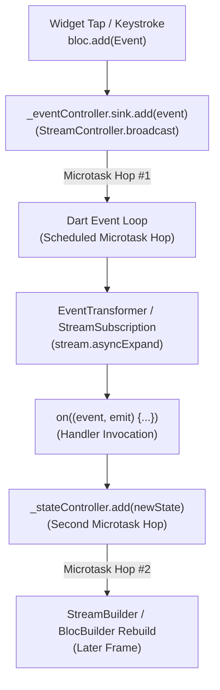
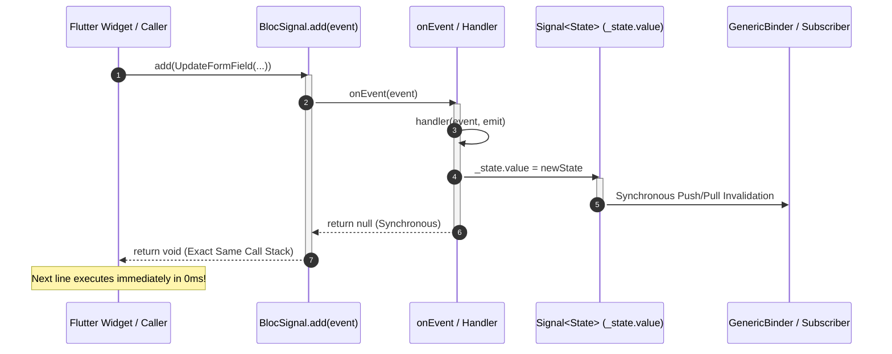

## The Muscle-Memory Illusion

> "An asynchronous network stream belongs at the perimeter of your architecture; once an AI agent's UI lands on the client, every keystroke, validation rule, and leaf rebuild must execute in 0ms on a synchronous signal graph."
> — Randal L. Schwartz

When Flutter developers inspected the code samples from our [`bloc_signals_genui` 1.0 announcement](https://dev.to/gde/generative-ui-without-the-async-tax-introducing-blocsignalsgenui-10-3gge), their classic [`package:bloc`](https://pub.dev/packages/bloc) muscle memory sparked an immediate question:

```dart
// Mutate bound form fields synchronously in 0ms
surfaceBloc.add(
  const UpdateFormField(
    path: '/user/name',
    value: 'Randal L. Schwartz',
  ),
);
```

The question went something like this: *Wait. It is called a `Bloc` and you are calling `.add(event)`. Doesn't that push the event into an asynchronous `StreamController` sink, schedule a microtask on the Dart event loop, sever the call stack, and update the UI in a later frame?*

In [`BlocSignal`](https://pub.dev/packages/bloc_signals), `.add()` dispatches events synchronously on the active call stack. When an event handler and its transformer execute synchronously, the entire dispatch-to-emission pipeline runs inline on the exact same call stack in 0ms. By the time the line immediately following `surfaceBloc.add(...)` executes:

1. The underlying [`a2ui_core`](https://pub.dev/packages/a2ui_core) `DataModel` signal cell is updated.
2. Every `GenericBinder` signal binding and `CheckRule` validation expression on the surface has recomputed.
3. `surfaceBloc.value` holds the new `SurfaceReady` immutable state snapshot.

Understanding this difference requires examining the mechanics of event propagation in Dart and the reasons client applications need a synchronous core.

* **The Asynchronous Microtask Tax in Classic BLoC**: Classic `package:bloc` routes events through Dart `StreamController` pipes. Even when an event handler does zero asynchronous work, Dart's stream architecture defers execution across an asynchronous microtask boundary, delaying state propagation by at least one event loop turn, severing call stacks, and inducing input lag during rapid keystrokes.
* **The `FutureOr` Fast-Path in `BlocSignal`**: By inspecting handler return types dynamically (`final result = onEvent(event); if (result is Future) ...`), `BlocSignal` executes synchronous event handlers immediately inline on the caller's call stack with zero microtask allocation while maintaining full `async` support for network tasks.
* **Why Generative UI Demands a Synchronous Core**: Google's official [`package:a2ui_core`](https://pub.dev/packages/a2ui_core) uses [`preact_signals`](https://pub.dev/packages/preact_signals) for its `DataModel` and two-way form bindings. Pairing an asynchronous network perimeter (`restartable()` SSE streaming) with a synchronous event core (`UpdateFormField`) enables 120 FPS form interactions without frame tearing or flaky test waits.

---

## Anatomy of the Microtask Tax: Why Classic bloc.add() Was Always Asynchronous

To see why developers assume `.add()` must be asynchronous, look at how classic `package:bloc` routes events under the hood:



In `package:bloc`, every `Bloc` manages an internal `StreamController<Event>`. Calling `add(event)` pushes the event into this stream sink. 

In Dart's [`dart:async`](https://api.dart.dev/stable/dart-async/dart-async-library.html) library, adding an event to a `StreamController` defers listener execution by scheduling a microtask on the Dart event loop. The Dart runtime continues executing whatever synchronous code remains in the current call stack, and processes stream events only after that synchronous block yields control.

Even if your event handler contains zero `await` calls and returns immediately:

```dart
// Classic package:bloc
on<UpdateFormField>((event, emit) {
  emit(state.copyWith(name: event.value));
});
```

The execution flow still incurs two asynchronous microtask hops: one to deliver the event to the handler, and a second to deliver the newly emitted state through the state stream to widget builders.

This architecture introduces three concrete penalties in production applications:

### 1. Stale State on the Next Line

Because the microtask has not fired yet, reading `bloc.state` on the line immediately following `bloc.add(...)` returns the old state:

```dart
// Classic package:bloc
bloc.add(const UpdateFormField(path: '/user/name', value: 'Randal'));

// Stale! The microtask is still waiting in the event loop queue:
print(bloc.state.name); // Prints previous value ('Alice'), retaining the stale state
```

Developers working around this behavior must introduce asynchronous delays (`await Future<void>.delayed(Duration.zero)`) or `await pump()` in tests just to observe the effect of a synchronous assignment.

### 2. Severed Call Stacks in Debugging

When an exception occurs inside a classic BLoC event handler, or when a developer pauses on a breakpoint, the debug stack trace reveals only the stream infrastructure:

```plaintext
#0  MyBloc._onUpdateFormField (my_bloc.dart:42)
#1  _MapStream._handleData (dart:async/stream_pipe.dart:214)
#2  _BufferingStreamSubscription._sendData (dart:async/stream_impl.dart:341)
#3  _BufferingStreamSubscription._add (dart:async/stream_impl.dart:271)
#4  _SyncStreamControllerDispatch._sendData (dart:async/stream_controller.dart:774)
#5  _StreamController._add (dart:async/stream_controller.dart:648)
#6  _StreamController.add (dart:async/stream_controller.dart:596)
#7  _microtaskLoop (dart:async/schedule_microtask.dart:40)
#8  _startMicrotaskLoop (dart:async/schedule_microtask.dart:49)
```

The original call site—the `TextField.onChanged` callback, the button tap, or the form submit handler—has been pruned from memory by the microtask queue. The causal link between user gesture and state transition is lost.

### 3. Frame Tearing and Input Lag in Interactive Forms

Modern mobile and desktop displays refresh at 60 Hz (16.6ms per frame) or 120 Hz (8.3ms per frame). When a user types rapidly on a software keyboard, the operating system dispatches input events in rapid succession.

If every keystroke schedules a microtask hop through a stream controller, the framework delays processing until after the current frame's layout phase has begun. In complex generative forms with cross-field validation rules, this microtask latency creates a race condition where the native text input field and the bloc's emitted state fall out of phase across frames. The result is visual cursor jitter, character transposition, and dropped inputs.

---

## Inside the Synchronous Event Fast-Path

`BlocSignal` retains the classic BLoC public API (`add`, `on<E>`, `emit`, `state`) while eliminating `StreamController` and microtask queues from event routing.

Here is the exact dispatch mechanism in [`BlocSignalMixin`](https://pub.dev/packages/bloc_signals):

```dart
void add(Event event) {
  if (isClosed) return;

  final currentObserver = BlocSignalObserver.observer;
  if (currentObserver != null) {
    try {
      currentObserver.onEvent(this, event);
    } on Exception catch (e, stackTrace) {
      onError(e, stackTrace);
    }
  }

  runZoned(
    () {
      try {
        final result = onEvent(event);
        if (result is Future) {
          unawaited(_handleAsyncResult(result, event));
        } else {
          _notifyEventCompleted(event);
        }
      } on Object catch (e, stackTrace) {
        onError(e, stackTrace);
        _notifyEventCompleted(event);
        if (e is Error) rethrow;
      }
    },
    zoneValues: {
      zoneEventKey: event,
      zoneBlocKey: this,
    },
  );
}
```

Notice the decisive branching check on line 17:

```dart
final result = onEvent(event);
if (result is Future) {
  unawaited(_handleAsyncResult(result, event));
} else {
  _notifyEventCompleted(event);
}
```

In `BlocSignal`, `on<E>` registers handlers that return Dart's [`FutureOr<void>`](https://api.dart.dev/stable/dart-async/FutureOr-class.html). 

When a handler contains synchronous logic, it returns plain `void` (`null`). The `result is Future` check evaluates to `false`. The engine executes the handler **inline on the caller's stack frame**, notifies completion, and finishes synchronously. Zero microtask scheduling occurs.

Here is the corresponding path through `onEvent` and the registered handlers:

```dart
@mustCallSuper
FutureOr<void> onEvent(Event event) {
  final matched = _handlers.where((h) => h.isType(event));
  if (_handlers.isNotEmpty && matched.isEmpty) {
    throw StateError(
      'add(${event.runtimeType}) was called without a registered event handler.',
    );
  }
  List<Future<dynamic>>? futures;
  for (final registry in matched) {
    final result = registry.handler(event, emit) as dynamic;
    if (result is Future) {
      (futures ??= []).add(result);
    }
  }
  if (futures != null) {
    return Future.wait(futures).then<void>((_) {});
  }
}
```

If none of the matched handlers return a `Future`, `futures` remains `null`. The method returns `null` synchronously.



### The Async Wrapper Trap (Repository Scar)

Maintaining this synchronous fast-path requires strict discipline in concurrency transformers.

In an early development phase of `BlocSignal`, higher-order event transformer wrappers were written using `async` syntax for convenience:

```dart
// THE PATHOGEN: Marking transformer closures async unconditionally
EventTransformer<E, S> faultyTransformer<E, S>() {
  return (event, handler, emit) async {
    // ...
    await handler(event, emit);
    // ...
  };
}
```

In Dart, marking a function `async` forces the runtime to allocate a `Future` and schedule execution across a microtask turn upon the first `await`, even if the wrapped `handler` is completely synchronous. In concurrency policies like `droppable()` or `restartable()`, this microtask gap delayed clearing reentrancy flags (`isProcessing = false`), causing back-to-back synchronous events emitted in the exact same frame to be dropped.

The permanent repository invariant codified in our architecture skill specifies:

> **The Synchronous Fast-Path Rule**: In event transformers, never mark outer or inner forwarding closures `async`. Inspect the handler's return type dynamically: `final result = handler(event, emit); if (result is Future) { return result.whenComplete(...); }`. Execute synchronous completions immediately inline so reentrancy flags clear in the exact same call stack.

### Intact Call Stacks

Because synchronous handlers execute inline, setting a breakpoint inside an event handler preserves the entire execution context:

```plaintext
#0  A2uiSurfaceBloc._onUpdateFormField (a2ui_surface_bloc.dart:630)
#1  BlocSignalMixin.onEvent (bloc_signal_mixin.dart:257)
#2  BlocSignalMixin.add.<anonymous closure> (bloc_signal_mixin.dart:99)
#3  _rootRun (dart:async/zone.dart:1399)
#4  _CustomZone.run (dart:async/zone.dart:1301)
#5  runZoned (dart:async/zone.dart:1805)
#6  BlocSignalMixin.add (bloc_signal_mixin.dart:96)
#7  A2uiTextField.onChanged (a2ui_text_field.dart:118)
#8  EditableTextState._formatAndSetValue (editable_text.dart:2890)
```

The stack trace connects the widget's `onChanged` event directly to the state machine's internal handler.

---

## Why Generative UI Demands a Synchronous Core

This synchronous fast-path is essential when building Generative UI with Google's official [A2UI (Agent-to-User Interface)](https://github.com/a2ui-project/a2ui) protocol.

In A2UI, an LLM streams a declarative UI description over the network using Server-Sent Events (SSE). The JSON payload contains surface definitions, component hierarchies, dynamic data models, and client-side validation rules (`CheckRule`).

Under the hood, Google's official [`package:a2ui_core`](https://pub.dev/packages/a2ui_core) uses [`preact_signals`](https://pub.dev/packages/preact_signals) for its reactive primitives:
- `DataModel` stores state in reactive signal nodes addressed by JSON Pointer paths (such as `/user/name` or `/order/total`).
- `GenericBinder` provides two-way `WritableBinding` connections between UI inputs and the data model.
- `CheckRule` evaluates client-side validation logic (for example regular expressions, required field checks, or numeric ranges) synchronously as signal expressions.

If you wrap `a2ui_core` in a traditional stream-based state manager, you sever this reactive signal graph. Every form field change must leave the signal graph, enter a stream sink, pass through a microtask queue, re-emerge into a stream handler, mutate the signal, and schedule another microtask to notify widget builders.

In [`bloc_signals_genui`](https://pub.dev/packages/bloc_signals_genui), `A2uiSurfaceBloc` handles form updates with zero microtask latency:

```dart
void _onUpdateFormField(
  UpdateFormField event,
  void Function(A2uiSurfaceState) emit,
) {
  final surfaceId = event.surfaceId ?? _activeSurfaceId;
  if (surfaceId == null) return;

  final surface = _processor.model.getSurface(surfaceId);
  if (surface == null) return;

  // Synchronous data model mutation with signal batching
  batch(() {
    surface.dataModel.set(event.path, event.value);
  });
  _touchSurface(surfaceId);
  _bumpSurfaceVersion(surfaceId);

  _emitSurfaceSnapshot(emit);
}
```

When a user edits an input field in an A2UI surface:
1. The widget dispatches `surfaceBloc.add(UpdateFormField(path: '/email', value: input))`.
2. `_onUpdateFormField` executes inline on the exact same thread.
3. `batch(() { surface.dataModel.set(...); })` updates the underlying `a2ui_core` signal graph atomically.
4. `CheckRule` expressions bound to `/email` re-evaluate synchronously. If the input is valid, dependent signal properties update in the exact same frame.
5. `_emitSurfaceSnapshot(emit)` calls `emit(SurfaceReady(...))`, which writes directly to `_state.value`.
6. Any submit button whose enabled state depends on `CheckRule.isValid` reflects the new state on the very next render frame with zero microtask delays.

---

## Proving It in Code: The Zero-Await Assertion and 1-Pump Widget Test

The most direct way to observe the synchronous event fast-path is through unit and widget tests.

In classic BLoC, testing an event dispatch requires asynchronous coordination:

```dart
// Classic package:bloc test: requires async stream waiting
test('classic bloc requires stream awaiting', () async {
  final bloc = MyClassicBloc();
  bloc.add(const Increment());

  // Fails synchronously! bloc.state is still initial:
  // expect(bloc.state, equals(1)); 

  // Must await the stream or pump microtasks:
  await expectLater(bloc.stream, emits(1));
});
```

In `BlocSignal`, because the event executes inline, testing is strictly synchronous:

```dart
// BlocSignal test: 100% synchronous assertions
test('supports on<E> registration and handles events synchronously', () {
  final bloc = RegistryBloc();
  expect(bloc.value, equals(0));

  bloc.add(Increment());
  // Immediately true on the very next line of execution:
  expect(bloc.value, equals(1));

  bloc.add(Decrement());
  expect(bloc.value, equals(0));
});
```

### Single-Pump Widget Tests

This predictability extends directly to Flutter widget testing. When testing complex A2UI generative surfaces with dynamic validation rules, testing with `bloc_signals_genui_flutter` requires exactly **one pump**:

```dart
testWidgets(
  'enables submit button synchronously when form fields pass CheckRule validation',
  (tester) async {
    final bloc = A2uiSurfaceBloc()..add(ProcessJsonMessage(signupFormSurfaceJson));
    await tester.pumpWidget(MaterialApp(home: A2uiSurfaceView(bloc: bloc)));

    // Initially, the submit button is disabled by its CheckRule:
    final initialBtn = tester.widget<ElevatedButton>(find.byType(ElevatedButton));
    expect(initialBtn.onPressed, isNull);

    // Dispatch synchronous form field update:
    bloc.add(
      const UpdateFormField(
        path: '/email',
        value: 'randal@example.com',
      ),
    );

    // Exactly one pump to allow Flutter to paint the new frame:
    await tester.pump();

    // The submit button is enabled immediately:
    final enabledBtn = tester.widget<ElevatedButton>(find.byType(ElevatedButton));
    expect(enabledBtn.onPressed, isNotNull);
  },
);
```

You never need `tester.pumpAndSettle()`. You never need arbitrary timeouts. You pump one frame, and the UI reflects the updated state.

---

## The Architectural Division: Async at the Perimeter, Sync in the Core

`BlocSignal` embraces asynchronous operations where system physics dictates them: network I/O, database access, background isolates, and large language model streams are inherently asynchronous operations.

The core architectural principle is **the division of responsibilities**:

```plaintext
┌────────────────────────────────────────────────────────┐
│             ASYNCHRONOUS PERIMETER                     │
│  • LLM Streaming SSE / WebSocket Firehose              │
│  • REST API Requests & Platform Channels               │
│  • Isolated with restartable() / droppable() Mutexes   │
└──────────────────────────┬─────────────────────────────┘
                           │
                           ▼ (IngestStream / ProcessMessages)
┌────────────────────────────────────────────────────────┐
│              SYNCHRONOUS STATE CORE                    │
│  • BlocSignal & A2uiSurfaceBloc State Machine          │
│  • 0ms Inline on<E> Event Dispatch                     │
│  • Atomic Two-Way Form Bindings (batch)                │
│  • Topological Signal Graph (a2ui_core DataModel)      │
└──────────────────────────┬─────────────────────────────┘
                           │
                           ▼ (UI = ƒ(State))
┌────────────────────────────────────────────────────────┐
│             SYNCHRONOUS PRESENTATION                   │
│  • Flutter 120 FPS Rendering Pipeline (build / paint)  │
│  • ANSI Terminal TUI (examples/genui_tui_agent)        │
│  • Zero Microtask Lag, Zero Frame Tearing              │
└────────────────────────────────────────────────────────┘
```

1. **Quarantine Asynchrony at the Perimeter**: Use `BlocSignal` with concurrency transformers (`restartable()`, `droppable()`) to absorb incoming network streams, handle user cancellation, and sequence external requests.
2. **Execute State Transitions Synchronously in the Core**: Once data crosses the perimeter into client memory, execute state transitions inline on the caller's call stack. Form inputs, validation rules, navigation state, and derived calculations belong in a synchronous signal graph.
3. **Project UI Synchronously Downstream**: Flutter's rendering pipeline (`build` $\rightarrow$ `layout` $\rightarrow$ `paint`) is 100% synchronous. Feeding it synchronous state snapshots ensures zero-frame loading flickers, intact debugging call stacks, and 120 FPS interface responsiveness.

The next time you call `bloc.add(...)` in `BlocSignal`, remember: it is a direct, synchronous state machine executing on your call stack in 0ms.

---

*Explore the code and packages:*
* [`bloc_signals` on pub.dev](https://pub.dev/packages/bloc_signals)
* [`bloc_signals_genui` on pub.dev](https://pub.dev/packages/bloc_signals_genui)
* [`bloc_signals_genui_flutter` on pub.dev](https://pub.dev/packages/bloc_signals_genui_flutter)
* [GitHub Repository: RandalSchwartz/BlocSignal](https://github.com/RandalSchwartz/BlocSignal)
